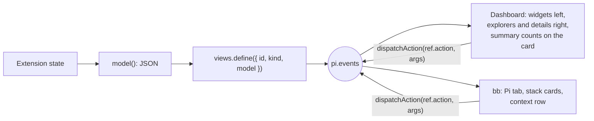

# Publish a view

The terminal draws what an extension hands pi-ui directly. Everything else (the
dashboard, bb, a saved bb session) draws only what the extension publishes on its
session's bus with [pi-surface](../../../packages/pi-surface/README.md): JSON
views, and actions referenced by id. The dashboard and the bb plugin know no
extension, so a well-formed view shows up there by itself.



## 1. Pick the kind and ids

| Kind       | Model           | Shows up as                                                                            |
| ---------- | --------------- | -------------------------------------------------------------------------------------- |
| `widget`   | `WidgetModel`   | Dashboard left column; a bb stack card only if listed in the plugin (step 5)           |
| `explorer` | `ExplorerModel` | Dashboard right column and bb's Pi tab; details load through `loadDetail`              |
| `detail`   | `DetailModel`   | Dashboard right column, one standalone detail                                          |
| `summary`  | `SummaryModel`  | Counts on the dashboard card and header; bb's context row reads specific keys (step 5) |
| `form`     | `FormModel`     | Open questionnaires a consumer can answer (pi-ask's `ask.questions` is the example)    |
| `session`  | `SessionModel`  | Owned by pi-system-insights (`system.session`); do not publish another                 |

- View ids are `<extension>.<view>` (`stash.explorer`, `todo.summary`), action ids
  `<extension>.<verb>` (`stash.inspect`, `git.worktree.remove`): lowercase, the
  extension name without `pi-`. Both throw on any other shape.
- If the terminal already draws a widget or explorer from a model, publish that
  same model function. Do not build a second one for remote renderers.
- A summary's count `key`s are an interface: consumers select by key, so never
  rename one without updating its readers (step 5). Present every count even
  at zero, so zero means "none" and an absent view means "not loaded".

## 2. Keep models small and plain

- A model must survive `JSON.parse(JSON.stringify(model))` unchanged: no
  functions, class instances, `undefined` in arrays, `NaN` or `Infinity`.
  Behaviour is an `ActionRef` (`{ action, args? }`): an explorer's `loadDetail`,
  `onOpen`, `marker.onClear`, a form's `submit` and `cancel`.
- Text is untrusted plain text with a semantic `tone`; renderers pick colours.
- Put heavy content (history, file contents) behind `loadDetail`, never in the
  list. A view over `MAX_VIEW_BYTES` (256 KiB) becomes an error entry, and the
  dashboard and bb deliveries drop the largest views first when a snapshot is
  over their limit.
- Mark state that exists only while this Pi process runs with `live` (a
  running agent, a ticking clock via `since`, a count of running things), so a
  saved bb session settles it to stopped. State kept in the session file (a
  task's status, review marks, records) is never `live`. The table under
  "Process-bound state" in the pi-surface README lists what each mark does.

## 3. Wire it to the session

```ts
const views = viewRegistry(pi.events);
const actions = actionRegistry(pi.events);

const defineSurface = () => {
  views.dispose();
  actions.dispose(); // session_start can run again on the same factory
  actions.define({
    id: "example.inspect",
    title: "Show an item's details",
    parse: (args) => {
      if (!isJsonObject(args) || typeof args.id !== "string") throw new Error("expected { id }");
      return { id: args.id };
    },
    handler: ({ id }) => detailBlocks(id), // JSON (DetailContent for loadDetail), or nothing
  });
  views.define({
    id: "example.explorer",
    kind: "explorer",
    title: "Example",
    model: explorerModel,
  });
  views.define({ id: "example.summary", kind: "summary", title: "Example", model: summaryModel });
};

pi.on("session_start", (_event, ctx) => {
  defineSurface();
  restore(ctx);
});
pi.on("session_shutdown", () => {
  views.dispose();
  actions.dispose();
});

// After every change any model would show, from tools, commands and restores alike:
views.changed("example.explorer");
views.changed("example.summary");
```

- `model()` runs on every read: build from current state, return `undefined`
  when there is nothing to show. It must not announce or change anything.
- Announce after each change, including `restore` on `session_tree`. Consumers
  batch announcements (250 ms), so announcing often is fine. Missing one leaves
  the dashboard and bb stale until something else changes.
- An action's `parse` must reject bad input with a clear error; the dashboard
  and bb send whatever the view referenced, plus `{ id }` or `{ ids }`.
- `stash` (`extensions/pi-stash/src/index.ts`, `summary.ts`) and `git`
  (`extensions/pi-git/src/view.ts`, `summary.ts`) are compact examples.

## 4. Test it

In the extension's SDK test (a real session on the faux model, see
`extensions/pi-stash/test/sdk.test.ts`), with the session's bus:

```ts
const announced: string[] = [];
onViewChanged(bus, (id) => announced.push(id));
await h.session.prompt("Work");
expect(announced).toContain("example.summary");
expect(listViews(bus)).toEqual([
  { id: "example.explorer", kind: "explorer", title: "Example" },
  { id: "example.summary", kind: "summary", title: "Example" },
]);
const model = readView(bus, "example.explorer");
expect(JSON.parse(JSON.stringify(model))).toEqual(model);
expect(isViewModel("explorer", model)).toBe(true);
await expect(dispatchAction(bus, "example.inspect", { id: "a" })).resolves.toEqual(/* … */);
h.session.dispose(); // shutdown removes them
expect(listViews(bus)).toEqual([]);
```

Unit-test model builders directly with plain data, including the empty case
and every `live` mark. If bb reads the counts (step 5), cover the reader in
`bb-plugin/test/`.

## 5. The places that name views

The dashboard names none. The bb plugin names a few, on purpose:

| File                           | What it names                                                    | Change it when…                                            |
| ------------------------------ | ---------------------------------------------------------------- | ---------------------------------------------------------- |
| `bb-plugin/ui/stack-cards.tsx` | `WIDGET_CARDS`: widget views that get a stack card, and the icon | a new widget should be a card above the composer           |
| `bb-plugin/ui/session-tab.tsx` | `EXPLORER_ORDER`: Pi tab order; `GIT_TAB_ORDER`: the Pi Git tab  | a new explorer should not sort last, or belongs in Pi Git  |
| `bb-plugin/views.ts`           | `VIEW` and the readers of summary count keys                     | the context row, row badge or sessions page should show it |

Changing `bb-plugin/` means running its own `npm run typecheck` and `npm test`,
and `bb-shot.mjs --expand --check` for anything inside a card (AGENTS.md).

## 6. Look at it

- **Dashboard:** add the state to `.agents/skills/tui-screenshot/scenarios/docs/dashboard.ts`
  if it belongs in the README images, then
  `node .agents/skills/tui-screenshot/scripts/docs-images.mjs dashboard dashboard-detail`
  and open both PNGs. A view whose provider failed shows its error in place.
- **bb:** the `bb-screenshot` skill runs a live session with the plugin; open the
  Pi tab with `--click` and check the card or row it should appear in.
- **Docs:** list the views and actions in the extension README's reference
  section, and the summary's count keys in a table (see pi-stash's README).
