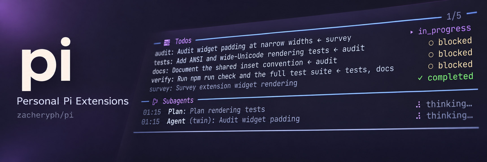

# Personal Pi Extensions



Personal Pi bundle: one install, multiple independent extensions. No npm publication
or TypeScript build required. Requires Pi 1.4.0+ and Node.js 24+.

## Install

### Local checkout (recommended for editing)

```bash
pi install /absolute/path/to/pi-personal
```

Pi loads files from this checkout without copying them. Edit code, then run `/reload`
in Pi. Local installs do not install dependencies; these extensions currently use
only Node built-ins and Pi-provided runtime modules.

### GitHub

```bash
pi install git:github.com/zacheryph/pi
```

Pi loads the same root manifest from its managed Git checkout, not your development
checkout. Push your changes, then update that installation:

```bash
pi update git:github.com/zacheryph/pi
```

Use `pi list` to inspect installed sources. When switching from Git to local, remove
that Git source first with `pi remove git:github.com/zacheryph/pi`. Do not load both
copies, another subagents extension, another `todo` extension, or another
background-jobs extension alongside this bundle: duplicate tools and commands can
conflict. When migrating from
`@juicesharp/rpiv-todo`, remove it with `pi remove npm:@juicesharp/rpiv-todo` before
loading the bundle's tasks extension. Existing rpiv plans are not auto-imported.

Install commands above configure personal scope. Add `--local` to install for one
project instead; project resources load after project trust is granted.

### Try without installing

From this repository:

```bash
pi -e .
```

Use `pi config` to enable or disable individual extensions within the bundle.

## Layout

```text
pi-personal/
├── package.json                         # bundle manifest + private dev workspace
├── tsconfig.base.json
├── skills/
│   ├── babysit-pr/                      # drives a pull request to green
│   ├── execute-roadmap/                 # carries out a chosen roadmap
│   └── make-it-easy/                    # roadmap-planning skill
│       ├── SKILL.md
│       └── references/                  # one file per phase, template, worked example
├── extensions/
│   ├── pi-ask/
│   │   ├── src/index.ts                 # ask tool, routed to the parent agent or the user
│   │   ├── test/
│   ├── pi-dashboard/
│   │   ├── src/index.ts                 # session reporter + /dashboard command
│   │   ├── src/hub/server.ts            # web hub (plain Node, not a Pi extension)
│   │   ├── test/
│   │   └── docs/plan.md                 # research and phased plan
│   ├── pi-git/
│   │   ├── src/index.ts                 # git_* tools + /git:worktrees, /git:prs, /git:refresh
│   │   └── test/
│   ├── pi-job/                          # vendored
│   │   ├── src/extension.ts             # job_* tools + /job command
│   │   ├── test/
│   │   ├── CHANGELOG.md                 # local changes
│   │   └── UPSTREAM.md                  # vendoring provenance
│   ├── pi-stash/
│   │   ├── src/index.ts                 # stash_* tools + /stash commands
│   │   └── test/
│   ├── pi-subagent/                     # vendored fork
│   │   ├── src/index.ts                 # subagent tools + /subagent:* commands
│   │   ├── agents/                      # built-in agent types as .md files
│   │   ├── skills/creating-agents/      # agent authoring skill
│   │   ├── test/
│   │   ├── docs/
│   │   ├── LICENSE
│   │   ├── CHANGELOG.md
│   │   └── UPSTREAM.md
│   ├── pi-system-insights/
│   │   ├── src/index.ts                 # /system:* commands
│   │   └── test/
│   ├── pi-tldr/
│   │   ├── src/index.ts                 # /tldr command + session naming
│   │   └── test/
│   └── pi-todo/                         # vendored engine, local UI
│       ├── src/index.ts                 # todo_* tools + /todo:* commands
│       ├── test/
│       ├── docs/comparison.md           # base-selection report
│       ├── CHANGELOG.md
│       └── UPSTREAM.md
└── packages/
    ├── pi-ui/                           # shared terminal UI library (no migrations yet)
    ├── pi-foundations/                  # shared settings + model lookup
    ├── pi-scripted-model/               # fake model + bundle test harness (dev only)
    └── pi-session-tree/                 # shared library, not an extension
        ├── src/index.ts                 # cross-session registry (globalThis)
        └── test/
```

Each extension directory is an npm workspace with its own `package.json`,
`tsconfig.json` (extending the root base), and `check`/`test` scripts.

Root `pi.extensions` lists entry points explicitly. Pi loads each as its own
extension; helper files and tests are not loaded as extensions. `packages/` holds
libraries shared by extensions, including [pi-ui](packages/pi-ui/README.md) for
terminal views and widget layout. They are workspaces with no `pi` entry, and
extensions import them by relative path. Workspaces simplify
development commands. All manifests are private;
nothing needs publishing.

## Extensions

### pi-ask

One `ask` tool for questions, routed by session. In the main session it asks you:
up to four questions, each with optional choices and a free-text answer, in a
window that opens under the transcript and keeps focus. In fullscreen mode the
window shrinks to three rows (title, waiting question, hint) while you scroll
back through the session, and
the next key brings it back. RPC hosts get their own dialogs instead, and the
dashboard can answer from the browser. In a subagent, `ask` goes to the agent
that delegated the task: the question is recorded on the run, the subagent ends
its turn, and the parent answers by resuming it. Where no one can answer (print
mode), the tool is hidden. See the [package README](extensions/pi-ask/README.md).

### pi-dashboard

Local web dashboard of running interactive Pi sessions at
`http://127.0.0.1:7317/`; `/dashboard` opens it. Cards are grouped by working
directory and show session name, `--agent` profile, model and thinking level,
context usage, live status (idle, working, running a tool, compacting, or
waiting on a dialog, which sorts first), and task, subagent, stash, open PR and
worktree counts. A card opens a detail page with the task list and history,
subagents, pull requests (opened here and referenced) and worktrees from
pi-git, recent tool calls and stash index with on-demand previews, in two even
columns with finished items folded away; usage and cost open from the header. **Focus** jumps to the session's cmux panel and
raises cmux. A filter box and opt-in browser notifications (waiting or
finished sessions) round out the index. Questions the model asks through
pi-ask's `ask` can be answered from the page. pi-todo, pi-stash and pi-git publish
their state as `todo:snapshot` / `stash:snapshot` / `git:snapshot` events on the
session's `pi.events` bus for this and other extensions.

The first interactive session starts a detached hub; sessions connect to it
over a unix socket in `~/.pi/agent/dashboard/`, and it exits 15 seconds after
the last one quits. Print-mode runs and subagent children are not shown. Port
and Node binary are set in `~/.pi/agent/dashboard.json`. Loopback only. See
[extension docs](extensions/pi-dashboard/README.md) and the
[plan](extensions/pi-dashboard/docs/plan.md).

### pi-git

Git worktrees an orchestrator creates and hands to subagents, kept in the
session ledger. `git_worktree_create` makes a worktree on a named branch in any
repository (an existing branch is checked out as it is) under
`~/.pi/agent/worktrees/`, and returns the path to pass as `cwd` to
`subagent_start`. A `workspace` groups worktrees of several repositories in one
directory, so one subagent can work across them. A worktree stays until
`git_worktree_remove` or `/git:worktrees remove` removes it; finishing or
releasing a subagent never does, so the next one continues in the same place.
Removal keeps the branch and refuses to lose uncommitted changes unless forced.

Every worktree is recorded as a `git:ledger` session entry with its repository,
branch, workspace, state and the subagents that ran in it, so `git_worktree_list`
and `/git:worktrees` still show it after a reload or resume. Worktrees a subagent
creates are handed up to its parent's ledger; worktrees under the root from
other sessions are listed separately.

Pull requests are recorded the same way whenever a tool touches one: `gh pr`
and `gh api …/pulls/<n>` in bash, the GitHub MCP tools, or a PR URL passed to any
tool. Each is **opened here** or **referenced**, with the last state, review,
checks and conflicts its output showed and the tool calls that touched it.
`git_pr_list` and `/git:prs` list them after a reload. `git_pr_status` reads a
PR's current state, review, checks and head from GitHub (through `gh`, or the
GitHub MCP tools without it, retrying transient failures) and records it; it is
read-only, so `job_watch` can poll it until `ciDone`. `/git:refresh` re-reads
every open PR and re-checks every worktree. After a compaction, reload, resume or
`/tree`, a context-only card lists open PRs and worktrees until the model reads
`git_pr_list` or `git_worktree_list`. State is published as `git:snapshot` for the
dashboard. The root
is set by `worktreeRoot` in `~/.pi/agent/git.json` or `.pi/git.json`;
`trackReferenced: false` keeps only PRs opened here. See [extension docs](extensions/pi-git/README.md) and the
[plan](docs/plans/git-github-ledger.md).

### pi-job

Background shell jobs and watches that wake the agent when they finish, vendored
from [`woksin/pi-jobs`](extensions/pi-job/UPSTREAM.md) with
[local additions](extensions/pi-job/CHANGELOG.md).
`job_start` runs a command in its own process group and returns immediately;
`job_watch` re-runs a shell check until it succeeds, fails, or its output changes.
With `toolCheck` it instead polls a read-only Pi tool, such as an MCP tool, until a
condition on its result holds ([tool checks](extensions/pi-job/TOOL-CHECKS.md)).
The agent ends its turn instead of polling, and completions arrive as one batched
follow-up message.
`job_list`, `job_read`, and `job_kill` inspect and stop work; `/job` lists or
kills jobs for the user. POSIX only. Logs live under `~/.pi/agent/jobs/` for seven
days. Do not also install `npm:@woksin/pi-jobs`. See the
[upstream README](extensions/pi-job/README.md) for delivery guarantees and limits.

### pi-stash

Keeps large text (search results, file snapshots, tool output, worker findings)
outside the model context and hands back a short handle such as
`stash:auth-findings@3f9a1c2b7d01`. The model and its subagents then read only the
slices they need.

- `stash_put` stores literal `content`, a `path` inside the working directory,
  the full result of an earlier tool call (`toolCallId`), or an existing `handle`.
  It returns a receipt with a short preview; it never echoes the content.
- `stash_get` reads a bounded, line-numbered slice: `lines`, `grep`, or `jsonPath`
  (head by default; 16 KB default, Pi's 50 KB / 2,000-line cap at most).
- `stash_list` lists this branch's entries.

Content is stored once by SHA-256 under `$PI_STASH_DIR` or `~/.pi/agent/stash/`.
The name index lives in the session, follows `/tree`, and survives compaction and
resume; full handles also work from other sessions, which is how a parent and its
subagents share data. A subagent's entries also appear in its parent's and
ancestors' stash as they are stored. Explore and Plan can read handles; Explore can
also stash large findings. `/stash` browses entries and `/stash:gc` expires unused content
(`retentionDays`, default 30, in `~/.pi/agent/stash.json`).

Stashed text is plaintext on local disk and is not redacted. See
[extension docs](extensions/pi-stash/README.md).

### pi-subagent

The built-in `orchestrator` profile manages long-running projects with categorized
todos, specialist delegation, and follow-ups in prior workers' sessions. It
gives each implementation task its own git worktree from pi-git (one per
repository when a task spans several) and runs the task's workers there, so
parallel workers never share a checkout. Use `pi --agent orchestrator` or
delegate with `subagent_type: "orchestrator"`.

The built-in `reviewer` profile verifies finished work: it runs the project's
checks, judges each acceptance criterion with evidence, and reports
`Verdict: PASS`, `FAIL`, or `BLOCKED` without fixing anything. The orchestrator
completes an implementation task only after a reviewer that did not do the work
passes it.

Personal copy of [`gotgenes/pi-packages/packages/pi-subagent`](https://github.com/gotgenes/pi-packages/tree/main/packages/pi-subagent).
Provides `subagent_start`, `subagent_get`, and `subagent_steer`, plus
`/subagent:settings`, `/subagent:sessions`, `/subagent:watch`, and
`/subagent:agents` (read-only browser for agent definitions).
`subagent_start` takes a `cwd`, so an orchestrator can run a worker in a
directory it prepared, such as a git worktree; that directory is never removed
for it and the worker stays resumable there.
The session records every agent's lifecycle, so `subagent_get` still answers for
an agent's ID after a reload or resume (status, result, question, transcript
path), lists the branch's agents when called without one, and a context-only
roster card restores them to the model after compaction, reload, resume or `/tree`.
A resume reopens the agent's saved transcript once its live session is gone, as
long as that transcript and the agent's directory still exist.

Background agents use a compact widget above Pi's editor:

```text
── ● Subagents ────────────────────────────────────────────
01:23  Explore: Find auth files                  ⠋ reading…
00:45  Agent (twin): Add tests                   ⠙ thinking…
--:--  Explore: Review changes                     ◦ queued
```

Only a top rule is drawn; Pi's own Working border, editor, and footer stay intact.
Each agent occupies one row, with task identity left and activity/outcome right.
Model/token/turn stats remain in tool results, not the widget. Finished agents keep
upstream linger behavior. Short terminals collapse overflow into a `+N more` row.

In Pi fullscreen mode, `Ctrl+Alt+S` or `/subagent:watch` toggles a passive
right-side watch overlay. It tails assistant text and compact tool summaries in
stacked agent sections, without taking editor focus or changing agent execution.
It starts closed. `/subagent:settings` selects quarter, third (default), half, or
two-thirds width and default visibility. Explicit show/hide wins for the current
session, including later agent runs. Regular mode keeps the compact widget only:
Pi 1.1.0 overlays can contaminate terminal scrollback there.

Custom agents are read from `.pi/agents/<name>.md` in the project where Pi runs, or
`~/.pi/agent/agents/<name>.md`; they are not definitions inside this bundle.
See [upstream README](extensions/pi-subagent/README.md),
[configuration](extensions/pi-subagent/docs/configuration.md),
[provenance](extensions/pi-subagent/UPSTREAM.md), and
[local changes](extensions/pi-subagent/CHANGELOG.md).

### pi-system-insights

Read-only session inspectors:

- `/system:prompt` — current Pi system prompt; tool/skill catalogs folded into redaction markers.
- `/system:tools` — accessible tools; Enter shows declaration/schema and prompt metadata.
- `/system:skills` — discovered skills; Enter shows description and loading evidence.

Viewers use the shared [pi-ui](packages/pi-ui/README.md) explorer and detail view
(fullscreen TUI only): a centered 80% width/height overlay with a title, rounded
border, padded content, and help footer. Indexes omit descriptions; details align
fields and show one full tool schema.

Skill loading tracks the current branch and becomes dirty after compaction.
Badges are green for fresh loading evidence, grey for unobserved/dirty state;
a legend above the list explains colors. Esc returns from details to list, then closes.
Viewers never load skill instructions or change tools/settings. See
[package README](extensions/pi-system-insights/README.md) for controls and evidence limits.

### pi-todo

Dependency-aware task tracking built on
[`@99percentpeople/pi-todo`](extensions/pi-todo/UPSTREAM.md). One tool per
action: `todo_list` reads, additive `todo_upsert` preserves omitted tasks, and
`todo_replace`, `todo_remove` and `todo_clear` make deletion explicit. Stable keys, cycle checks, optional revision guards, and
branch-scoped persistence work with direct and nested codemode calls.

Updates can carry a `message` (completion summary, findings, handoff). It is
recorded in task history and flagged until reviewed, so outcomes survive later
subagent or tool output. The widget counts unreviewed messages, shows excerpts, and
puts those tasks first.

Above-editor widget and browser use the shared [pi-ui](packages/pi-ui/README.md)
widget and explorer. `/todo` opens a searchable browser with All,
Unreviewed and Recent views plus per-task activity timelines. `/todo:review` opens
unreviewed messages. Commands: `/todo:add`, `/todo:update`, `/todo:remove`,
`/todo:clear`, `/todo:settings`.
Settings layer global `todo.json` with project `.pi/todo.json`.

A parent hands tasks to a subagent with `handoff: { todo: { keys } }` on its
`subagent_start` call. The spawn is blocked if a key is unknown, completed or already
handed out. The subagent then sees and updates only those tasks, directly in the
parent's list (shown as `→ agent a3f2b1c4`). The claim is released when the agent ends.

User additions never start/steer a turn. Changed state syncs to the next model
request by default; no auto-removal, auto-completion, or implicit subagent dispatch.
Multiple active tasks remain possible for parallel work. See
[usage/settings](extensions/pi-todo/README.md) and
[comparison/decision report](extensions/pi-todo/docs/comparison.md).

### pi-tldr

`/tldr` displays a concise model-generated recap of the current session: initial
premise, major findings/turning points, and current status. It uses the shared
[pi-ui](packages/pi-ui/README.md) detail view as a centered modal (fullscreen TUI only).

After the first user prompt of a new interactive session, it asynchronously
suggests a short hyphen-separated name (2–4 words). `/tldr` opens immediately
with an in-modal loading indicator and refreshes only extension-generated names,
never manual names. Pi manages the terminal title itself. Model selection
prefers the latest available Haiku or Luna.

Configure globally in `~/.pi/agent/tldr.json`, with a project override in
`.pi/tldr.json`:

```json
{ "model": "auto", "setSessionName": true }
```

Set `setSessionName` to `false` to keep summaries while disabling extension-driven
session naming. See [extension docs](extensions/pi-tldr/README.md).

## Skills

Root `pi.skills` loads `skills/` and the skills an extension ships in its own
`skills/` directory, so a bundle install provides these. Force one
with `/skill:<name>`. Skills for working on this repository itself live in
`.agents/skills/` and are not part of the bundle.

### babysit-pr

Drives one pull request to green CI with every review comment handled, without
polling. It reads the PR with pi-git's `git_pr_status` and waits with
`job_watch` polling it until checks settle (or a shell watch pinned to the head
commit SHA, or `job_start` with `gh run watch`), ending its turn until they
finish, then confirms the head SHA is still the one it pushed. A failed check
gets its log read and is classified: caused by
the PR (reproduce locally with the same command, smallest fix, rerun, push),
infrastructure (rerun the failed jobs once), or pre-existing (reported, not
fixed). Review comments in scope are fixed and answered; larger asks go back to
you. It stops after three attempts per check, on a decision only you can make, or
on a conflict with the base branch. Never skips tests, pushes empty commits,
rewrites others' history, approves, or merges. Uses `gh` when authenticated,
otherwise the GitHub MCP tools, for logs, reruns and replies.

### make-it-easy

Turns a project or goal into implementation roadmap options, following Kent
Beck's "make the change easy (warning: this may be hard), then make the easy
change". The work is staged, and each stage has a gate:

1. **True goal:** separates the request from the outcome it serves; produces a
   goal brief with success criteria, non-goals, and what existing things may change.
2. **Inputs:** lists what the new work must know or receive (placement,
   identity, config, dependencies, policy) and designs how each is supplied so
   producer and consumer stay decoupled, for example discovery by tag instead of
   hardcoded IDs.
3. **What exists:** researches prior art, conventions, and friction, and decides
   per item whether to fix first, work around, or leave.
4. **Options:** two or three different strategies (always including a
   least-preparation baseline) with a recommendation.
5. **Roadmap:** ordered, independently shippable steps that keep tidying
   separate from behavior change and end with a small, easy change.

It plans and writes `docs/roadmaps/<slug>.md`; it does not implement. It asks
its questions with pi-ask's `ask`, four at a time, and logs each one in the
roadmap with the recommendation it showed, your answer, and whether it is
resolved. A question you dismiss stays open; it is not answered for you. It
overlaps with
[`@firstpick/pi-extension-grill-me`](https://www.npmjs.com/package/@firstpick/pi-extension-grill-me)
only in stage 1 and reuses an existing `GRILL-ME.md` instead of re-asking.
Nothing here depends on it.

### execute-roadmap

Carries out a chosen make-it-easy roadmap. Each step becomes a `todo` with its
`Depends on` mapped to `dependsOn`; ready steps go to subagents (steps that run
in parallel each get their own git worktree from pi-git, and land on the roadmap
branch in roadmap order); a `reviewer` that did not do the work checks
every step against its "Done when" and "Verification" lines before it is
committed and completed. Two failed repair rounds block a step. A finding the roadmap did not anticipate
stops the run and lands in the document's open questions instead of an
improvised plan. The roadmap document stays the plan of record: its `Status:`
and per-step `Landed:` lines are updated as work lands, so a later run resumes
from the first unfinished step. It commits locally and pushes only when asked.

### creating-agents

Shipped by pi-subagent (`extensions/pi-subagent/skills/`). Creates, overrides,
hides or disables an agent type: where the file goes and which one wins, every
frontmatter field, how to write the `description` and `guidance` that make up
the agent's line in `subagent_start`, `prompt_mode`, tool selection,
`visibility: hidden` for agents only a skill calls, locked fields, fragments,
and how to check the result in `/subagent:agents`.

## Development

Runtime loading needs no build. Install development dependencies only for checks
and tests:

```bash
npm install --ignore-scripts
npm run check  # formatting, linting, and type checking
npm run fix    # formatting and safe automatic lint fixes
npm test
npm run verify:bundle
```

`verify:bundle` checks root-package discovery and tool and skill registration in temporary
settings, without model calls or changes to your Pi configuration.

Oxfmt and Oxlint use one root configuration for every workspace and repository
script. Oxlint's type-aware rules use the native TypeScript implementation;
TypeScript 7 runs the full type checks. Shared development dependencies live in
the root package, while runtime peer dependencies stay with each extension.
Generated declarations, coverage, and the npm lockfile are excluded from formatting.
Tests may reference mock methods in assertions; unbound-method checking stays
enabled for runtime source. Terminal-control regexes have local lint explanations.
The fix command formats again after successful lint fixes so it leaves code ready
for the formatting check.

These check/test commands cover every development workspace. To run one
workspace, pass it with `-w`, e.g. `npm test -w extensions/pi-todo`. Pi modules
are dev dependencies for testing and peer dependencies for runtime; Pi supplies its
own modules when loading extensions.

GitHub Actions runs `check` and `test` in parallel jobs per extension workspace,
plus `verify:bundle` whenever any extension is selected.
A repository-wide job always checks formatting and lint, including scripts. Pull requests
select extensions with changes under their directory; changes to root
manifests/lockfiles, `.nvmrc`, shared TypeScript or Oxc settings, workflows, or scripts
select all extensions. Pushes to `main` always check and test all extensions.
Unrelated PR changes skip the extension matrix.
The repository job also checks registration
(`scripts/bundle-manifest.test.mjs`): every directory under `extensions/` and
`packages/` is a workspace named after it with `check` and `test` scripts, and root
`pi.extensions` and `pi.skills` are exactly what the extension workspaces declare. Matrix selection is tested with
`node --test scripts/select-test-extensions.test.mjs`. CI reads its Node.js
version from `.nvmrc`; `nvm use` or `fnm use` picks up the same version locally.

Public API type exports reference TypeScript source directly; no declaration build is needed.

To work on one extension without other configured extensions:

```bash
pi --no-extensions -e ./extensions/pi-subagent/src/index.ts
```

### Add another extension

Use the [`new-extension` skill](.agents/skills/new-extension/SKILL.md).

To copy a third-party extension into the repository, use the
[`import-extension` skill](.agents/skills/import-extension/SKILL.md). Its script
commits a verbatim copy of upstream, verified by tree hash, and prepares the
integration. Each imported extension records its provenance in `UPSTREAM.md` and
its local changes in `CHANGELOG.md`.

### Test the bundle end to end

[`packages/pi-scripted-model`](packages/pi-scripted-model/README.md) runs the
whole bundle in-process against a scripted fake model: real tools, extensions
and subagents, no API key or network. A scenario scripts each model response;
`startSession` loads the bundle, `prompt` runs a turn, and `toolRuns()` returns
every call with its result. Use it for behavior that spans extensions, such as
todo handoff to a subagent. CI runs it whenever any extension changes.

### Screenshot the TUI

Use the [`tui-screenshot` skill](.agents/skills/tui-screenshot/SKILL.md). A
scenario file scripts the same fake model, and a driver runs Pi with the bundle in a
private tmux server and renders the screen to PNG. No API key is needed. It is
development-only: nothing under `.agents/` is in the bundle manifest, and
`verify:bundle` fails if it ever is.

## License

Vendored subagents code retains its upstream [MIT license](extensions/pi-subagent/LICENSE).
Vendored todo engine retains its upstream [MIT license](extensions/pi-todo/LICENSE).
Vendored jobs code retains its upstream [MIT license](extensions/pi-job/LICENSE).
pi-git's GitHub retry classifier (`extensions/pi-git/src/retry.ts`) is copied from `@gotgenes/pi-github-tools` and keeps its MIT notice in the file.
