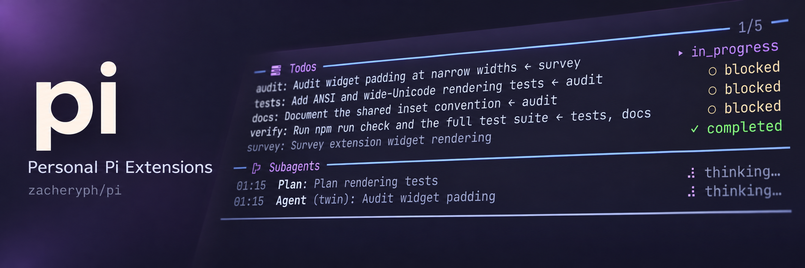
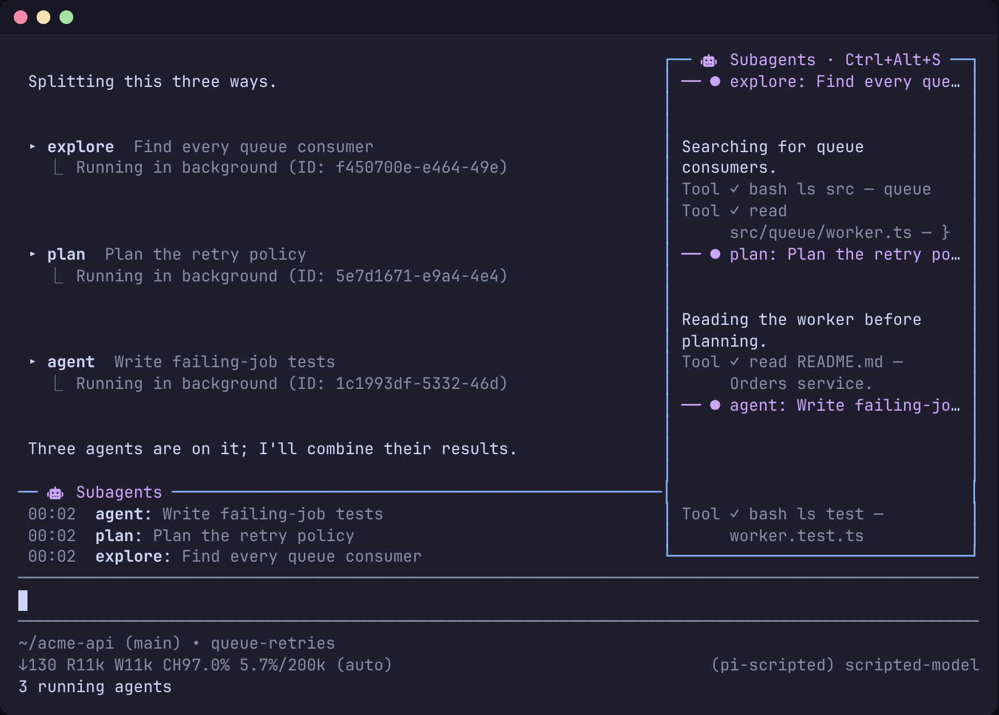
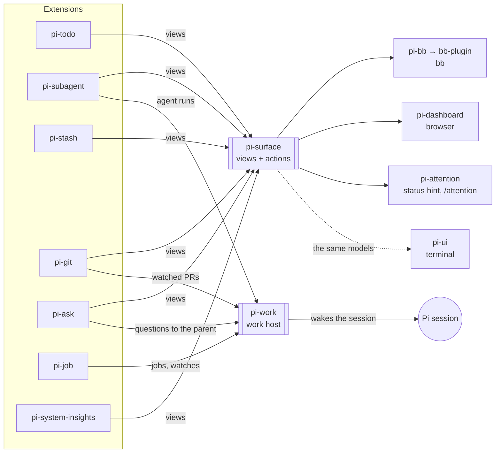
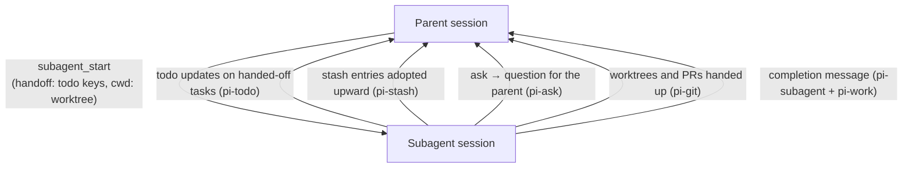
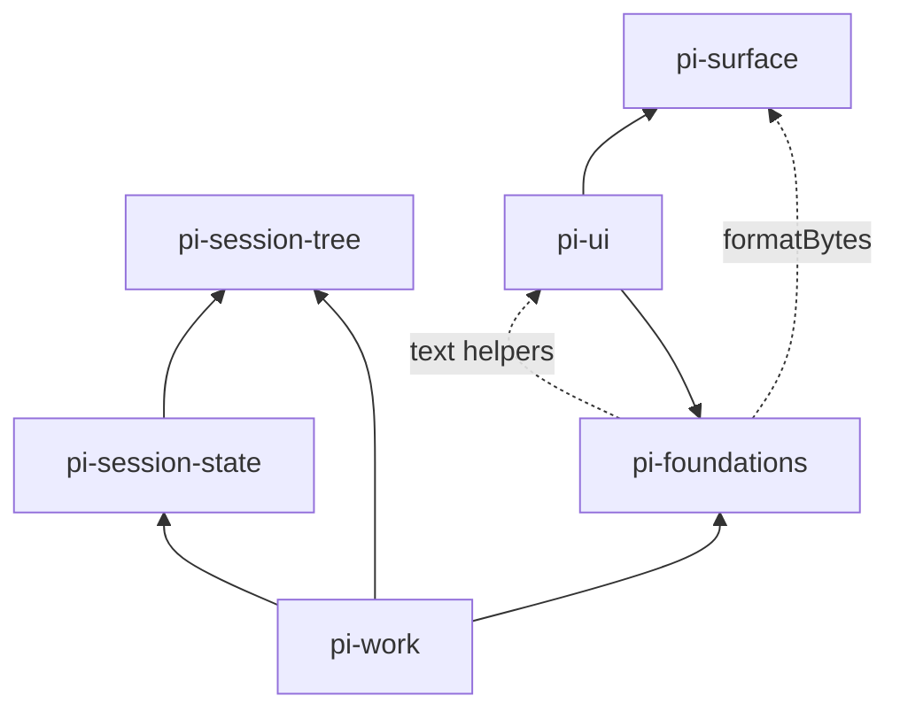

# Personal Pi Extensions



A bundle of extensions for [Pi](https://pi.dev), the coding agent. One install
gives your agent a task list you can watch, background subagents, background
jobs that wake it when they finish, a place to park large output, Git worktrees
and pull request tracking, questions it can ask you, and a dashboard of every
running session. You can see all of it in your terminal, a browser or
[bb](https://getbb.app).



## Install

```bash
pi install git:github.com/zacheryph/pi
```

Then start Pi as usual. To try it without installing, run `pi -e .` from a
checkout. Requires Pi 1.4.0+ and Node.js 24+.

<details>
<summary>Install from a local checkout, update, or switch</summary>

From a checkout you want to edit:

```bash
npm run setup:pi
```

Pi then loads files straight from the checkout: edit, then `/reload` in Pi.
`npm run setup:bb` also builds and installs the [bb plugin](bb-plugin/README.md)
into an already installed bb. Both use the Pi installed in this checkout, not
whichever `pi` is on PATH; plain `npm install` never touches your Pi or bb
settings. After pulling, run `npm run deps` if dependencies changed (it installs
the root workspaces and `bb-plugin/`, which is not a workspace), then `/reload`
in Pi; changes under `bb-plugin/` or `packages/pi-surface/` need `npm run setup:bb`
again, because bb runs a built copy of the plugin. An already prepared checkout can also be registered with
`pi install /absolute/path/to/checkout`.

A Git install loads its own managed checkout. Push your changes, then
`pi update git:github.com/zacheryph/pi`. To switch from Git to local, first run
`pi remove git:github.com/zacheryph/pi`; `pi list` shows what is installed.

Load only one copy of the bundle, and no other subagents, `todo` or
background-jobs extension beside it: their tools and commands would conflict.
Coming from `@juicesharp/rpiv-todo`, run `pi remove npm:@juicesharp/rpiv-todo`
first (its plans are not imported).

The commands above install for your user. Add `--local` to install for one
project; project resources load once you trust the project. `pi config` turns
individual extensions in the bundle on or off.

</details>

## What's inside

### Extensions

Each one is independent, and they get better together: subagents take tasks,
work in worktrees, hand back stash handles and ask questions, all tracked in one
place.

|                                                                   | What you get                                                                                                                                 | You use it through                                  |
| ----------------------------------------------------------------- | -------------------------------------------------------------------------------------------------------------------------------------------- | --------------------------------------------------- |
| [**pi-todo**](extensions/pi-todo/README.md)                       | A dependency-aware task list above the editor that the agent keeps, with findings recorded on each task.                                     | `/todo`, `/todo:add`; tools `todo_*`                |
| [**pi-subagent**](extensions/pi-subagent/README.md)               | Background agents (explore, plan, implement, review, orchestrate, assist, dig) in a live widget, with a watch overlay that tails their work. | `Ctrl+Alt+S`, `/subagent:*`; tools `subagent_*`     |
| [**pi-ask**](extensions/pi-ask/README.md)                         | The agent asks you up to four multiple-choice questions in an inline window; a subagent asks its parent instead.                             | Arrow keys and Enter; tool `ask`                    |
| [**pi-job**](extensions/pi-job/README.md)                         | Long commands and "wait until…" checks run in the background and wake the agent once when done. No polling, no tokens spent.                 | `/job`; tools `job_*`                               |
| [**pi-stash**](extensions/pi-stash/README.md)                     | Large output parked outside the context behind a short handle such as `stash:auth-findings@3f9a1c2b7d01`, read back in slices.               | `/stash`; tools `stash_*`                           |
| [**pi-git**](extensions/pi-git/README.md)                         | Git worktrees for workers, a ledger of every PR the session touched, PR watches, and one call to ship the PRs you reviewed.                  | `/git:worktrees`, `/git:prs`; tools `git_*`         |
| [**pi-attention**](extensions/pi-attention/README.md)             | A footer hint while the session owes you something (a PR to review, findings to read), and a list to open or dismiss it.                     | `/attention`                                        |
| [**pi-tldr**](extensions/pi-tldr/README.md)                       | A one-screen recap of the session, and short automatic session names.                                                                        | `/tldr`                                             |
| [**pi-system-insights**](extensions/pi-system-insights/README.md) | Read-only views of the system prompt, tools and skills the model actually has, and the core session view every UI reads.                     | `/system:prompt`, `/system:tools`, `/system:skills` |
| [**pi-dashboard**](extensions/pi-dashboard/README.md)             | A local web page of every running session: status, tasks, agents, stash, Git. Answer questions from the browser.                             | `/dashboard`, `http://127.0.0.1:7317/`              |
| [**pi-bb**](extensions/pi-bb/README.md)                           | Everything above inside [bb](https://getbb.app): cards above the composer, a Pi tab, a sessions page. Pairs with the bb plugin.              | [`bb-plugin/`](bb-plugin/README.md), `/bb`          |

### Skills

Skills ship with the bundle; force one with `/skill:<name>`. See the
[skills overview](skills/README.md).

|                                                                           | What it does                                                                                    |
| ------------------------------------------------------------------------- | ----------------------------------------------------------------------------------------------- |
| [make-it-easy](skills/make-it-easy/SKILL.md)                              | Turns a goal into roadmap options: make the change easy, then make the easy change.             |
| [execute-roadmap](skills/execute-roadmap/SKILL.md)                        | Carries out a chosen roadmap step by step with subagents, reviews and, if asked, pull requests. |
| [babysit-pr](skills/babysit-pr/SKILL.md)                                  | Drives one pull request to green CI with every review comment handled, without polling.         |
| [creating-agents](extensions/pi-subagent/skills/creating-agents/SKILL.md) | Creates, overrides or hides a subagent type.                                                    |

### Libraries

Shared code the extensions are built on. Nothing here is loaded by Pi on its
own.

|                                                           | What it is for                                                                                          |
| --------------------------------------------------------- | ------------------------------------------------------------------------------------------------------- |
| [pi-surface](packages/pi-surface/README.md)               | Views as plain JSON plus actions by name, so the terminal, the dashboard and bb draw the same data.     |
| [pi-ui](packages/pi-ui/README.md)                         | The terminal side: widgets, explorers, detail views and inline windows with one look.                   |
| [pi-work](packages/pi-work/README.md)                     | One contract for everything a session waits on; delivers results and wakes the session.                 |
| [pi-session-tree](packages/pi-session-tree/README.md)     | Lets a subagent's extensions find their parent's, and the reverse, inside one Pi process.               |
| [pi-session-state](packages/pi-session-state/README.md)   | Restore cards after compaction, services along the session tree, replay of saved entries.               |
| [pi-foundations](packages/pi-foundations/README.md)       | Settings files declared once, model lookup, cmux notifications, command output outside the TUI.         |
| [pi-scripted-model](packages/pi-scripted-model/README.md) | A fake model that plays a script, for tests and screenshots with no API key. Development only.          |
| [pi-test-helpers](packages/pi-test-helpers/README.md)     | Shared test fixtures: temp dirs, themes, a fake `ExtensionAPI`, offline SDK sessions. Development only. |

## How it fits together

Extensions describe what they show as plain JSON **views**
([pi-surface](packages/pi-surface/README.md)). In the terminal
[pi-ui](packages/pi-ui/README.md) draws them; the same views are published on
the session's event bus, where the dashboard and the bb plugin collect and draw
them, calling actions by name. Anything a session
waits on (a job, a subagent, a question for the parent, a watched pull request)
is an item in its **work host** ([pi-work](packages/pi-work/README.md)), which
wakes the session when the result arrives.



Subagents are full Pi sessions in the same process, so the extensions also
cooperate across the parent–child line through
[pi-session-tree](packages/pi-session-tree/README.md):



### Who imports what

Every extension imports [pi-foundations](packages/pi-foundations/README.md).
Beyond that:

| Extension          | pi-surface | pi-ui | pi-work | pi-session-state | pi-session-tree |
| ------------------ | :--------: | :---: | :-----: | :--------------: | :-------------: |
| pi-ask             |     ●      |   ●   |    ●    |                  |        ●        |
| pi-attention       |     ●      |   ●   |         |                  |                 |
| pi-bb              |     ●      |       |         |                  |                 |
| pi-dashboard       |     ●      |       |         |                  |                 |
| pi-git             |     ●      |   ●   |    ●    |        ●         |                 |
| pi-job             |            |   ●   |    ●    |                  |        ●        |
| pi-stash           |     ●      |   ●   |         |        ●         |        ●        |
| pi-subagent        |     ●      |   ●   |    ●    |        ●         |        ●        |
| pi-system-insights |     ●      |   ●   |         |                  |                 |
| pi-tldr            |            |   ●   |         |                  |                 |
| pi-todo            |     ●      |   ●   |    ●    |        ●         |        ●        |



pi-surface and pi-session-tree depend on nothing; pi-surface does not even
import Pi, so the dashboard's hub and the bb plugin can use it outside Pi.
pi-foundations takes its display size (`formatBytes`) from pi-surface, so a
size reads the same in the terminal, the dashboard and bb. The
arrows only point this way: a package never imports an extension, and the
dashboard hub and the bb plugin reach the repository only through pi-surface.
`npm run verify:bundle` checks both.

## Working on this repository

See [CONTRIBUTING.md](CONTRIBUTING.md) for the layout, checks, tests,
screenshots and how to add an extension.

## License

The vendored subagents code, todo engine and jobs code keep their upstream MIT
licenses: [pi-subagent](extensions/pi-subagent/LICENSE),
[pi-todo](extensions/pi-todo/LICENSE), [pi-job](extensions/pi-job/LICENSE).
pi-git's GitHub retry classifier (`extensions/pi-git/src/retry.ts`) is copied
from `@gotgenes/pi-github-tools` and keeps its MIT notice in the file.
