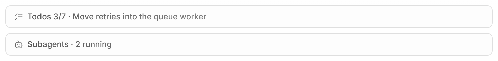

# Pi surface (bb plugin)

A [bb](https://getbb.app) plugin that shows Pi sessions running this bundle in
bb's UI. bb runs Pi in RPC mode and drops Pi's widgets, status line and
overlays; the bundle's [`pi-bb`](../extensions/pi-bb/README.md) extension sends
the session's views here instead, as one complete pi-surface delivery snapshot
per update, and this plugin draws them in bb's slots. See
[bb's UI slots](../docs/bb/ui-slots.md) for every slot with a screenshot.



Plugin id `pi-surface`, package `bb-plugin-pi-surface`. It is its own package
with its own toolchain, not one of the bundle's npm workspaces.

## Install

From the repository root, install the Pi bundle and this plugin together:

```sh
npm run setup:bb
```

This installs root dependencies, registers the local bundle with Pi, installs
the plugin's own dependencies from its lockfile (`npm ci`, which never rewrites
it) and runs the command below. bb must already be
installed. It does not open bb or create a thread.

To install just the bb companion manually:

```sh
cd bb-plugin
npm ci --include=dev
bb plugin install "$PWD" --yes
```

`bb plugin install` builds the plugin. From then on every Pi thread receives
`PI_BB_SURFACE_URL` and `PI_BB_SURFACE_TOKEN`; a running Pi thread picks them up
when bb restarts its process on the next turn. The bundle (with `pi-bb`) must be
installed in Pi as usual.

Try the UI without a model run:

```sh
bb pi-surface fixture --thread <thread-id>   # a canned session on any thread
bb pi-surface list
bb pi-surface clear --thread <thread-id>
```

Fixtures live in memory, never raise a form in the composer, and are refused
for a thread whose Pi session is connected. Remove the plugin with
`bb plugin remove pi-surface --yes`.

## What it shows

| Slot                                | Registration                                                        | Content                                                                                                                                                       |
| ----------------------------------- | ------------------------------------------------------------------- | ------------------------------------------------------------------------------------------------------------------------------------------------------------- |
| Composer banner (stack card)        | `app.composer.customize({ banners, chrome: "bare" })`               | Todos card, Subagents card: the widget views                                                                                                                  |
| Thread context segment              | `app.slots.experimental_threadContextSegment`                       | Profile, task, subagent and owed counts; opens the Pi tab                                                                                                     |
| Thread context card row and section | `experimental_threadContextCardRow` / `…Section`                    | Needs you: owed items with their links; stash count; worktrees and pull requests                                                                              |
| Composer action                     | `app.composer.customize({ actions })`                               | Opens the Pi tab                                                                                                                                              |
| Composer popup                      | `experimental_popups` + `app.composer.experimental_registerCommand` | Stash picker (Mod+Shift+S, or the + menu); agent profile switch, pi-subagent's `/subagent:switch` (the + menu or the palette)                                 |
| Thread tabs                         | `app.slots.experimental_tab({ context: { kind: "thread" } })`       | **Pi**: the session, tasks, subagents, activity; **Pi Git**: pull requests, worktrees, stash. Details on demand, expand or collapse a section's items at once |
| Thread row metadata                 | `app.slots.experimental_threadRowMetadata`                          | Attention dot, open-question and running-subagent badge                                                                                                       |
| Sidebar navigation                  | `app.slots.navPanel` with `experimental_useBadge`                   | **Attention** page (badged) of what needs you; **Pi sessions** page                                                                                           |
| Pending interaction                 | `app.slots.pendingInteraction` + `bb.ui.requestInput`               | pi-ask's open questionnaire as one form                                                                                                                       |

Every slot renders nothing for a thread without a session.

The stack cards and the two tabs draw the session's
[pi-surface](../packages/pi-surface/README.md) views with one renderer
(`ui/surface.tsx`): each widget view is a stack card, each explorer view a
section of a tab, and an explorer's `loadDetail`, `onOpen` and
`marker.onClear` go back to the session as actions. A section's double-chevron
button (Expand all) opens every item of its tab in view, as clicking each
would; pressed again (Collapse all) it closes them. Tabs a view marks `secondary` (pull requests merged, closed or
only referenced) sit in a **More** menu after the others. Which widget gets a card, with which icon, is the table in
`ui/stack-cards.tsx`. The Pi Git tab holds the explorers in `GIT_TAB_ORDER`
(`git.prs`, `git.worktrees`, `stash.explorer`, in that order); the Pi tab holds
every other, in `EXPLORER_ORDER` (`ui/session-tab.tsx`), with any other
explorer after. A new view in an extension shows in the Pi tab with no plugin
change. The context card
lists the items of the `git.worktrees` and `git.prs` explorers' first tabs
(worktrees in use, pull requests still in play) with the same renderer, and the stash picker is the `stash.explorer` view's items.

Everything else is read from structured views (`views.ts`), never from display
text: the header, activity and usage from `system.session` (pi-system-insights);
the context row, row badge and sessions page from the `todo.summary`,
`subagent.summary` (with the main agent's profile) and `stash.summary` counts;
open questions from the session's form views (`ask.questions`). Each reader
tolerates a missing or failed view, a missing `system.session` included.
`/plugins/pi-surface/sessions/gallery` (not linked) draws the components that
bb shows only behind experiments, for the docs.

## How it works

- **Sessions.** `bb.http.experimental_websocket("/session", …, { auth: "none" })`.
  A session's first message is `hello` with its thread id and token; the token
  is an HMAC-SHA256 of the thread id under a random secret kept in
  `bb.storage.kv`, so it is valid for that thread only and survives plugin
  reloads. Protocol version 3 (`protocol.ts`, matching pi-bb's): an accepted
  hello is answered with `welcome`, after which pi-bb sends updates and offers
  to answer forms. Bad tokens close with 4401, other protocol versions with
  4400 (pi-bb then says to reinstall the plugin and restart the thread), and an
  older process for the same thread with 4409 once a newer one says hello.
  Messages are measured in UTF-8 bytes against a 2 MiB limit before parsing
  and checked strictly; a malformed one is dropped with a warning in bb's log.
  Each update replaces the thread's whole view set. A disconnected session
  stays live for 15 seconds, which covers `/reload` and bb's process restarts;
  a replaced process's late update or result never reaches its replacement.
- **Saved sessions.** Every live snapshot is also written to the plugin's
  SQLite database (`archive.ts`) as a versioned record. When no Pi comes back
  for a thread (bb restarted, the plugin reloaded, bb stopped the process) the
  thread shows its last snapshot as `saved`, settled with pi-surface's
  `settleSnapshot`, until the next turn starts Pi again: tasks, stash, Git,
  usage and finished subagents as they were; status idle, no forms, live
  counts zero, and running subagents stopped. Actions are removed from the
  views and requests to a saved session are refused, so the tab opens only
  details a view carries inline. A record of another version, or one that
  cannot be read, is treated as missing (one warning in bb's log); the
  thread's next live turn writes a new one. A deleted thread's row is
  removed; rows untouched for 30 days are pruned at load. Pi's own session
  files are never touched.
- **Environment.** `bb.providers.experimental_contributeEnv("pi", …)` returns
  `PI_BB_SURFACE_URL` as `{ serverPath: "/api/v1/plugins/pi-surface/http/session" }`,
  which bb's host expands against its `BB_SERVER_URL`, and the thread's token.
  Model listing (no thread) gets nothing. bb shows contributed values in the
  thread's `provider.env-resolved` events, which is one reason the token is
  per thread.
- **App reads.** RPC `snapshot({ threadId })` and `sessions()` are tagged
  `thread:<id>` and `sessions`; the server calls `bb.rpc.experimental_invalidate`
  on every change, so all mounted slots share one live read per thread and
  refresh together over bb's realtime socket. `request({ threadId, request })`
  forwards an action request `{ action, args? }` (an action on the session's
  bus) and waits up to 10 seconds for its result; a fixture answers from canned
  data.
- **Questions.** While pi-bb is welcomed it advertises bb as a form consumer,
  so pi-ask publishes its questionnaires as the `ask.questions` form view. The
  server raises each open questionnaire of a live session with
  `bb.ui.requestInput` (renderer `questionnaire`) and runs its `submit` action
  reference with the answer, or its `cancel` when the user declines, only
  through the connection that raised it. A form is withdrawn when the view
  stops listing it, when the connection closes or another process takes the
  thread. Fixtures and saved sessions never raise one.
- **Thread title.** When a live session's name changes (pi-tldr names a new
  session after its first prompt), the server sets the bb thread's title with
  `bb.sdk.threads.update({ threadId, title })`. Only a change against the
  store's earlier snapshot counts, so a Pi that reconnects with its saved name
  does not undo a rename made in bb. Turn bb's own thread-title AI service off
  (`bb settings ai-services set thread-title off`) so the two do not compete.
- **Dispose.** `bb.onDispose` withdraws open forms and closes every session
  socket; bb itself closes them with 1012 on reload, and pi-bb reconnects.

## Develop

```sh
npm test            # server contract tests (fake host) and component tests (jsdom)
npm run typecheck
npm run build       # bb plugin build .
bb plugin dev       # after installing: rebuild and reload on save
```

To see a change in bb without installing anything of your own, the
`bb-screenshot` skill (`.agents/skills/bb-screenshot/`) runs a private bb with
this plugin and Pi sessions on a scripted model, takes screenshots of the
slots, and checks that the stack cards and the context row share bb's 12px
inset (`bb-shot.mjs --check`).

The view models, delivery snapshot, byte limits, guards and settling rules come
from [`pi-surface`](../packages/pi-surface/README.md), a `file:` dependency on
`../packages/pi-surface` (`contract.ts` re-exports the types); `bb plugin build`
bundles them. Nothing else in the repository is imported: the root
`npm run verify:bundle` fails if the plugin's imports, types included, reach
another workspace. The root `npm run check` formats this directory but neither
lints nor type-checks it: its types come from this directory's own
`node_modules`, which the root install does not create. Run `npm run typecheck`
and `npm test` here.
