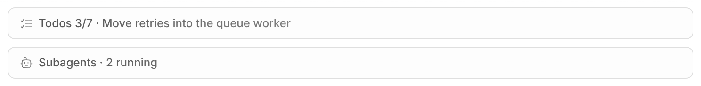
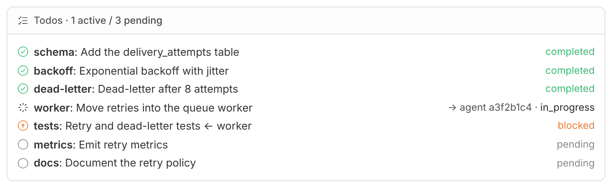
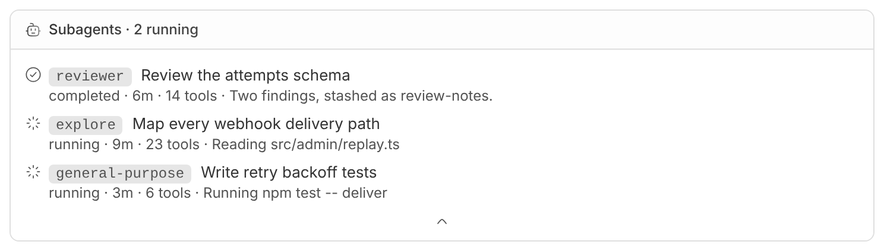
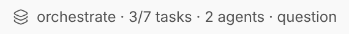
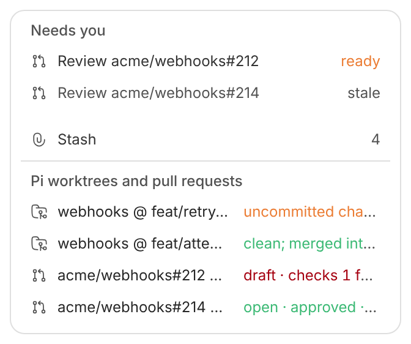
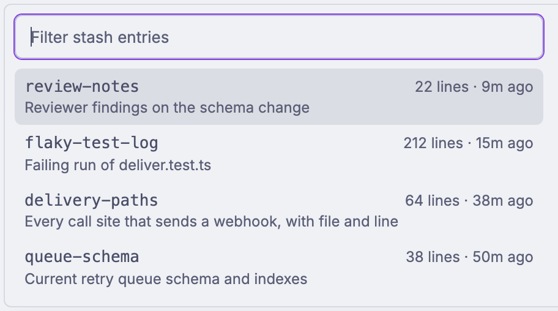
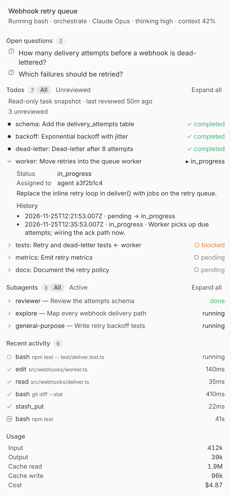
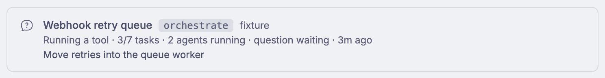
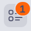
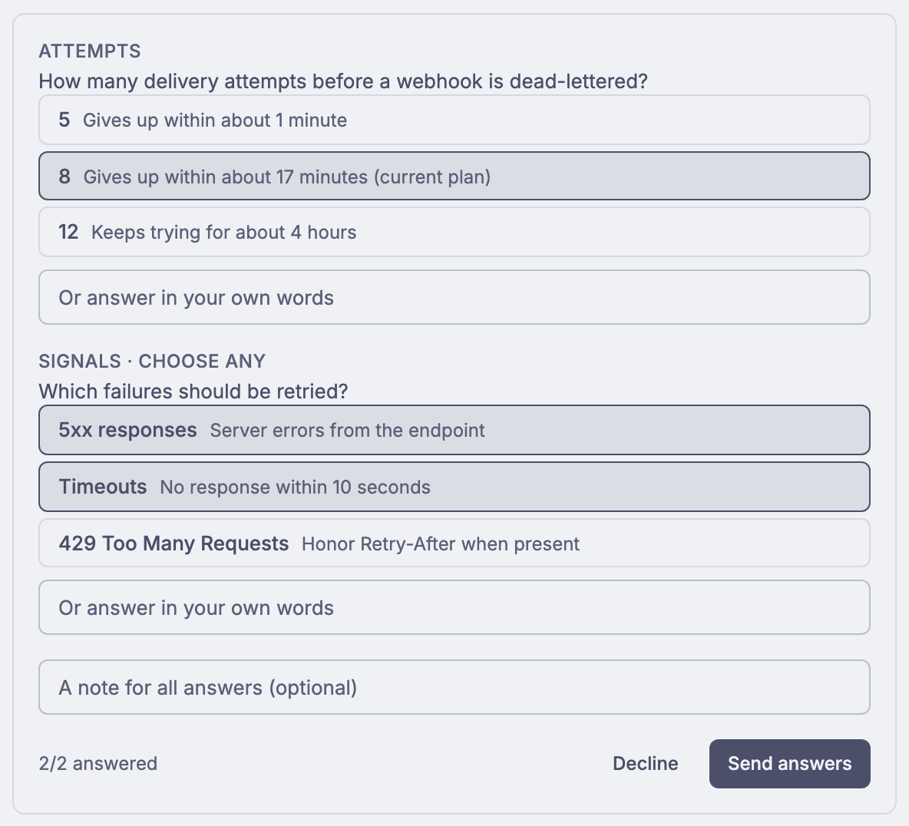

# bb's UI slots, by example

Where a bb plugin can draw, shown with one worked example per slot from the
`pi-surface` plugin in [`bb-plugin/`](../../bb-plugin/README.md). Each example
is fed by the views that [`pi-bb`](../../extensions/pi-bb/README.md) sends from
a Pi thread, one complete pi-surface delivery snapshot per update, and renders
nothing for a thread without one. Widgets and explorers are drawn by one generic
renderer; everything else reads structured views by their machine-readable
fields: the core session from `system.session` (pi-system-insights), counts and
the main agent's profile from the extensions' summary views (`todo.summary`,
`subagent.summary`, `stash.summary`), and questionnaires from form views
(`ask.questions`). Every slot tolerates a missing or failed view, including a
missing `system.session`.

Checked against bb 0.49.0 with plugin SDK 0.6.132 (the installed declarations
in `node_modules/@get-bb/plugin-sdk/bundled-types/` are the contract). Every
slot below is `experimental_` unless noted; recheck after a bb upgrade.

## How the screenshots were made

All images show fixture data from `bb pi-surface fixture --thread <id>`, cropped
to the plugin's own element, light theme, 2x. The `bb-screenshot` skill
(`.agents/skills/bb-screenshot/`) runs a private bb with the plugin and scripted
Pi sessions and takes these crops; images 1, 2 and 6 were last made with it.

- **Live** images were captured from the bb web UI on loopback with headless
  Chromium, on a real thread page with the plugin installed.
- **Gallery** images come from the plugin's unlinked page
  `/plugins/pi-surface/sessions/gallery`, which bb renders with the same
  components, bb's host components and theme. They stand in for slots that bb
  hides behind experiments or that only appear during a live interaction. The
  surrounding frame (card border, row title) is drawn by the gallery, not by bb.

| #   | Slot                                | Registration                                                    | Image   |
| --- | ----------------------------------- | --------------------------------------------------------------- | ------- |
| 1   | Composer banner, stack card         | `app.composer.customize({ banners })` + `CollapsibleStackCard`  | Live    |
| 2   | Thread context segment              | `app.slots.experimental_threadContextSegment`                   | Live    |
| 3   | Thread context card row and section | `experimental_threadContextCardRow` / `…CardSection`            | Gallery |
| 4   | Composer action                     | `app.composer.customize({ actions })`                           | Live    |
| 5   | Composer popup with a shortcut      | `experimental_popups` + `composer.experimental_registerCommand` | Live    |
| 6   | Thread tab                          | `app.slots.experimental_tab({ context: { kind: "thread" } })`   | Live    |
| 7   | Thread row metadata                 | `app.slots.experimental_threadRowMetadata`                      | Gallery |
| 8   | Sidebar navigation page             | `app.slots.navPanel` (stable) + `experimental_useBadge`         | Live    |
| 9   | Pending interaction                 | `app.slots.pendingInteraction` (stable) + `bb.ui.requestInput`  | Gallery |

## 1. Composer banner: collapsible stack cards

Above the composer of a thread, the stack where bb's Plan mode and Goal cards
sit. Register a banner with `chrome: "bare"` and draw
`experimental_CollapsibleStackCard` (`label`, `title`, `icon`, `isActive`,
optional `dismiss`, `children`). Plugin banners sit above bb's own cards.

Each card is one of the session's widget views (see
[pi-surface](../../packages/pi-surface/README.md)), drawn by the plugin's
generic renderer: **Todos** is `todo.widget` (`Todos · 1 active / 3 pending`,
active while a task is in progress) and **Subagents** is `subagent.widget`
(`Subagents · 2 active`: running, waiting and just-finished agents with their
latest activity). The title is the widget's title and its fullest meta; both
widgets count active and pending work the same way, leaving out a zero.

Every row has one shape: its state as bb's icon, always first and under the
card header's icon, in the colour of the terminal's glyph (a check, a spinner, a
lock, a circle…); the row's lead; its text, with the key or agent type always
bold; and at the right the rest of the fullest status the terminal draws there.
A task row is its icon, `key: subject` and its status label, with the agent
holding it first (`→ agent a3f2b1c4 · in_progress`). A subagent row is its
icon, its clock, `type: description` and its activity; the clock carries its
start time, so bb keeps it running between snapshots.
A widget with nothing to show draws no card. The plugin keeps only a small
table of which widget gets a card and which bb icon it has. A saved thread's
cards are settled by the widgets' own `live` marks: running agents read
stopped, clocks stop and the card is no longer active.

Spacing: bb draws the card frame, the header (`px-3 py-1.5`: a 12px inset,
14px icon, 6px gap to the title) and the collapse row at the bottom, and wraps
`children` with no padding of its own. The body's padding is ours: the cards
pad it `px-3 pt-3` and give rows the header's icon size and gap, so the body has
the header's 12px inset on the left, right and top, and each row keeps a
leading column as wide as the header's icon, so row text lines up under the
header's title. The card takes no `className`, so the header and the
collapse row cannot change. `bb-shot.mjs --check` in the `bb-screenshot` skill
measures this in bb.

Limits:

- There is no slot **below** the composer; the stack above it is the closest.
- Cards start collapsed and bb owns the toggle; `isActive` switches the header
  to bb's animated working style.
- Banners do not render on a thread whose composer is hidden (archived, or its
  environment is gone). We scope ours to thread composers (`scopes: ["thread"]`).
- The test harness draws the card as a plain section with its children always
  visible, so collapse behaviour is only checked live.

## 2. Thread context segment

The context row directly above the composer, where bb shows the parent thread
and the Git plugin's changed files. `experimental_threadContextSegment({ id,
title, group, order, summary, action?, details?, useVisible? })`; groups come
from `experimental_THREAD_CONTEXT_SEGMENT_GROUPS` (`1_thread`, `3_git`). We
join `1_thread`.

Ours is one button, `orchestrate · 3/7 tasks · 2 agents · question`, that opens
the Pi tab: the main agent's profile and running or queued subagents from
`subagent.summary` (the profile shows even with no subagents), completed and
total tasks from `todo.summary`, and an open questionnaire in a form view. The
counts are producer totals, so they hold when the widgets are hidden. bb puts a 4px inset around the row and leaves each segment's
padding to its owner; ours uses bb's segment padding (`min-h-6 px-2 py-1`), so
its icon sits 12px from the card edge like the stack cards' icons.

Limits: segments show whether the pane uses the context row or the context
card. A segment that repeats a card row should hide itself with
`useVisible: () => experimental_useThreadContextKind() === "banner"`; ours
does not repeat the card, so it always shows. `details` (an expandable area
below the row) is available but unused.

## 3. Thread context card: row and section

The card at a thread pane's upper right, beside the transcript.
`experimental_threadContextCardRow({ id, group, order, component })` adds a row
drawn with `experimental_ThreadContextCardRow` (icon, label, trailing value,
`onClick`); `experimental_threadContextCardSection({ id, title, group, order,
component })` adds a titled section below the rows. Groups are the Info tab's
(`experimental_THREAD_INFO_ROW_GROUPS`, `…SECTION_GROUPS`).

Ours: a **Stash 4** row (the `entries` count of `stash.summary`) that opens the
Pi tab, and a **Pi worktrees and pull requests** section that lists the items
of the `git.worktrees` explorer's first tab (the session's worktrees in use)
and of the `git.prs` explorer, each with its label and toned badge (dirty,
unpushed, merged; draft, review, checks). A row whose included detail has a
bare URL field, as a pull request's does, opens it in bb; any other opens the
Pi tab.

Limits (why this one is a gallery image): bb shows the card instead of the
context row only while the `threadContextCard` experiment is on, for a thread
opened as a page in a pane wide enough for the card, and never on phones. The
experiment was off on the machine we checked, so the live thread showed the
context row and the card slots did not mount. The rows and section above are
bb's own `ThreadContextCardRow` components; the card frame and section heading
are drawn by the gallery.

## 4. Composer action

A control in the composer's action row, before voice input and Send.
`app.composer.customize({ actions: [{ id, component }] })`; `useComposer()`
inside it is bound to that composer. Ours is an icon button that opens the Pi
tab through `experimental_useAppPanel().openTab(…)`.

Limits: actions are not rendered in the composer's compact layout (narrow
panes, phones), per the SDK documentation; we did not capture that layout. Use
the vendored `Button` (it has no `title` prop; give it an `aria-label`).

## 5. Composer popup opened by a shortcut

A popup anchored to the composer, placed like bb's mention menu (a drawer on
compact screens). Register it in `experimental_popups: [{ id, label,
component }]` and open it with `composer.experimental_openPopup(id)` from a
composer command, `app.composer.experimental_registerCommand({ id, title,
defaultShortcut, run })`, or a `plusMenu` row.

Ours is a stash picker: **Mod+Shift+S** (or **+ → Insert a Pi stash handle**)
lists the `stash.explorer` view's items (each item's id is its entry's handle)
with a filter over their label and search text; Up/Down move, Enter inserts
the handle at the caret, Escape closes.

Verified live: the default shortcut opened the popup from the focused composer.
Limits: the component owns its own search and keyboard navigation; users can
rebind the command, and a default that conflicts with another stays unbound.
The shortcut is inactive while a terminal, browser tab or modal has focus.

## 6. Thread tab

A tab in the thread's side panel. `experimental_tab({ context: { kind:
"thread" }, availability: "fixed", id, title, icon, component, useVisible })`
pins one destination; `availability: "action"` would add a launcher for
closable instances instead. Ours is the fixed **Pi** tab, visible only on
threads with a session: header (name, status, profile, model, thinking, context
use), open questions, then every explorer view the session offers, then recent
tool calls and usage. The header, activity and usage are `system.session`'s;
the profile is `subagent.summary`'s; without a system view the header reads
"Pi session" and the rest still draws. The explorers are drawn by the generic renderer as Info
sections: `todo.explorer`, `subagent.explorer`, `stash.explorer`,
`git.worktrees` and `git.prs` in that order, any other after them. Each has its
tabs beside the heading, its notices, and items with a badge that open into
their detail: inline when the view carries it (subagents, worktrees, pull
requests, where a URL opens in bb), otherwise through the view's `loadDetail`
action on the session (a task's details and history, a stash entry's
contents). Opening a task with an unreviewed message runs the view's
`marker.onClear` (`todo.review`), as opening it in the terminal does. A failed
action shows its error where the detail would be. On a saved thread the views
are settled with pi-surface's `settleSnapshot`, which removes their actions,
so only details a view includes open. It uses bb's `experimental_InfoSection`,
`InfoList` and `InfoListRow`.

Limits: bb keeps a closed panel's tab mounted, so a tab that polls should pause
with `experimental_useTabVisible()`; ours only reads the shared live query.
The panel is narrow by default: content must not force horizontal overflow
(`min-w-0`, wrapping previews).

## 7. Thread row metadata

A small item on the metadata line under each thread's title in the sidebar.
`experimental_threadRowMetadata({ id, order, useData, component })`: `useData`
runs once for the whole list (we read the sessions list once and index it by
thread), and the component draws one row. Ours shows a question glyph while
Pi waits on an answer (an open questionnaire in a form view) and a robot with
the count of running or queued subagents (`subagent.summary`'s live counts).

Limits (why this one is a gallery image): bb draws the metadata line only while
the `threadRowMetadata` experiment is on **and** the user turns on Organize →
Rows → Metadata; both are off by default and were off here. Keep items to an
icon and a few characters; a click opens the thread. The thread title in the
image is drawn by the gallery.

## 8. Sidebar: the Pi sessions page

`app.slots.navPanel({ id, title, icon, path, component, experimental_useBadge })`
adds a destination to the sidebar navigation and owns the route
`/plugins/pi-surface/sessions`. Ours lists every connected Pi session (name,
profile, status, task counts, running subagents, waiting question, active task,
all read from its views) and opens its thread on click. The badge counts
sessions that wait on the user.

Limits: `experimental_sidebarNavigation` would draw the whole navigation, but
it is exclusive (it replaces bb's Rail or Top list), so a plugin that only adds
an entry should not use it; `navPanel` is the additive slot.
`experimental_sidebar` on the panel could replace the thread list while the
page is open; we do not use it. The Rail draws a count badge or a dot, never
the badge's `text`.

## 9. Pending interaction: pi-ask's questionnaire as one form

A form that replaces the thread's composer until it is answered. The server
calls `bb.ui.requestInput({ threadId, rendererId: "questionnaire", title,
payload })`; the app registers `pendingInteraction({ id: "questionnaire",
component })`, whose `submit(value)` resolves the server's promise.

Each questionnaire of a live session's form views (pi-ask's `ask.questions`)
is one form. pi-ask publishes that form instead of using Pi's own dialogs only
while a form consumer is advertised, and pi-bb advertises one only while the
plugin has welcomed its connection. Ours shows every question at once, with
its options (single or multiple choice), a free-text answer per question and a
note for all answers; **Send answers** (enabled once every question has an
answer, as pi-ask requires) runs the questionnaire's `submit` action reference
with the answer, **Decline** runs its `cancel`, both only through the
connection that raised the form. The server withdraws the form when the form
view stops listing the questionnaire (answered in the terminal, or the tool
ended), when the connection closes, or when another process takes the thread;
if Pi refuses an answer, the form is raised again.

Limits:

- Every form leaves a row in the thread's timeline ("Waiting for your answer",
  then "Answered"), so fixtures and saved sessions never raise one: that would
  write into a real thread. The gallery image is the same component with a
  no-op submit.
- Payloads and answers are capped at 64 KiB. Forms are raised with bb's
  longest timeout (seven days), since Pi waits as long as it runs; a timeout
  declines the questionnaire.
- When the connection drops, pi-ask hands an open questionnaire back to Pi's
  own dialogs, which bb shows as its native `provider-pi/extension-ui`
  interaction.

## Data flow and refresh

Every slot reads `snapshot({ threadId })` through `experimental_useRpcQuery`;
the read is tagged `thread:<id>`, and the server calls
`bb.rpc.experimental_invalidate` whenever a session's snapshot changes, so all
mounted slots share one request per thread and refresh together over bb's
realtime socket. We use this instead of `bb.realtime.publish` plus a manual
refetch, which the SDK documents as the older pattern.

Each update from pi-bb replaces the thread's whole view set; nothing is merged,
and a view that is gone from an update is gone from every slot. A thread whose
Pi has stopped shows its last snapshot from the plugin's database, settled
(nothing running, no forms, no actions). Saved records are versioned: one the
plugin cannot read (another version's, or a malformed one) is treated as
missing, and the thread shows Pi again after its next live turn.
