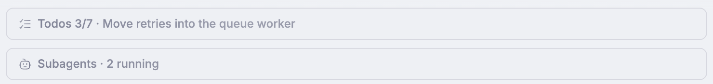
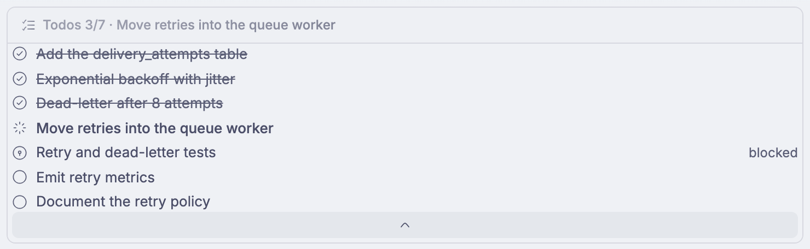
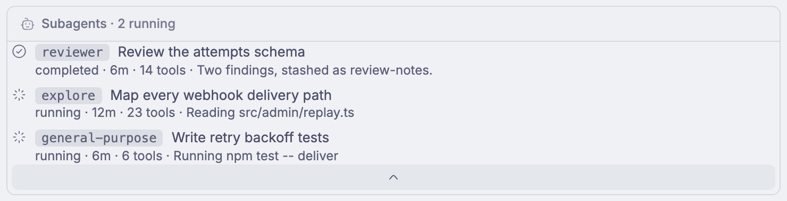
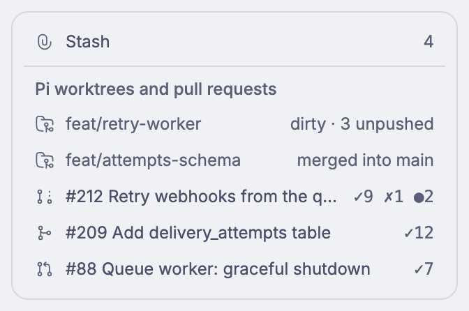
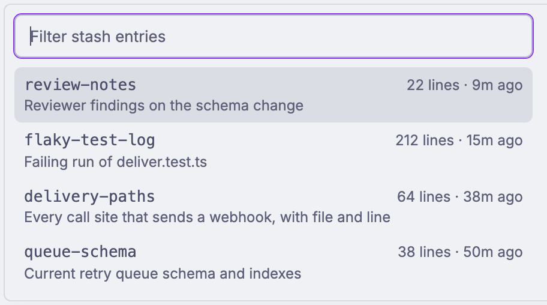
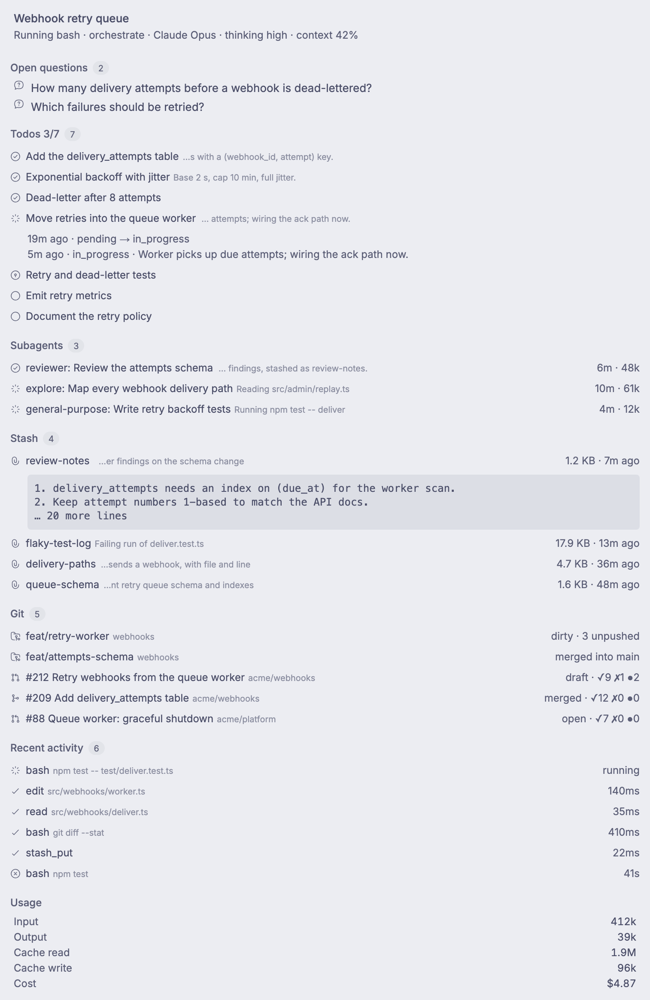
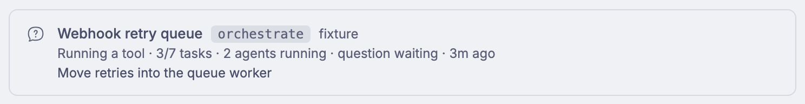
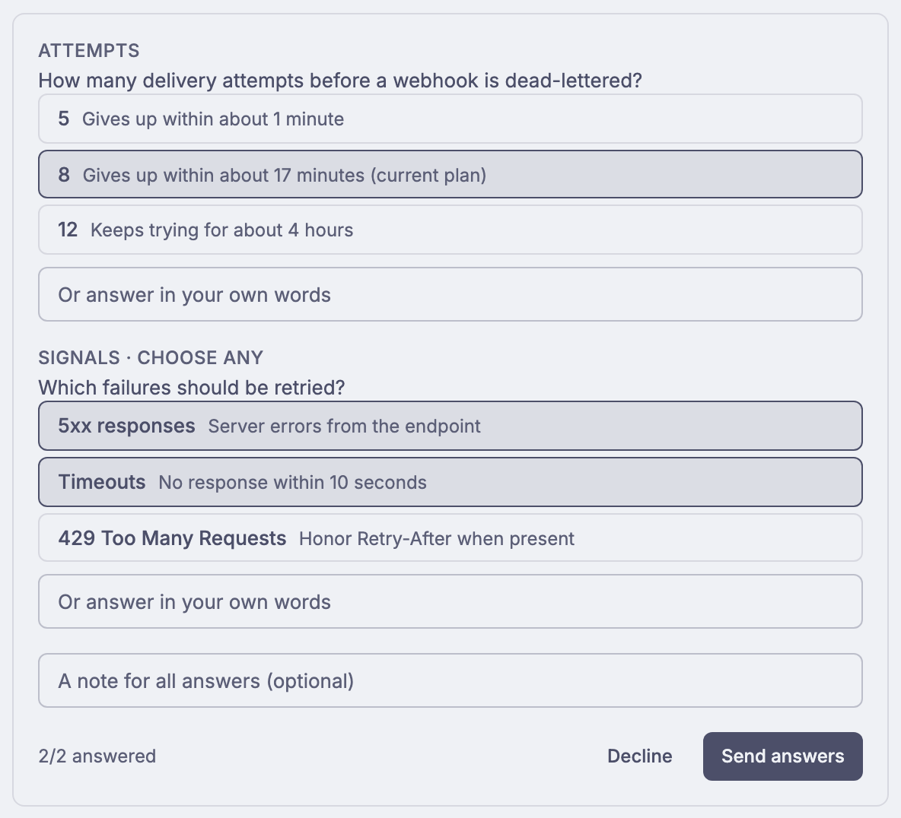

# bb's UI slots, by example

Where a bb plugin can draw, shown with one worked example per slot from the
`pi-surface` plugin in [`bb-plugin/`](../../bb-plugin/README.md). Each example
is fed by the `SessionSnapshot` that [`pi-bb`](../../extensions/pi-bb/README.md)
sends from a Pi thread, and renders nothing for a thread without one.

Checked against bb 0.49.0 with plugin SDK 0.6.132 (the installed declarations
in `node_modules/@get-bb/plugin-sdk/bundled-types/` are the contract). Every
slot below is `experimental_` unless noted; recheck after a bb upgrade.

## How the screenshots were made

All images show fixture data from `bb pi-surface fixture --thread <id>`, cropped
to the plugin's own element, light theme, 2x.

- **Live** images were captured from the bb web UI on loopback with headless
  Chromium, on a real thread page with the plugin installed.
- **Gallery** images come from the plugin's unlinked page
  `/plugins/pi-surface/sessions/gallery`, which bb renders with the same
  components, bb's host components and theme. They stand in for slots that bb
  hides behind experiments or that only appear during a live interaction. The
  surrounding frame (card border, row title) is drawn by the gallery, not by bb.

| #   | Slot                                | Registration                                                    | Image   |
| --- | ----------------------------------- | --------------------------------------------------------------- | ------- |
| 1   | Composer banner, stack card         | `app.composer.customize({ banners })` + `CollapsibleStackCard`  | Live    |
| 2   | Thread context segment              | `app.slots.experimental_threadContextSegment`                   | Live    |
| 3   | Thread context card row and section | `experimental_threadContextCardRow` / `…CardSection`            | Gallery |
| 4   | Composer action                     | `app.composer.customize({ actions })`                           | Live    |
| 5   | Composer popup with a shortcut      | `experimental_popups` + `composer.experimental_registerCommand` | Live    |
| 6   | Thread tab                          | `app.slots.experimental_tab({ context: { kind: "thread" } })`   | Live    |
| 7   | Thread row metadata                 | `app.slots.experimental_threadRowMetadata`                      | Gallery |
| 8   | Sidebar navigation page             | `app.slots.navPanel` (stable) + `experimental_useBadge`         | Live    |
| 9   | Pending interaction                 | `app.slots.pendingInteraction` (stable) + `bb.ui.requestInput`  | Gallery |

## 1. Composer banner: collapsible stack cards

Above the composer of a thread, the stack where bb's Plan mode and Goal cards
sit. Register a banner with `chrome: "bare"` and draw
`experimental_CollapsibleStackCard` (`label`, `title`, `icon`, `isActive`,
optional `dismiss`, `children`). Plugin banners sit above bb's own cards.

We draw two cards: **Todos** (`Todos 3/7 · <active task>`, active while a task
is in progress, expanding to the task list with status glyphs) and
**Subagents** (`Subagents · 2 running`, one row per agent with type,
description, state, duration, tool count and latest note).

Limits:

- There is no slot **below** the composer; the stack above it is the closest.
- Cards start collapsed and bb owns the toggle; `isActive` switches the header
  to bb's animated working style.
- Banners do not render on a thread whose composer is hidden (archived, or its
  environment is gone). We scope ours to thread composers (`scopes: ["thread"]`).
- The test harness draws the card as a plain section with its children always
  visible, so collapse behaviour is only checked live.

## 2. Thread context segment

The context row directly above the composer, where bb shows the parent thread
and the Git plugin's changed files. `experimental_threadContextSegment({ id,
title, group, order, summary, action?, details?, useVisible? })`; groups come
from `experimental_THREAD_CONTEXT_SEGMENT_GROUPS` (`1_thread`, `3_git`). We
join `1_thread`.

Ours is one button, `orchestrate · 3/7 tasks · 2 agents · question`, that opens
the Pi tab.

Limits: segments show whether the pane uses the context row or the context
card. A segment that repeats a card row should hide itself with
`useVisible: () => experimental_useThreadContextKind() === "banner"`; ours
does not repeat the card, so it always shows. `details` (an expandable area
below the row) is available but unused.

## 3. Thread context card: row and section

The card at a thread pane's upper right, beside the transcript.
`experimental_threadContextCardRow({ id, group, order, component })` adds a row
drawn with `experimental_ThreadContextCardRow` (icon, label, trailing value,
`onClick`); `experimental_threadContextCardSection({ id, title, group, order,
component })` adds a titled section below the rows. Groups are the Info tab's
(`experimental_THREAD_INFO_ROW_GROUPS`, `…SECTION_GROUPS`).

Ours: a **Stash 4** row that opens the Pi tab, and a **Pi worktrees and pull
requests** section with each worktree (dirty, unpushed, merged) and each pull
request with its checks (`✓9 ✗1 ●2`); a pull request row opens its URL.

Limits (why this one is a gallery image): bb shows the card instead of the
context row only while the `threadContextCard` experiment is on, for a thread
opened as a page in a pane wide enough for the card, and never on phones. The
experiment was off on the machine we checked, so the live thread showed the
context row and the card slots did not mount. The rows and section above are
bb's own `ThreadContextCardRow` components; the card frame and section heading
are drawn by the gallery.

## 4. Composer action

A control in the composer's action row, before voice input and Send.
`app.composer.customize({ actions: [{ id, component }] })`; `useComposer()`
inside it is bound to that composer. Ours is an icon button that opens the Pi
tab through `experimental_useAppPanel().openTab(…)`.

Limits: actions are not rendered in the composer's compact layout (narrow
panes, phones), per the SDK documentation; we did not capture that layout. Use
the vendored `Button` (it has no `title` prop; give it an `aria-label`).

## 5. Composer popup opened by a shortcut

A popup anchored to the composer, placed like bb's mention menu (a drawer on
compact screens). Register it in `experimental_popups: [{ id, label,
component }]` and open it with `composer.experimental_openPopup(id)` from a
composer command, `app.composer.experimental_registerCommand({ id, title,
defaultShortcut, run })`, or a `plusMenu` row.

Ours is a stash picker: **Mod+Shift+S** (or **+ → Insert a Pi stash handle**)
lists the branch's stash entries with a filter; Up/Down move, Enter inserts the
entry's handle at the caret, Escape closes.

Verified live: the default shortcut opened the popup from the focused composer.
Limits: the component owns its own search and keyboard navigation; users can
rebind the command, and a default that conflicts with another stays unbound.
The shortcut is inactive while a terminal, browser tab or modal has focus.

## 6. Thread tab

A tab in the thread's side panel. `experimental_tab({ context: { kind:
"thread" }, availability: "fixed", id, title, icon, component, useVisible })`
pins one destination; `availability: "action"` would add a launcher for
closable instances instead. Ours is the fixed **Pi** tab, visible only on
threads with a session: header (name, status, agent, model, thinking, context
use), open questions, todos (a task opens its status history, fetched from the
session on demand), subagents, stash (an entry opens a preview of its first
lines on demand), Git, recent tool calls and usage. It uses bb's
`experimental_InfoSection`, `InfoList` and `InfoListRow`.

Limits: bb keeps a closed panel's tab mounted, so a tab that polls should pause
with `experimental_useTabVisible()`; ours only reads the shared live query.
The panel is narrow by default: content must not force horizontal overflow
(`min-w-0`, wrapping previews).

## 7. Thread row metadata

A small item on the metadata line under each thread's title in the sidebar.
`experimental_threadRowMetadata({ id, order, useData, component })`: `useData`
runs once for the whole list (we read the sessions list once and index it by
thread), and the component draws one row. Ours shows a question glyph while
Pi waits on an answer and a robot with the count of running subagents.

Limits (why this one is a gallery image): bb draws the metadata line only while
the `threadRowMetadata` experiment is on **and** the user turns on Organize →
Rows → Metadata; both are off by default and were off here. Keep items to an
icon and a few characters; a click opens the thread. The thread title in the
image is drawn by the gallery.

## 8. Sidebar: the Pi sessions page

`app.slots.navPanel({ id, title, icon, path, component, experimental_useBadge })`
adds a destination to the sidebar navigation and owns the route
`/plugins/pi-surface/sessions`. Ours lists every connected Pi session (name,
agent, status, task counts, running subagents, waiting question, active task)
and opens its thread on click. The badge counts sessions that wait on the user.

Limits: `experimental_sidebarNavigation` would draw the whole navigation, but
it is exclusive (it replaces bb's Rail or Top list), so a plugin that only adds
an entry should not use it; `navPanel` is the additive slot.
`experimental_sidebar` on the panel could replace the thread list while the
page is open; we do not use it. The Rail draws a count badge or a dot, never
the badge's `text`.

## 9. Pending interaction: pi-ask's questionnaire as one form

A form that replaces the thread's composer until it is answered. The server
calls `bb.ui.requestInput({ threadId, rendererId: "questionnaire", title,
payload })`; the app registers `pendingInteraction({ id: "questionnaire",
component })`, whose `submit(value)` resolves the server's promise. Ours shows
every question of the questionnaire at once, with its options (single or
multiple choice), a free-text answer per question and a note for all answers;
**Send answers** goes back to Pi as an `answer` request, **Decline** cancels.
When Pi closes the questionnaire first, the server aborts the form.

Limits:

- **Not live yet, by pi-ask's choice.** In RPC mode pi-ask asks through Pi's
  own dialogs (`ctx.ui.select`, `input`), one question at a time, which bb
  already shows as its native `provider-pi/extension-ui` interaction. It emits
  `ask:opened` only for its terminal questionnaire, so under bb no
  questionnaire reaches the snapshot and this form is never raised. Showing it
  needs a pi-ask change: in RPC mode with a connected pi-bb, open the
  questionnaire on the bus (`ask:opened`) and wait for `ask:answer` instead of
  using dialogs. The plugin side is in place and covered by the server's
  contract tests.
- Every form leaves a row in the thread's timeline ("Waiting for your answer",
  then "Answered"), so fixtures never raise one: that would write into a real
  thread. The gallery image is the same component with a no-op submit.
- Payloads and answers are capped at 64 KiB; forms time out after ten minutes
  unless `timeoutMs` says otherwise.

## Data flow and refresh

Every slot reads `snapshot({ threadId })` through `experimental_useRpcQuery`;
the read is tagged `thread:<id>`, and the server calls
`bb.rpc.experimental_invalidate` whenever a session's snapshot changes, so all
mounted slots share one request per thread and refresh together over bb's
realtime socket. We use this instead of `bb.realtime.publish` plus a manual
refetch, which the SDK documents as the older pattern.
