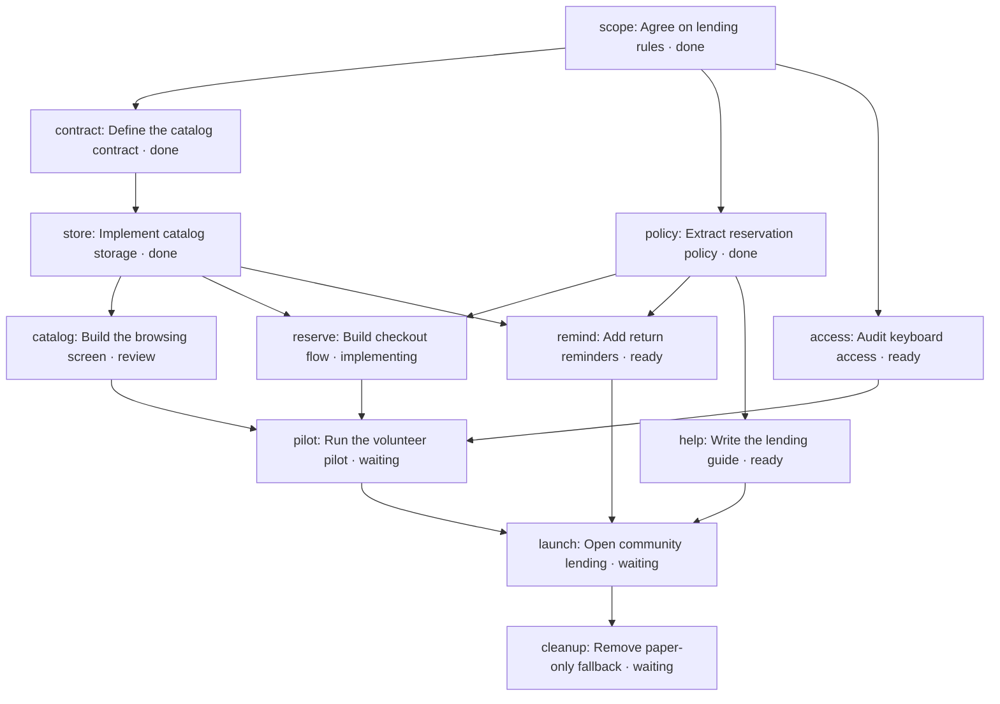

<!-- Generated roadmap community-tool-library · revision 7. Edit source JSON and regenerate. -->

# Community tool library

Status: in_progress · Updated: 2026-11-16 · Revision: 7

> Fictional roadmap and evidence. No real commits, PRs, owners or completed work are represented.

## Goal brief

**Stated request:** Replace a paper lending process with a small community tool library.

**True goal:** Members can find, reserve and return shared tools without volunteer spreadsheet work.

**consumers:**
- Members
- Volunteer coordinators

**successCriteria:**
- Borrow-and-return works for five pilot households.
- Two members cannot reserve the same tool simultaneously.
- Overdue reminders are safe to retry.

**nonGoals:**
- Payments
- Multiple branches
- A native mobile app

**constraints:**
- Keep existing loan records.
- Pilot before opening to the community.

**openToChange:**
- Inventory storage
- Checkout flow
- Volunteer process

**offLimits:**
- Membership authentication

**Appetite:** leave it better

## Answers

| ID | Question | Recommended | Answer | Source | Status |
| --- | --- | --- | --- | --- | --- |
| q1 | Can the pilot use the existing member login? | Reuse it. | Yes, reuse the existing member login. | fictional planning workshop | resolved |

## Inputs

| Input | Source | Owner | Supply | Tradeoff |
| --- | --- | --- | --- | --- |
| Inventory records | Volunteer spreadsheet | Coordinator | Import into the catalog contract | One import adapter; checkout does not read spreadsheet columns. |
| Member identity | Existing member login | Membership service | Verified member ID | Reuses authentication while keeping lending policy local. |

## What exists

**Prior art:**
- Existing member login
- Volunteer lending rules

**Conventions:**
- Stable tool IDs
- Keep historical loan records

| Friction | Evidence | Blocks | Verdict |
| --- | --- | --- | --- |
| Rules are duplicated in checkout notes. | fictional: volunteer procedure section 3 | reserve, remind | fix_first |

**Noticed, not doing:**
- Repair tracking

**Not examined:**
- Multi-branch lending is outside this example.

## Options

### baseline: Direct replacement

Build a single checkout screen around the spreadsheet.

**Cost:** S initially

**Risk:** Spreadsheet shape and lending rules stay coupled to the UI.

**Value timing:** First demo fastest; more manual coordination remains.

**Makes easy:** A one-off pilot.

**Leaves behind:** Spreadsheet runtime dependency.

**Choose when:** The pilot is disposable.

### contract-first: Contract first

Pin the catalog shape and isolate lending policy, then build parallel consumers.

**Cost:** M

**Risk:** Some preparation before the first usable screen.

**Value timing:** Storage, browsing and policy can be reviewed separately.

**Makes easy:** Independent browsing, checkout and reminders.

**Leaves behind:** One catalog contract and one lending policy.

**Choose when:** The library will continue after the pilot.

## Decision

contract-first · fictional pilot coordinator · 2026-11-13

The catalog and policy will have several consumers.

## Current implementation

4/12 steps completed. This is a step count, not an effort estimate.

| Step | Stage | Depends on |
| --- | --- | --- |
| scope | done | — |
| contract | done | scope |
| policy | done | scope |
| access | ready | scope |
| store | done | contract |
| catalog | review | store |
| reserve | implementing | policy, store |
| remind | ready | policy, store |
| pilot | waiting | catalog, reserve, access |
| help | ready | policy |
| launch | waiting | pilot, remind, help |
| cleanup | waiting | launch |

## Dependency map

Arrows mean prerequisite → dependent. Grouping and display order do not add dependencies.

## Roadmap

### scope. Agree on lending rules

**Type:** planning · **Track:** PLANNING · **Size:** S

**Eases:** contract, policy, access

**Does:** One household can borrow up to three tools; volunteers approve the pilot.

**Done when:**
- One household can borrow up to three tools; volunteers approve the pilot.

**Verification:**
- Review rules with pilot coordinator.

**Ships alone:** yes

**Rollback:** Revert the rules document.

**Depends on:** none

**Scope:** example/scope

**Stage:** done

**Note:** —

**Evidence:**
- verification: fixture:check-scope (passed)
- commit: fixture:commit-scope (recorded)

### contract. Define the catalog contract

**Type:** contract · **Track:** FOUNDATION · **Size:** M

**Eases:** store

**Does:** Inventory records expose stable tool IDs, availability and condition.

**Done when:**
- Inventory records expose stable tool IDs, availability and condition.

**Verification:**
- Validate representative fixtures against the contract.

**Ships alone:** yes

**Rollback:** Revert the contract before any consumer ships.

**Depends on:** scope

**Scope:** example/contract

**Stage:** done

**Note:** —

**Evidence:**
- verification: fixture:check-contract (passed)
- commit: fixture:commit-contract (recorded)

### policy. Extract reservation policy

**Type:** tidy · **Track:** FOUNDATION · **Size:** S

**Eases:** reserve, remind, help

**Does:** Existing lending rules run through one pure policy module with unchanged results.

**Done when:**
- Existing lending rules run through one pure policy module with unchanged results.

**Verification:**
- Run characterization cases for limits, overdue loans and cancellations.

**Ships alone:** yes

**Rollback:** Restore the previous policy call sites.

**Depends on:** scope

**Scope:** example/policy

**Stage:** done

**Note:** —

**Evidence:**
- verification: fixture:check-policy (passed)
- commit: fixture:commit-policy (recorded)

### access. Audit keyboard access

**Type:** research · **Track:** QUALITY · **Size:** S

**Eases:** pilot

**Does:** Known keyboard and screen reader gaps have reproduction steps and owners.

**Done when:**
- Known keyboard and screen reader gaps have reproduction steps and owners.

**Verification:**
- Complete the browse, reserve and cancel audit checklist.

**Ships alone:** yes

**Rollback:** No runtime change to roll back.

**Depends on:** scope

**Scope:** example/access

**Stage:** ready

**Note:** —

**Evidence:**
None.

### store. Implement catalog storage

**Type:** migration · **Track:** FOUNDATION · **Size:** M

**Eases:** catalog, reserve, remind

**Does:** The pilot inventory imports without losing tool IDs.

**Done when:**
- The pilot inventory imports without losing tool IDs.

**Verification:**
- Compare imported IDs and counts; test failed import rollback.

**Ships alone:** yes

**Rollback:** Restore the pre-import backup.

**Depends on:** contract

**Scope:** example/store

**Stage:** done

**Note:** —

**Evidence:**
- verification: fixture:check-store (passed)
- commit: fixture:commit-store (recorded)

### catalog. Build the browsing screen

**Type:** change · **Track:** EXPERIENCE · **Size:** M

**Eases:** —

**Does:** Members can browse tools and see their current availability.

**Done when:**
- Members can browse tools and see their current availability.

**Verification:**
- Exercise empty, unavailable and available inventory states.

**Ships alone:** yes

**Rollback:** Disable the new browsing route.

**Depends on:** store

**Scope:** example/catalog

**Stage:** review

**Note:** Waiting for independent review.

**Evidence:**
None.

### reserve. Build checkout flow

**Type:** change · **Track:** EXPERIENCE · **Size:** M

**Eases:** —

**Does:** Eligible members can reserve and return tools with policy checks.

**Done when:**
- Eligible members can reserve and return tools with policy checks.

**Verification:**
- Test simultaneous reservation, return and rejected requests.

**Ships alone:** yes

**Rollback:** Disable checkout; retain existing loan records.

**Depends on:** policy, store

**Scope:** example/reserve

**Stage:** implementing

**Note:** Implementation is active; reservation race handling remains.

**Evidence:**
None.

### remind. Add return reminders

**Type:** change · **Track:** OPERATIONS · **Size:** M

**Eases:** —

**Does:** A daily job queues one reminder per overdue loan without duplicates.

**Done when:**
- A daily job queues one reminder per overdue loan without duplicates.

**Verification:**
- Run a dry job twice and compare queued notifications.

**Ships alone:** yes

**Rollback:** Disable the reminder job.

**Depends on:** policy, store

**Scope:** example/remind

**Stage:** ready

**Note:** —

**Evidence:**
None.

### pilot. Run the volunteer pilot

**Type:** migration · **Track:** RELEASE · **Size:** M

**Eases:** —

**Does:** Five volunteer households finish a borrow-and-return cycle.

**Done when:**
- Five volunteer households finish a borrow-and-return cycle.

**Verification:**
- Review pilot results and confirm no lost reservations.

**Ships alone:** yes

**Rollback:** Return volunteers to the paper checkout process.

**Depends on:** catalog, reserve, access

**Scope:** example/pilot

**Stage:** waiting

**Note:** —

**Evidence:**
None.

### help. Write the lending guide

**Type:** change · **Track:** OPERATIONS · **Size:** M

**Eases:** —

**Does:** Members can find lending limits, return instructions and contact details.

**Done when:**
- Members can find lending limits, return instructions and contact details.

**Verification:**
- Coordinator checks the guide against the agreed lending rules.

**Ships alone:** yes

**Rollback:** Unpublish the guide.

**Depends on:** policy

**Scope:** example/help

**Stage:** ready

**Note:** —

**Evidence:**
None.

### launch. Open community lending

**Type:** change · **Track:** RELEASE · **Size:** M

**Eases:** —

**Does:** Community checkout is enabled after the pilot and reminders pass.

**Done when:**
- Community checkout is enabled after the pilot and reminders pass.

**Verification:**
- Run a production smoke check against the enabled release.

**Ships alone:** yes

**Rollback:** Disable community checkout; keep volunteer access.

**Depends on:** pilot, remind, help

**Scope:** example/launch

**Stage:** waiting

**Note:** —

**Evidence:**
None.

### cleanup. Remove paper-only fallback

**Type:** cleanup · **Track:** RELEASE · **Size:** S

**Eases:** —

**Does:** Old-only instructions are removed and loan records remain accessible.

**Done when:**
- Old-only instructions are removed and loan records remain accessible.

**Verification:**
- Search for retired instructions and verify record lookup.

**Ships alone:** yes

**Rollback:** Restore fallback instructions.

**Depends on:** launch

**Scope:** example/cleanup

**Stage:** waiting

**Note:** —

**Evidence:**
None.

## Open questions

- q2: Should damaged tools automatically stop new reservations? Blocks: none. Follow-up policy discussion; does not block the agreed pilot.
