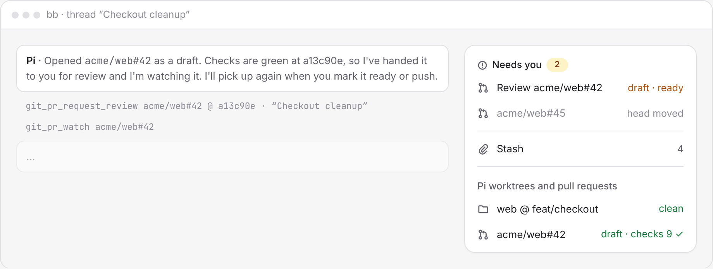
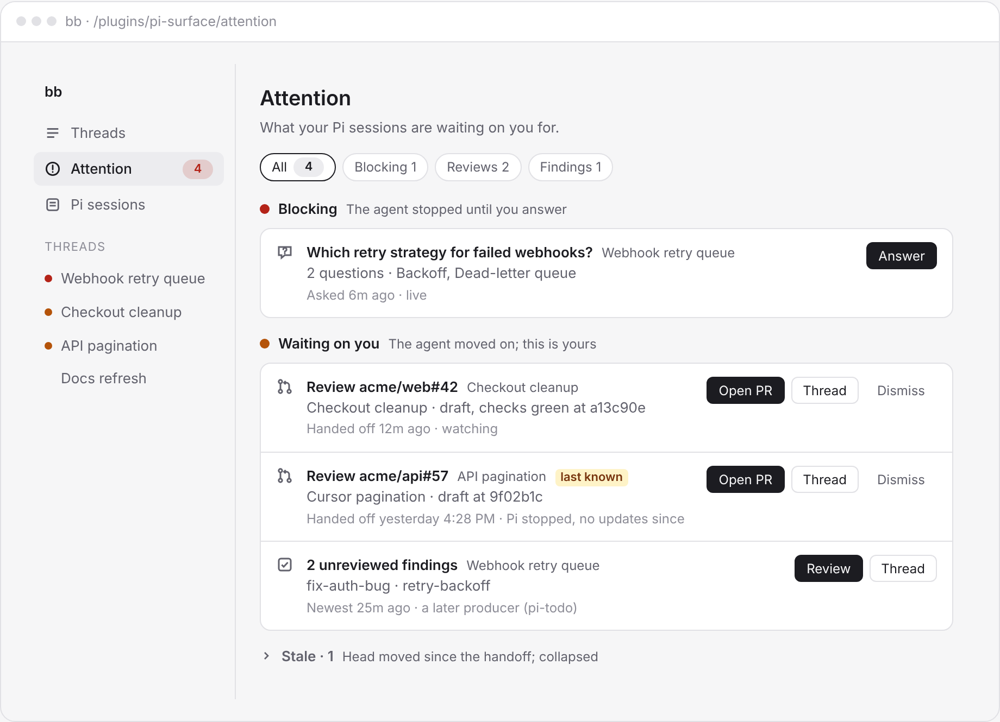
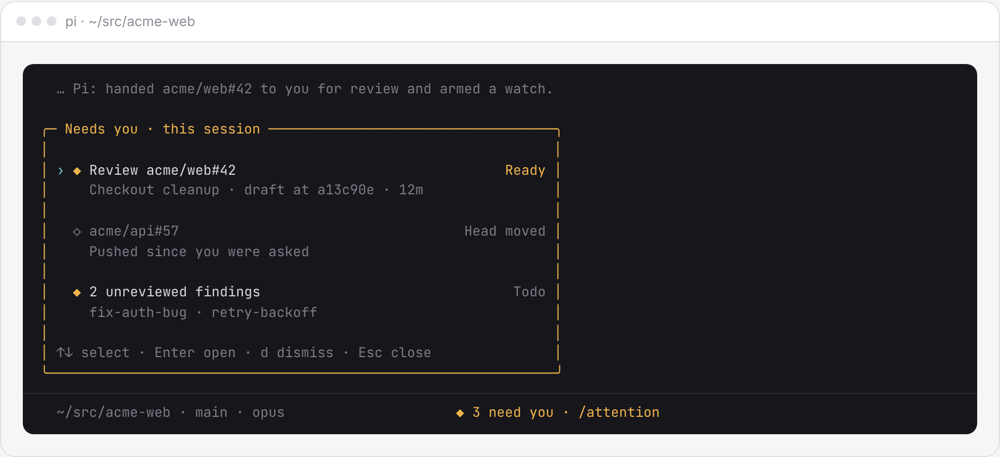
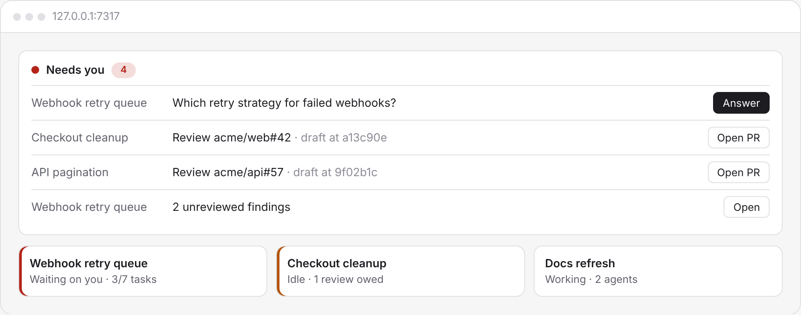
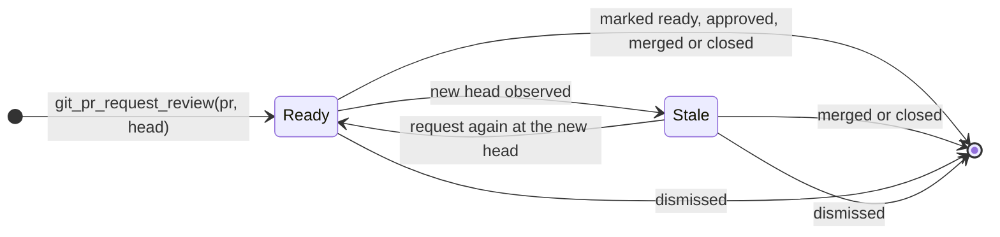

# An attention queue across sessions

Status: chosen · Updated: 2026-11-26

Supersedes the Git-only "Your turn" plan proposed in #207. The concept page with
the same mockups is [`attention.html`](attention.html); open it in a browser.
It is also a private artifact owned by the repository owner:
<https://claude.ai/artifact/8XzbcB9Ns8Nb8e3fQPLwmT>.

## Goal brief

**Stated request:** Make "your turn" generic rather than Git-specific. Show
what needs the user at two levels: per session in a context card, and across all
sessions on a dedicated Attention page. Today the only producer is draft PRs
handed to the user for review; more will follow.

**True goal:** After leaving agents unattended, come back and see what needs
you, why, and where to act, without reading transcripts, for one session or all
of them.

**Consumers:** A person in bb (context card, Attention page, thread list), in the
terminal (the current session), or in the dashboard (every terminal session).

**Success criteria:**

- An explicit PR review handoff produces one item with a working link. It
  survives a Pi reload and, in bb, a stopped thread (as "last known").
- An observed head change marks it stale. An observed ready-for-review,
  approval, merge or close resolves it, as does a dismissal.
- An open questionnaire, or Pi waiting on a dialog, shows on the Attention page
  and the dashboard as Blocking, with no change to pi-ask.
- A second producer (todo findings) needs no contract change.
- Green CI without an explicit handoff never creates an item.

**Non-goals:** Automatic approval or merge. Inferred handoffs. A cross-session
index in the terminal (the dashboard is that view). Any GitHub access from bb or
the dashboard. A generic agent-raised item in this plan (see
[Later](#later-a-generic-attention_raise-tool)).

**Constraints:** Change bundle code and the bb plugin, not Pi or bb core. Follow
the extension runtime rules in `AGENTS.md`: closure state, `appendEntry` and
replay, no per-request context messages, `pi-work` for anything a session waits
on, `pi-surface` for what other UIs show. Packages never import extensions.

## Two kinds of attention

| Kind         | Meaning                                                      | Sources                                                | Where it comes from                                                                          |
| ------------ | ------------------------------------------------------------ | ------------------------------------------------------ | -------------------------------------------------------------------------------------------- |
| **Blocking** | The agent has stopped and cannot continue until you act      | An open `ask` questionnaire; status `waiting`          | Derived by consumers from `form` views and `system.session`; already in every snapshot       |
| **Owed**     | The agent handed something off and moved on; it waits on you | A draft PR handed off for review; later, todo findings | Published by the owning extension as an `attention` view; survives the process as last known |

The context card shows a thread's **Owed** items. bb already replaces the
composer with a Blocking questionnaire, so the card leaves those out. The
Attention page, the dashboard and the thread-list dots show **both**, Blocking
first.

## Concept mockups

These are drawn by hand, not captured. Regenerate real images with the
`tui-screenshot` and `bb-screenshot` skills as each step lands.

**bb context card:** a "Needs you" section above Stash; a row opens its link.



**bb Attention page:** a new sidebar destination. Its badge counts every item
and turns red when anything is Blocking. Stopped threads' rows say "last known".



**Terminal:** a status hint while anything is owed, and `/attention` for the
current session.



**Dashboard:** the "Waiting on you" panel becomes "Needs you".



## Answers

| Question                                                 | Answer                                                                    | Source                                                                                                                          |
| -------------------------------------------------------- | ------------------------------------------------------------------------- | ------------------------------------------------------------------------------------------------------------------------------- |
| Is attention Git-specific?                               | No. One contract; pi-git is the first producer.                           | User, 2026-11-26                                                                                                                |
| What shows per session, and what across sessions?        | Context card: Owed. Attention page: Owed and Blocking, every session.     | User, 2026-11-26                                                                                                                |
| Does pi-ask publish questions as attention items?        | No. Consumers derive Blocking from `form` views and session status.       | Decided 2026-11-26                                                                                                              |
| Can the agent raise an arbitrary item?                   | Not yet. Domain tools only; `attention_raise` is described for later.     | Decided 2026-11-26                                                                                                              |
| Attention page or a section above Pi sessions?           | Its own page; the waiting badge moves there from Pi sessions.             | Decided 2026-11-26                                                                                                              |
| Cross-session view in the terminal?                      | The dashboard. `/attention` stays per session.                            | Decided 2026-11-26                                                                                                              |
| Why not an explorer view, as PR links are carried today? | Settling strips explorer actions and bb scrapes links from detail fields. | [`settle.ts`](../../packages/pi-surface/src/settle.ts#L131), [`thread-context.tsx`](../../bb-plugin/ui/thread-context.tsx#L112) |

## Inputs

| Input                           | Owner / source today                                                                                                  | Proposed supply                                                                                                                                                                     |
| ------------------------------- | --------------------------------------------------------------------------------------------------------------------- | ----------------------------------------------------------------------------------------------------------------------------------------------------------------------------------- |
| Handoff intent                  | Prose: `execute-roadmap` calls [`user_notify`](../../skills/execute-roadmap/SKILL.md#L211) and records a todo message | `git_pr_request_review({ pr, head, reason })` from the main session. The skill decides readiness; pi-git validates and records.                                                     |
| PR state                        | pi-git's ledger ([`readLedger`](../../extensions/pi-git/src/fold.ts#L31)): `state`, `draft`, `review`, `headSha`      | The reducer joins intent with ledger facts by canonical PR key. A watch (a `pi-work` item) keeps facts arriving without polling.                                                    |
| Persistence                     | Session entries, replayed across `/tree`                                                                              | A versioned `git:attention` entry for each request and dismissal, replayed with the ledger. Session-wide, like the PR ledger. Children contribute facts, never requests.            |
| Owed items for display          | None                                                                                                                  | `attention` view kind in pi-surface (contract below), one view per producer: `git.attention`, later `todo.attention`.                                                               |
| Blocking items for display      | `ask.questions` form view; `system.session` status                                                                    | `attentionRows(snapshot)` in pi-surface derives them. No producer change.                                                                                                           |
| Cross-session aggregation       | bb [`sessions()`](../../bb-plugin/server.ts#L129) RPC; dashboard hub records                                          | bb: a new `attention()` RPC over live, saved and fixture sessions. Dashboard: the same `attentionRows`, embedded in the page as `format.ts` is.                                     |
| Dismissal from a stopped thread | None                                                                                                                  | bb keeps it in `bb.storage.kv` under `threadId/viewId/itemId@rev`, hides the row, and runs the item's `dismiss` action when Pi reconnects. An unknown item on reconnect is dropped. |

### The contract

```ts
// packages/pi-surface/src/attention.ts
export interface AttentionItem {
  id: string; // stable within the view: "pr:github.com/acme/web#42"
  rev?: string; // what was handed off (head SHA); a dismissal names it
  category: string; // "review" | "findings" | …; renderers map it to an icon, unknown → generic
  title: Line; // "Review acme/web#42"
  reason?: string; // "Checkout cleanup · draft at a13c90e" (bounded)
  state: "ready" | "stale";
  since: number; // when it was raised
  observedAt?: number; // when the producer last confirmed it
  link?: { url: string; label: string }; // https only; checked again by every consumer
  open?: ActionRef; // optional in-session action; live only
  dismiss?: ActionRef; // live only
  live?: true; // exists only while the process runs: settling removes the item
}
export interface AttentionModel {
  items: AttentionItem[];
  total: number; // the producer's true count, so a capped list can say "and 12 more"
}
```

- **Settling:** items marked `live` are removed; `open` and `dismiss` are
  dropped. Everything else, the link included, survives as last known.
- **Bounds:** `MAX_ATTENTION_ITEMS` (about 50), bounded title, reason, id and
  URL, enforced by `isAttentionModel` as `isFormModel` does for forms.
- **Ids:** views are `<extension>.attention`. Across sessions an item's key is
  `threadId/viewId/itemId`.
- **Older readers:** `readDeliverySnapshot` skips unknown kinds, so a consumer
  without this change keeps its other views.

### Review item lifecycle



- **Request:** main session only. Read the PR once; require it open with exactly
  the given full head SHA. Build the URL from the validated identity (https, no
  userinfo, query or fragment). If the read fails or disagrees, record nothing.
- **Repeat:** one item per PR per session. Repeating a ready request for the same
  head returns "already requested" with no new entry.
- **Stale:** a later accepted observation of a different full head SHA. A
  checks-only update or an abbreviated SHA is not evidence. It stays stale until
  requested again, even if the head moves back.
- **Resolved:** a later accepted observation of `draft: false` (when the request
  was made on a draft), an approving review, a merge or a close; or a dismissal
  entry. Missing facts, watch expiry and errors resolve nothing.
- **Stopped:** no process, no new facts. bb shows the archived row as last known
  with its observation time, and its link still opens.

## What exists

**Prior art:** [`git:prs` and `git:refresh`](../../extensions/pi-git/src/index.ts#L1170)
for viewing and refreshing; `readLedger` and `recordPr` for durable facts and
observation; pi-surface's view registry, `collectDelivery` and `settleSnapshot`;
the bb sessions store, [saved snapshots](../../bb-plugin/archive.ts) and
[`useSessionsBadge`](../../bb-plugin/ui/sessions.tsx#L54); the dashboard's
["Waiting on you" panel](../../extensions/pi-dashboard/src/hub/page.ts#L762);
`setStatus` hints, as pi-subagent uses.

**Conventions to follow:** command prefixes (`/attention` is `pi-attention`'s
main command); padded terminal rows with narrow-width and wide-Unicode tests;
bb's 12px inset, checked with `bb-shot.mjs --expand --check`; views defined on
`session_start` and disposed on `session_shutdown`.

**Friction:**

| Friction                                                      | Evidence                                                                     | What to do                                                     |
| ------------------------------------------------------------- | ---------------------------------------------------------------------------- | -------------------------------------------------------------- |
| Handoff intent is prose and a toast, not data                 | `execute-roadmap` step at [L211](../../skills/execute-roadmap/SKILL.md#L211) | Steps 7–9: record intent as entries; the skill calls the tool. |
| No view kind carries durable rows with links through settling | Explorer actions are removed on settle; bb finds links in detail fields      | Step 1: a dedicated kind.                                      |
| "Waiting" is computed separately in bb and in the dashboard   | `useSessionsBadge`; the hub's form panel                                     | Step 2: one `attentionRows` both use.                          |

**Noticed, not doing:** routing a subagent's question anywhere but its parent;
native notifications beyond `user_notify`; changing how PR watches re-arm.

**Not examined:** live bb with the `threadContextCard` experiment on; the card
section is verified from the gallery until then, as the Git section is.

## Options

| Option                                     | Approach                                                                                            | Trade-off                                                                    |
| ------------------------------------------ | --------------------------------------------------------------------------------------------------- | ---------------------------------------------------------------------------- |
| A. Git-only review rows (#207)             | A `review-requests` kind in pi-git, `/git:your-turn`, a section above Pi sessions.                  | Smallest, but every later source needs its own kind and UI.                  |
| **B. Generic attention contract (chosen)** | An `attention` kind any extension publishes; consumers derive Blocking; one page, one card section. | One more shared contract and a small extension; new sources need no UI work. |

## Decision

**B**, decided 2026-11-26 by the repository owner, with all four recommendations
accepted (see [Answers](#answers)). #207 is closed in favour of this plan; its
pi-git reducer and lifecycle rules carry over into steps 7–9.

## Roadmap

Each step updates the READMEs and images it affects, as `AGENTS.md` requires:
pi-surface's kind table, the root README's tables and "Who imports what",
`docs/bb/ui-slots.md`, and the new extension's README.

### Make it easy

### 1. Add the `attention` view kind to pi-surface

**Type:** contract

**Eases:** Steps 2–8 share one checked model instead of each inventing rows.

**Does:** Add `src/attention.ts` (model, `isAttentionModel`, bounds), add
`attention` to `VIEW_KINDS` and the model guards in `views.ts`, the settle rule
in `settle.ts`, and exports. Add the type re-exports to `bb-plugin/contract.ts`.

**Done when:** A valid model round-trips through `collectDelivery`; malformed and
over-bound models become error entries; settling removes `live` items and
actions and keeps links; an older reader skips the kind and keeps other views.

**Verification:** `npm run test:workspace -- pi-surface`; `npm --prefix bb-plugin run typecheck`.

**Ships alone:** yes, nothing publishes the kind yet.

**Rollback:** revert; no producer exists.

**Depends on:** none · **Size:** S

### 2. Derive attention rows once: `attentionRows(snapshot)`

**Type:** contract

**Eases:** Steps 3–6 show the same rows in the same order.

**Does:** A pure, self-contained function in pi-surface (embeddable with
`Function.prototype.toString`, like `format.ts`). It returns Blocking rows from
`form` views (one per questionnaire) and from `waiting` status with no form,
then Owed rows from every `attention` view. It sorts Blocking, then ready by
age, then stale, and drops links that are not https.

**Done when:** Table tests cover forms only, attention only, both, a failed
view, a settled snapshot and a non-https link.

**Verification:** `npm run test:workspace -- pi-surface`.

**Ships alone:** yes.

**Rollback:** revert.

**Depends on:** 1 · **Size:** S

### 3. bb server: `attention()` RPC, counts and dismissal queue

**Type:** migration

**Eases:** Step 4 reads one live query for every slot.

**Does:** In `bb-plugin/sessions.ts` and `server.ts`, collect `attentionRows`
across live, saved and fixture sessions, with session name, source and
connection; add RPC `attention()` tagged `attention` and invalidated wherever
`sessions` is; add `attention: { blocking, owed }` to `SessionSummary`. Store
dismissals for saved sessions in `bb.storage.kv` and run them on reconnect. Add
an attention view to the fixture.

**Done when:** A fixture shows rows; a saved session's rows survive a plugin
reload; a queued dismissal runs once on reconnect and is dropped if the item is
gone.

**Verification:** `npm --prefix bb-plugin test` with an archive restore → saved
→ live test on a real snapshot; `npm --prefix bb-plugin run typecheck`.

**Ships alone:** yes, nothing reads it yet.

**Rollback:** revert.

**Depends on:** 2 · **Size:** M

### 4. bb UI: Attention page, context card section, thread dots

**Type:** migration

**Eases:** The change lands with nowhere left to build.

**Does:** `navPanel({ id: "attention", … })` with `experimental_useBadge`
(count of all rows; warning tone, or a stronger one when anything is
Blocking); remove the badge from Pi sessions. A
`threadContextCardSection` ordered before the Git section, listing the thread's
Owed rows (a row opens its link, a stale row is dimmed). Row-metadata dots and
a `1 review` segment part. Answer opens the thread; Open PR uses
`navigate.openUrl`; Dismiss runs the action or queues it.

**Done when:** The fixture matches the mockups; a saved row's link opens with no
session request; no section or page content appears without rows.

**Verification:** component tests; `bb-shot.mjs --expand --check` passes; new
screenshots in `docs/bb/ui-slots.md`.

**Ships alone:** yes, on fixture data.

**Rollback:** revert the slots; restore the Pi sessions badge.

**Depends on:** 3 · **Size:** M

### 5. Terminal: the `pi-attention` extension

**Type:** migration

**Eases:** Terminal users see handoffs once step 9 lands.

**Does:** Scaffold with the `new-extension` skill. On `session_start`, read
`attention` views from the session's own bus with `collectViews` and follow
`onViewChanged`. While any item is owed, set a status hint
(`◆ 2 need you · /attention`); clear it on the last resolve and on shutdown.
`/attention` opens a padded `pi-ui` list: Enter opens the link with an argv
launch (no shell) or prints it; `d` runs `dismiss`; outside the TUI it prints
rows through `userOutput`. An empty list says so and, when the dashboard reports
other sessions' items, points to `/dashboard`.

**Done when:** The overlay renders the mockup on fixture views; the hint clears;
no-opener fallback prints the URL.

**Verification:** `npm run test:workspace -- pi-attention` including narrow
widths and ANSI/wide Unicode; `npm run verify:bundle`; a `tui-screenshot` image
for its README.

**Ships alone:** yes.

**Rollback:** unregister the extension.

**Depends on:** 2 · **Size:** M

### 6. Dashboard: the "Needs you" panel

**Type:** migration

**Eases:** Terminal users get the cross-session view.

**Does:** Embed `attentionRows` in the hub page. Replace "Waiting on you" with
"Needs you" across sessions (Answer for Blocking, Open for links); give session
cards an amber edge for Owed and keep the Blocking highlight.

**Done when:** The panel lists forms and attention rows from two reporters;
answering still works.

**Verification:** `npm run test:workspace -- pi-dashboard`; regenerate
`docs/images/dashboard*.png`.

**Ships alone:** yes.

**Rollback:** revert the page.

**Depends on:** 2 · **Size:** S

### 7. pi-git: replay review handoffs with PR facts

**Type:** contract

**Eases:** Steps 8–9 get one outcome per PR instead of rebuilding it.

**Does:** #207's step 1: a versioned `git:attention` entry (request, dismissal)
and a pure reducer over intent and accepted ledger facts, using per-field
timestamps so out-of-order facts cannot change a row early. Fed on replay and on
live writes and adoption. No public tool.

**Done when:** Replay and the live reducer agree on same-head retries, head
change and reversion, ready-for-review, approval, merge, close, reopen,
dismissal, reload, `/tree`, and child facts without child intent.

**Verification:** `npm run test:workspace -- pi-git`, table-driven.

**Ships alone:** yes, no public change.

**Rollback:** revert.

**Depends on:** none · **Size:** M

### 8. pi-git: publish `git.attention` and its dismiss action

**Type:** contract

**Eases:** Step 9 only has to record a request.

**Does:** Map reducer rows to `AttentionItem` (`category: "review"`, `rev` the
head SHA, link built from the validated identity) and define the view and
`git.attention.dismiss` on `session_start`; announce on every reducer change.

**Done when:** Seeded entries appear in a snapshot and in a settled snapshot
without actions; dismiss writes one entry and removes the row.

**Verification:** `npm run test:workspace -- pi-git`.

**Ships alone:** yes, empty until step 9.

**Rollback:** revert; readers ignore the absent view.

**Depends on:** 1, 7 · **Size:** S

### The change

### 9. Turn on review handoffs

**Type:** the change

**Does:** Register `git_pr_request_review` (main session only; no GitHub write)
that validates, records the request and arms a `git_pr_watch` if none is open.
Change `execute-roadmap`'s PR handoff to call it with the checked head before
its single `user_notify`. Document the tool and lifetime limits in pi-git's
README.

**Done when:** A green PR with no request shows nothing; a request shows one
item in bb, the terminal and the dashboard; a retry adds nothing; a push makes
it stale; ready-for-review or merge resolves it; it survives reload and a
stopped bb thread.

**Verification:** a scripted scenario in `test/scenarios/` (green → request →
duplicate → head move → request again → ready-for-review → reload); the tool's
child restriction; `npm run verify:bundle`; in bb, stop Pi, open the saved row's
link, resume and see the snapshot replace it.

**Ships alone:** yes, after the steps above.

**Rollback:** remove the tool and the skill call; readers tolerate old entries.

**Depends on:** 4, 5, 6, 8 · **Size:** S

### Follow-up

### 10. Second producer: unreviewed todo findings

**Type:** the change

**Does:** pi-todo publishes `todo.attention`: one `findings` item per task with
unreviewed messages, with an `open` action into its review. No link, so bb opens
the thread.

**Done when:** Items appear and resolve on review with no change to pi-surface,
bb or the dashboard.

**Verification:** `npm run test:workspace -- pi-todo`.

**Ships alone:** yes.

**Rollback:** remove the view.

**Depends on:** 1 · **Size:** S

**Start with step 1.** It is safe to start today; steps 1 and 7 can proceed in
parallel.

## Later: a generic `attention_raise` tool

Not in this plan. Some handoffs will have no domain tool, such as "check the
staging deploy" or "approve the migration in the console". When a real case like
that comes up, a generic tool can raise an Owed item with the same contract,
within these limits:

- **Main session only,** like `user_notify`. A subagent reports to its parent.
- **Required expiry.** Nothing observes a generic item resolving, so it takes a
  deadline (say 1–72 hours) and shows as stale once that passes.
- **Optional, checked link:** https only, no userinfo, checked again by every
  consumer.
- **Dedupe by key:** raising the same key again updates the item.
- **A cap:** a few open generic items per session; past that the tool refuses.
- **Resolved by you or the agent:** dismiss in any UI, or
  `attention_resolve(key)` once the agent sees it is done.

It would live in `pi-attention`, publish `attention.items` with category
`agent`, and need no contract change.

## Open questions

- The exact bb badge tone for Blocking depends on what `ExperimentalBadge`
  offers beyond `warning`; check in step 4.
- Whether the dashboard hub can tell `/attention` that other sessions have items
  (for the empty-state pointer) without a new request; if not, drop the pointer.
