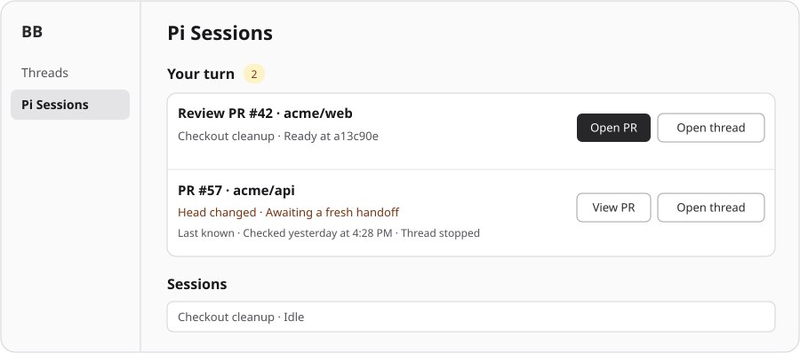

# A durable “Your turn” queue

Status: draft · Updated: 2026-11-25

## Goal brief

**Stated request:** Plan the “Your turn” queue and sketch how it looks in Pi’s terminal UI and BB.

**True goal:** After leaving agents unattended, come back and know what needs you, why, and where to act without reading a transcript. Start with explicitly requested PR reviews.

**Consumers:** A person returning to a Pi session in the terminal, or triaging Pi threads in BB.

**Success criteria:** A request to review a particular PR head produces one row with a direct link. It survives a Pi reload; BB retains the last successfully archived handoff after a thread stops. An observed head change marks the request stale; an observed merge or close clears it. Green CI without an explicit handoff does not create a row.

**Non-goals:** No automatic approval or merge, global terminal session index, new dashboard, generalized notification inbox, or inferred handoffs. The terminal view covers the current Pi session, not every terminal session; BB aggregates across its own threads. Marking a review complete or dismissing a request separately from PR closure is out of scope.

**Constraints:** Reuse the existing Git ledger, PR observation, terminal UI components, and BB sessions surface where practical. Keep `ask` and `user_notify` behavior unchanged. Change bundle code and its BB plugin, not Pi or BB core. This PR proposes the plan only. Favor one feature-specific contract over a general workflow engine.

## Answers

| Question                                               | Answer                                                                          | Source                                                                          |
| ------------------------------------------------------ | ------------------------------------------------------------------------------- | ------------------------------------------------------------------------------- |
| What goes in the first queue?                          | Explicit handoffs for PR review; no green-CI inference.                         | The proposal this plan was requested for.                                       |
| Which host surfaces?                                   | Pi TUI and BB.                                                                  | User request.                                                                   |
| Is an open review request the same as a live question? | No. A saved snapshot drops forms; review links must still work with no process. | [`pi-surface/src/settle.ts:124`](../../packages/pi-surface/src/settle.ts#L124). |

## Inputs

| Input                                     | Owner / source today                                                                                                                       | Proposed supply                                                                                                                                                                                                                                                                                                                                                                                                                  |
| ----------------------------------------- | ------------------------------------------------------------------------------------------------------------------------------------------ | -------------------------------------------------------------------------------------------------------------------------------------------------------------------------------------------------------------------------------------------------------------------------------------------------------------------------------------------------------------------------------------------------------------------------------- |
| Intent, expected head, and reason         | `execute-roadmap` calls `user_notify` and writes a todo message in [its PR handoff step](../../skills/execute-roadmap/SKILL.md#L210-L215). | An explicit `git_pr_request_review` call from the main session takes `pr`, the full expected head SHA, and a short reason. The workflow owns readiness policy; Git owns validation and recording.                                                                                                                                                                                                                                |
| Canonical identity and latest known state | `pi-git` normalizes PR identities and merges observations from its tools and adopted child facts.                                          | Join with the existing Git ledger using its canonical PR key and URL. Request the expected head explicitly; never substitute the latest head silently.                                                                                                                                                                                                                                                                           |
| Persistence and replay                    | Pi session entries; the Git ledger replays the whole session, across `/tree` branches.                                                     | A separate versioned `git:review-request` entry stores intent. Replay it alongside accepted Git observations. Keep it session-wide like the PR ledger: a `/tree` navigation does not undo a handoff already made to a person. Children may contribute observations, not requests.                                                                                                                                                |
| Presentation                              | `pi-surface` snapshots, which BB already collects, settles, and caches.                                                                    | A narrow `git.review-requests` view of kind `review-requests`, with a total and bounded rows: canonical key, URL, PR label, short reason, full requested head, state (`ready` or `head-changed`), requested time, and last observed time. BB discloses overflow and points to the originating thread; TUI can read the full local projection. Renderers shorten the SHA. No executable actions or session internals in the rows. |
| Freshness and navigation                  | `git_pr_watch`, `git_pr_status`, `/git:refresh`, and BB's thread identity and connection status.                                           | PR observations advance the rows; connection status gates the “Last known” label, not the links. Host UI opens the validated PR URL directly and BB opens the originating thread through its existing navigation.                                                                                                                                                                                                                |

### Lifecycle rules

- **Request:** Only the main session can publish a handoff. Reuse the Git status reader for a one-time read of that PR. Require an open PR with the exact supplied full SHA. Generate the HTTPS URL from validated parts of the resolved PR identity; require a matching host and PR path, with no userinfo, query, or fragment. If the read fails, lacks facts, or disagrees with the expected head, do not publish; the caller can re-evaluate. Recheck the session generation and the latest accepted facts before appending if the read raced a watch or a session switch. Git does not decide whether the checks or reviews are sufficient.
- **Repeat:** Keep one current row per PR per Pi session, keyed by canonical PR identity, not the display label. Repeating a ready handoff for the same head returns “already requested,” with no new entry or toast. A fresh request can replace a stale one only after validation. BB keeps separate thread rows for genuinely separate handoffs to the same PR.
- **Head changed:** A later accepted observation of a different full head SHA makes the request stale. A checks-only report or an abbreviated SHA is not evidence of a different head. It stays stale until a fresh explicit request, even if the head moves back. Show “Head changed,” not “Review PR.”
- **Merged or closed:** A later accepted terminal observation removes the row. An intentional request after a verified reopen can create a new row; reopening alone never revives one. Missing facts, watch expiry, and transient errors do not resolve anything.
- **Stopped:** No process means no new PR facts. BB shows the last successfully archived row as **Last known** with its observation time and still opens the PR. If Pi stops before a new handoff reaches BB, replay publishes it on the next connection. Reconnect replaces the snapshot; normal PR observation updates it. Opening either view is passive and does not query GitHub. No background service, new polling loop, or guarantee past BB’s existing archive retention.

## What exists

**Prior art:** [`git:prs` and `git:refresh`](../../extensions/pi-git/src/index.ts#L1174) provide the existing Git viewing and refresh patterns. [`readLedger`](../../extensions/pi-git/src/fold.ts#L26) replays durable facts; [`recordPr` and adoption](../../extensions/pi-git/src/index.ts#L275) provide the observation paths. [`readDeliverySnapshot`](../../packages/pi-surface/src/delivery.ts#L100) skips unknown view kinds, so older consumers can ignore the new view without losing their other views. BB has a [sessions query](../../bb-plugin/server.ts#L119), [saved snapshots](../../bb-plugin/sessions.ts#L213), and [direct URL navigation](../../bb-plugin/ui/thread-context.tsx#L157).

| Friction                                                                      | Evidence                                                                                                                                                                       | What to do                                                                                                                |
| ----------------------------------------------------------------------------- | ------------------------------------------------------------------------------------------------------------------------------------------------------------------------------ | ------------------------------------------------------------------------------------------------------------------------- |
| Durable intent is currently prose; the toast is not a queue.                  | [`execute-roadmap`](../../skills/execute-roadmap/SKILL.md#L210), [`user_notify`](../../extensions/pi-ask/src/index.ts#L245)                                                    | Fix first: separate intent from observed Git facts (step 1). Do not parse todo messages or change notifications globally. |
| An explorer is not a durable machine-readable list of links and review state. | BB currently [finds links in PR explorer detail](../../bb-plugin/ui/thread-context.tsx#L99); [settling](../../packages/pi-surface/src/settle.ts#L71) removes explorer actions. | Fix first: send structured data that survives settling (step 2). Leave existing explorer links alone.                     |
| A stopped thread cannot check GitHub.                                         | [`sessions.ts`](../../bb-plugin/sessions.ts#L400) settles on disconnect; [`archive.ts`](../../bb-plugin/archive.ts#L14) defines existing retention.                            | Work within it: last known, with a direct link; normal watch/status reconciliation when Pi runs.                          |

**Not examined:** live UI behavior in BB or terminal; the mockups below are concepts, not captures. Use the existing [scripted bundle scenarios](../../test/scenarios/) as the lifecycle harness and check the actual rendered UI during implementation.

## Options

| Option                                                   | Approach                                                                                                                                                                                                            | First value / trade-off                                                                                                                                                                        |
| -------------------------------------------------------- | ------------------------------------------------------------------------------------------------------------------------------------------------------------------------------------------------------------------- | ---------------------------------------------------------------------------------------------------------------------------------------------------------------------------------------------- |
| **A. Extend the existing PR explorer**                   | Persist the same explicit intent, filter against PR ledger state, then add review badges and narrowly typed link metadata on PR explorer items. TUI shows a filtered PR tab; BB derives its queue from those items. | Smallest change with no new view kind, but the sessions list inherits the explorer’s display and row-budget decisions. It would need a stable exception to carry state, timestamps, and links. |
| **B. Publish a focused review projection (recommended)** | Persist explicit intent in `pi-git`, project it once as structured rows, and reuse those rows in the two hosts. Turn on the producer only after both consumers are ready.                                           | Slightly more shared contract and tests before launch. The two hosts use the same semantics, and BB can show a last-known row with a real link without inspecting an explorer or calling Pi.   |

## Decision

Proposed for this PR: **B**. There are two host consumers with different lifetimes; sharing the projection is worth the small contract. Keep it PR-specific until there is a second real producer. The feature direction comes from the requested queue; this roadmap remains draft pending review of the implementation strategy.

## Roadmap

### Make it easy

### 1. Replay explicit review intent with PR facts

**Type:** contract

**Eases:** Steps 2–4 get one outcome instead of reconstructing intent or state in each host.

**Does:** Add the request record and pure reducer in `extensions/pi-git`. Replay ordered intent and accepted `git:ledger` PR entries together, and feed the same reducer on live writes/adoption, using the existing per-field status timestamps so out-of-order or partial facts cannot prematurely change a row. Report observation time from the relevant head/state fields, not the latest unrelated check. An unchanged poll may update last-observed time without persisting another transition; after replay, report the last persisted observation time. No public tool yet.

**Done when:** Replay and the live reducer agree on same-head retries, head change and reversion, close/merge and reopen, reload and `/tree`, and child facts without child intent. Existing PR recording is unmodified in behavior.

**Verification:** `npm run test:workspace -- pi-git`, including table-driven reducer and transcript reload tests.

**Ships alone:** yes, no public behavior changes.

**Rollback:** revert the private reducer and fixtures.

**Depends on:** none · **Size:** M

### 2. Carry review rows through surface snapshots

**Type:** contract

**Eases:** Step 3 can render live and saved state without agent RPC, link scraping, or Git access.

**Does:** Add the JSON model, guard, and explicit settling rule in `packages/pi-surface`; map the reducer rows in `pi-git`. Test an empty or missing view, bounded text/rows, a malformed entry alongside good ones, and old consumers ignoring the kind. Keep the projection within the snapshot budget; surface an unavailable result for a rejected view rather than claiming there are no requests. Settle without removing or zeroing durable fields. Keep the transport envelope and dashboard UI unchanged.

**Done when:** The same validated rows reach a live snapshot and a settled snapshot without action refs, and other views still appear with a mixed-version consumer.

**Verification:** `npm run test:workspace -- pi-surface` and `npm run test:workspace -- pi-git`; old/new BB and dashboard snapshot-reader coverage.

**Ships alone:** yes, no real rows until step 4.

**Rollback:** revert publisher then model; tolerant readers ignore archived entries of the unknown kind.

**Depends on:** 1 · **Size:** M

### 3. Put the queue in the two existing host surfaces

**Type:** migration

**Eases:** Step 4 can hand off work without making a transcript or notification the only way to find it.

**Does:** In TUI, add `/git:your-turn` to `pi-git`, a padded selection overlay that borrows existing `pi-ui` layout and does not repurpose the PR explorer’s Enter-to-detail action. When rows exist, show a compact status hint with the count and command; clear it on teardown and when the last row resolves. Selecting a row opens its validated URL with argument-vector process launch (no shell) and prints the URL if no opener is available. Other modes print the rows and links with no browser launch. In BB, add the typed rows to the existing sessions RPC and show them above Sessions, using its existing navigation and URL opener. Sort ready rows first, stale below, oldest first within each group. Show saved or reconnecting rows as last known, not confirmed fresh. Hide the BB section with no requests or older producers that do not publish the view; show a non-blocking unavailable message for failed views.

**Done when:** Fixtures match the mockups; a stopped row’s button opens the URL without a live session request; Open thread uses the owner thread. The command shows a clear empty state and does not alter `/git:prs`. Neither host opens a URL from model text or a non-HTTPS target.

**Verification:** TUI rendering and opener tests for narrow width, ANSI/wide Unicode, and no-opener fallback; BB component tests and an archive restore → saved → live replacement test with a real snapshot (not a memory-only fixture); run `npm --prefix bb-plugin test` and `npm --prefix bb-plugin run typecheck`. Before landing, preview in real Pi and BB with the screenshot skills; `bb-shot.mjs --expand --check` passes.

**Ships alone:** yes, fixtures exercise it before real requests exist.

**Rollback:** revert the CLI command and BB consumer.

**Depends on:** 2 · **Size:** M (TUI and BB can be separate implementation commits)

### The change

### 4. Make the PR review handoff explicit

**Type:** the change

**Does:** Register `git_pr_request_review` as a main-session tool (Pi-local handoff only; no GitHub write) and change `execute-roadmap`’s existing user handoff to call it with the checked SHA before notifying or recording the waiting stage. Notify once for new requests, preserving the skill’s existing one-toast rule for a group of PRs. Failed validations are not presented as ready. Do not change the ownership or re-arming of PR watches. Document the TUI command and BB lifetime limits.

**Done when:** The PR can go green with no queue entry. An explicit request produces one row, survives reload and BB stop, does not repost on a retry, turns stale on observed head move, and disappears after an observed close or merge. A saved row never claims a GitHub update it has not received.

**Verification:** Extend `test/scenarios/pr-watch.test.ts` or add a sibling scripted scenario covering green → request → duplicate → head move → renewed request → merge and a fresh session reload. Verify the tool’s child restriction and run `npm run verify:bundle`. In BB, stop Pi, open a saved row’s PR link, then resume and verify the new snapshot replaces it.

**Ships alone:** yes, after the above steps land.

**Rollback:** remove the producer call and tool; keep readers tolerant of prior entries (or revert the publisher to hide them).

**Depends on:** 3 · **Size:** S

## Concept mockups

### Pi TUI — `/git:your-turn`

```text
╭─ Git · Your turn ─────────────────────────────────────────────╮
│                                                               │
│ › Review PR #42 · acme/web                     Ready          │
│   Checkout cleanup · requested head a13c90e                   │
│                                                               │
│   PR #57 · acme/api                            Head changed   │
│   Awaiting a fresh review request                             │
│                                                               │
│ ↑↓ select  ·  Enter open PR  ·  Esc close                     │
╰───────────────────────────────────────────────────────────────╯
```

Outside the overlay, a status hint like `Your turn: 2 · /git:your-turn` tells you where to look. A row shows why it is here and the requested revision. Enter opens the selected PR, not a transcript and never a merge action. A stale selection says “View PR”; an empty list says “Nothing waiting for you in this session.” Preserve the horizontal inset on both sides, even at narrow widths.

### BB — existing Pi Sessions page



The same actionable rows appear above the existing sessions list. “Open PR” goes directly to the PR, and “Open thread” is the route to context or resuming Pi. A saved row displays the last-known state and observation timestamp; it does not imply BB is still watching the PR.

## Open questions

No additional scope decision is required to review the plan. Implementation depends on acceptance of option B; if approved, start with step 1, which ships without changing the UI. In particular, validate that BB’s saved-session cache replaces the stale snapshot cleanly on reconnect before enabling the handoff producer.
