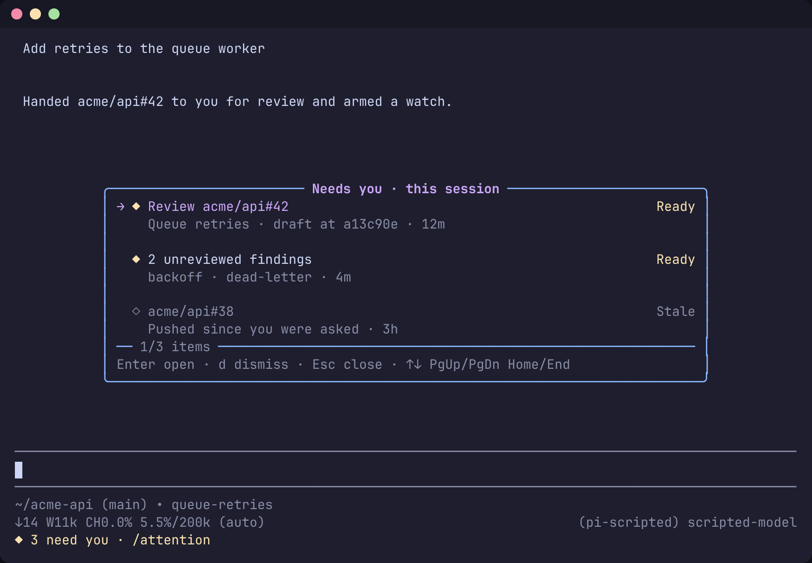

# pi-attention

Come back to a session and see what it has handed to you: a status hint in the
footer while anything is owed, and `/attention` to open, print or dismiss it.

## At a glance

- **You see** `◆ 3 need you · /attention` in the footer while the session owes
  you anything: a pull request handed off for review, findings to read. It
  clears when the last one resolves.
- **You type** `/attention` for the list. Enter opens the row's link in your
  browser, or prints the URL where there is no browser to open (over SSH, or
  without a display); a row without a link runs its producer's open action.
  `d` dismisses a row. Outside the terminal (bb, RPC hosts) the command prints
  the rows instead.
- **The agent calls** nothing here. Items come from the extensions that raise
  them, each through its own tool; pi-git's review handoff is the first planned
  (see the [attention roadmap](../../docs/roadmaps/2026-11-26-attention.md)).

## What counts

pi-attention reads the `attention` views other extensions publish on the
session's own bus (see [pi-surface](../../packages/pi-surface/README.md#attention))
and derives rows with `attentionRows`, so the terminal shows the same rows in
the same order as bb and the dashboard. It publishes nothing itself.

| Row      | Shown here | Why                                                                                     |
| -------- | :--------: | --------------------------------------------------------------------------------------- |
| **Owed** |     ●      | Something was handed off and the session moved on; it waits on you.                     |
| Blocking |            | An open question or a waiting dialog is already on screen as pi-ask's window, in focus. |

So the hint counts owed items only: the producers' totals, including items a
capped view leaves out (the list ends with "and 12 more"). Ready rows come
first, oldest first, then stale ones (dimmed, `◇`). A view whose model fails
is named in the list rather than counted.

The list follows its producers while it is open: a dismissal or a new item
updates it in place. Only an announcement from an `attention` view causes a
read, and a burst of announcements causes one.

## Opening links

Enter launches `open` (macOS), `explorer` (Windows) or `xdg-open` (Linux and
the BSDs, only when `DISPLAY` or `WAYLAND_DISPLAY` is set) with the URL as its
single argument: no shell reads it. Only `https:` links are opened. When there
is no opener, or it fails, the URL is printed instead.

## Not here

- Other sessions' items: `/attention` is per session, and the
  [dashboard](../pi-dashboard/README.md) is the view across sessions. The empty
  list does not point to `/dashboard`, since this session cannot tell whether
  the dashboard has other sessions' items without a new request.
- Items the agent raises on its own, with no domain tool behind them: the
  roadmap's `attention_raise`, for later.

## Configuration

None.
