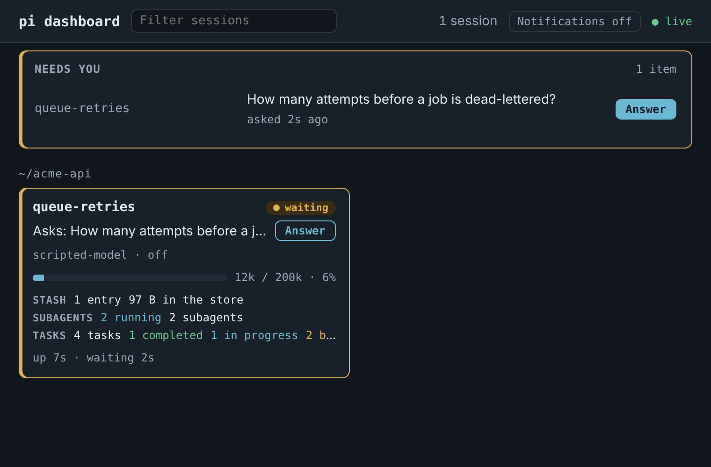
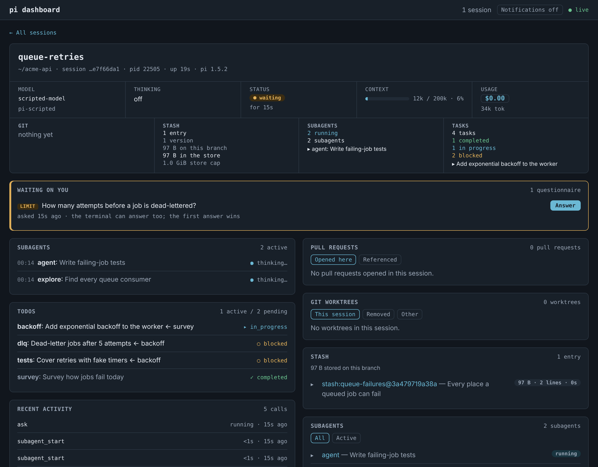

# pi-dashboard

A local web page of every running Pi session, grouped by working directory and
updated live. See at a glance which sessions wait on you, what each is doing,
and answer its questions from the browser.



## At a glance

- **You type** `/dashboard` in any session to open `http://127.0.0.1:7317/`.
  The first interactive session starts the dashboard; it stops on its own 15
  seconds after the last session exits.
- **The index** shows one card per session: name, status (sessions waiting on
  you sort first), model, context use, and each extension's counts. A filter
  box and opt-in browser notifications (a session starts waiting or finishes)
  sit at the top.
- **A session's page** shows its live widgets and recent tool calls on the
  left and everything it keeps (tasks and their history, subagents, stash
  entries, worktrees, pull requests) on the right. Open any item for details.
- **Answer** a question the agent asked with pi-ask from the card or the
  **Waiting on you** panel; the terminal's window closes when you do.
- **Focus** jumps to the session's pane in cmux.



Only interactive terminal sessions are listed; print-mode runs, RPC hosts and
subagents are not. It listens on loopback only.

## What the page shows

Everything the page shows is a session's [pi-surface](../../packages/pi-surface/README.md)
views, collected by the reporter into one complete snapshot per update. Each
snapshot replaces the previous one, so a view an extension removes disappears
from the page. The page has one renderer per view kind and knows no extension:

- **session**: `system.session` from
  [pi-system-insights](../pi-system-insights/README.md): name (or
  `untitled …<id>`), directory, model and thinking level, context usage,
  status (`idle`, `working`, `tool: <name>`, `compacting`, or `waiting` when
  Pi is blocked on a dialog), recent tool calls and usage for the whole session
  file. Waiting sessions sort first and get a highlighted edge.
- **summary**: each extension's counts as toned chips, its active item and a
  profile such as the main agent's (`agent · <profile>` on the card). Cards
  show the non-zero counts; the detail header shows all of them.
- **widget**: the extension's heading and rows, as the terminal draws them.
- **explorer**: items with badges, tabs, notices and marks. Opening an item
  runs the explorer's `onOpen`, clears its mark through the marker's `onClear`
  (as the terminal does) and loads its detail through `loadDetail`, such as a
  task's history or a stash entry's first lines. The marker's button (its
  `clearAction`, e.g. "mark reviewed") clears every mark.
- **detail**: a standalone detail view.
- **form**: open questionnaires; see [Answering questions](#answering-questions).

A view whose provider failed or was too large to send shows as its error,
without affecting the others. Without pi-system-insights (or with its view
failing) a card is titled by its process id, says why session information is
missing, and keeps its other views and Focus.

Click a card for its detail page (`#<pid>`):

- **Header**: directory, profile, session id, pid, uptime and Pi version, and
  **Focus**.
- **Strip**: model and provider, thinking level, status and how long it has
  held, context usage, and usage: the session cost as a button, with total
  tokens under it. The button opens input, output, cache read, cache write and
  total tokens and the cost for the whole session file, matching `/session`,
  in an overlay that stays live; Esc, the × button or a click outside closes it.
  Below it, every summary.

Below the header, two even columns: what the session is doing now (widgets and
recent activity) on the left, and the records it keeps (explorers and details)
on the right. When one side has nothing to show, its panels are split across
both. Long lists fold behind one row (`▸ 32 more tasks`); a fold or item you
open stays open across live updates.

The index has a filter box (every word must match the name, directory,
profile, model or status) and a **Notifications** toggle. With notifications
on, the browser notifies you when a session starts waiting on a dialog, or
finishes its work and goes idle, while the dashboard tab is open but not
focused. Clicking a notification opens that session. The filter and toggle are
remembered per browser.

`/dashboard` shows the URL and opens it in your browser. Outside the terminal UI (an app that runs Pi over RPC, say) it only shows the URL, as a displayed message; that session is not listed.

## Focus

In cmux, **Focus** runs `cmux focus-panel --panel "$CMUX_PANEL_ID"`, which
selects the session's workspace, surface and tab, then `open -b
"$CMUX_BUNDLE_ID"` on macOS to bring cmux in front of the browser. It runs
inside the Pi process (the hub forwards the click over the session's socket),
because the cmux CLI authenticates with the socket capability cmux put in that
process's environment. `CMUX_BUNDLED_CLI_PATH` is preferred over `cmux` on
`PATH`. Sessions outside cmux show no Focus button; other terminals can be
added as adapters in `src/terminal.ts`.

## Answering questions

When the session's model asks you something with the bundled
[pi-ask](../pi-ask/README.md) `ask` tool, pi-ask publishes the questionnaire as
its `ask.questions` form view. The card says `Asks: <question>` with an
**Answer** button, and the detail page shows a **Waiting on you** panel. Answer
opens a form with every question: one option or your own text for
single-select questions, any options plus optional text for multi-select ones,
and an optional note for the whole answer. **Send answer** runs the
questionnaire's `submit` action with the answer; **Decline** runs its `cancel`
action, as Esc does in the terminal.

The terminal window stays open meanwhile, and the first answer wins: an answer
from the page closes the terminal's questionnaire. If you answer in the
terminal first, the form says so and stops accepting input. Closing the form
keeps your draft until the question is answered. pi-ask validates every answer
strictly: one that does not fit is refused with pi-ask's reason and the
question stays open.

While the hub has the session, the reporter advertises the dashboard as a form
consumer on the session's bus (pi-surface's `advertiseFormConsumer`), and
withdraws it when the connection closes. In the terminal pi-ask shows its own
questionnaire as well; the advertisement matters to sessions without one.

With notifications on, a new question notifies you with its text.

## Views and actions

| What              | Source                                                                                        |
| ----------------- | --------------------------------------------------------------------------------------------- |
| Session           | pi-system-insights' `system.session` view                                                     |
| Counts, profile   | `*.summary` views (pi-todo, pi-subagent, pi-stash, pi-git, …)                                 |
| Lists and details | widget, explorer and detail views; details load through the explorer's `loadDetail` action    |
| Questions         | pi-ask's `ask.questions` form view; answers through its questionnaires' `submit` and `cancel` |
| Focus             | the reporter's terminal adapter, sent as host metadata beside the views                       |

The reporter collects with pi-surface's `collectDelivery` within the hub's
1 MiB line limit, measured in UTF-8 bytes: a view over 256 KB, or the largest
views when the snapshot would not fit, are sent as errors instead, and the
session says so once. Content an action returns, such as stash content or task
history, is never part of the live session list; it is fetched when you open
an item and returned only to the page that asked.

## How it works

- Every interactive (TUI) Pi session runs a small reporter. Print, JSON and RPC
  runs are not shown, and neither are subagent children, which run in print
  mode. One process reports at most one session.
- The reporter connects to a hub over a unix socket at
  `~/.pi/agent/dashboard/hub.sock`. If nothing answers, it starts the hub as a
  detached Node process (output in `~/.pi/agent/dashboard/hub.log`). Binding the
  socket is the lock, so concurrent sessions start exactly one hub.
- An open connection means a live session: a session that quits or crashes
  leaves the page at once. `/new`, `/resume`, `/fork` and `/reload` keep the
  card while the runtime restarts, settled with pi-surface's `settleSnapshot`:
  running state reads stopped, forms are gone, item actions are removed, and
  the hub refuses every request for the session until the new runtime connects.
- Reporter and hub speak protocol 7. The hub answers a hello with `welcome`. A
  reporter with a newer protocol makes the hub exit so that reporter can start
  its own; an older or malformed hello gets an explicit `refused` with the
  reason (logged in the hub log, and shown once in that Pi session), and its
  connection is closed.
- The hub exits 15 seconds after the last session disconnects and starts again
  with the next session.
- View changes are batched (pi-surface's `batchViews`) into at most one
  complete snapshot every 250 ms per session, pushed to the page with
  server-sent events. Streaming tokens are never sent.

macOS and Linux only (the hub uses a unix socket). The hub runs outside Pi
under plain Node, which strips TypeScript types. It uses Pi's own Node binary;
when Pi is a compiled (Bun) build it falls back to `node` on `PATH` (Node 22.18
or newer).

## Configuration

`~/.pi/agent/dashboard.json` (global only, since one hub serves every project):

```json
{ "port": 7317, "node": "/opt/homebrew/bin/node" }
```

- `port`: loopback HTTP port. If it is taken, the hub keeps retrying and
  `/dashboard` says so.
- `node`: Node binary for the hub; defaults to Pi's runtime.

A port change takes effect when the hub next starts (after every session exits).

## Security

The hub listens on `127.0.0.1` only and rejects requests whose `Host` header is
not `127.0.0.1:<port>` or `localhost:<port>`, which blocks DNS-rebinding pages.
The socket lives in a `0700` directory. The live session list carries what the
session's views show: directories, session names, model names, dialog titles,
task text, subagent descriptions, stash entry names, worktree paths and
branches, pull request titles and links, open questions, and recent tool calls
(including the first line of bash commands, clipped to 80 characters). It
carries no transcript or stash content.

Requests the page makes of a session (`POST /api/sessions/<id>/focus` and
`POST /api/sessions/<id>/actions` with `{ action, args }`) require a random
per-hub token that is embedded in the page and sent as `X-Dashboard-Token`, and
an `Origin` of the dashboard itself when the browser sends one. Other sites
cannot read the page to learn the token. The hub runs only an action that one
of the session's current views references (an explorer's `onOpen`,
`loadDetail` or marker `onClear`, a questionnaire's `submit` or `cancel`), so
the page can do what the views offer and nothing else, and only while the
session is live. The body is JSON of at most 64 KB. The hub accepts a result
only from the connection of the session it asked, and returns it to that
request alone. Stash previews are read by pi-stash itself and capped; stashed
text can hold secrets from tool output, and a preview shows what is stored.

Answering a question is the one request that changes what a session does
beyond review marks. It can only answer a questionnaire that is open and
waiting on you, and pi-ask checks the answer strictly.

## Planned

Answering other waiting dialogs, then abort and compact. The original
[plan](docs/plan.md) is kept for its research; it predates the move to views.

## Code layout

The reporter knows no extension: it collects the session's views and runs the
actions they reference, through pi-surface. The hub and protocol import only
pi-surface, which has no Pi imports. Typechecking also checks the hub and protocol separately with
`tsconfig.hub.json` so plain Node's erasable-syntax requirement stays enforced.
