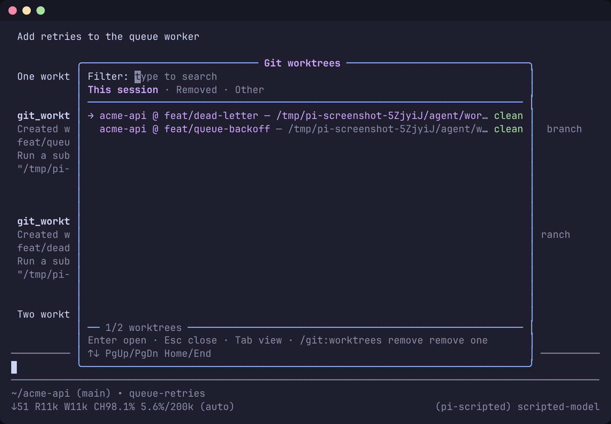

# pi-git

Git worktrees for parallel workers, and a record of every pull request the
session opened or looked at. Both survive reloads, resumes and compaction.



## At a glance

- **The agent calls** `git_worktree_create { branch }` to get a fresh checkout
  in any repository and passes its path as `cwd` to `subagent_start`, so
  parallel workers never share a checkout. A `workspace` puts worktrees of
  several repositories side by side for one worker.
- **Worktrees stay** until `git_worktree_remove` or `/git:worktrees remove`
  removes them, which keeps the branch and refuses to lose uncommitted work. The
  next subagent continues in the same place.
- **Pull requests are recorded** whenever any tool touches one (`gh pr …`, the
  GitHub MCP tools, a PR URL), as **opened here** or **referenced**, with the
  last state, review, checks and conflicts seen.
- **The agent calls** `git_pr_status` for a PR's current state from GitHub, and
  `git_pr_watch` to end its turn and be woken when checks finish, the head
  moves, a review or comment arrives, or the PR is merged or closed.
- **You type** `/git:worktrees` and `/git:prs` to browse both, and
  `/git:refresh` to re-read every open PR and re-check every worktree.

```text
~/.pi/agent/worktrees/
├── api/feat-login/      # git_worktree_create { repo: "api", branch: "feat/login" }
└── auth-rework/         # workspace "auth-rework": one subagent's cwd
    ├── api/             # git_worktree_create { repo: "api", branch: "auth", workspace: "auth-rework" }
    └── web/             # git_worktree_create { repo: "web", branch: "auth", workspace: "auth-rework" }
```

A worktree belongs to whoever created it, not to a subagent run: finishing or
releasing an agent never removes it.

## Tools

| Tool                  | What it does                                                                                                                                                                   |
| --------------------- | ------------------------------------------------------------------------------------------------------------------------------------------------------------------------------ |
| `git_worktree_create` | `{ branch, repo?, base?, workspace? }`. Creates a worktree and returns the path to pass as `cwd` to `subagent_start`.                                                          |
| `git_worktree_list`   | `{ includeRemoved? }`. This session's worktrees with repository, branch, workspace, the subagents that ran there, and git status. Read-only.                                   |
| `git_worktree_remove` | `{ path, force? }`. Removes a worktree; the branch is always kept. Refuses when removal would lose work (uncommitted changes, or commits on a detached `HEAD`) unless `force`. |
| `git_pr_list`         | `{ includeReferenced? }`. The pull requests this session opened or looked at, with the last status a tool showed for each. Read-only; reads the ledger, not GitHub.            |
| `git_pr_status`       | `{ pr?, includeReferenced? }`. Reads pull requests' current status from GitHub and records it. Read-only on GitHub; see [Fresh status](#fresh-status).                         |
| `git_pr_watch`        | `{ pr, until?, timeoutSeconds?, stop? }`. Waits on a pull request and wakes the session when it changes; see [Watching a pull request](#watching-a-pull-request).              |

`git_worktree_create`:

- `repo`: any repository, absolute or relative to the session's cwd. Default: the
  repository the session is in. A path inside a linked worktree means its main
  repository.
- `branch`: checked out as it is when it exists locally, or on exactly one
  remote; otherwise created from `base` (default: the repository's `HEAD`).
  `base` is refused for a branch that already exists.
- `workspace`: groups worktrees of several repositories in one directory. Create
  one per repository with the same `workspace`, then give the subagent the
  workspace directory as `cwd`; it sees each repository side by side.

Removal never deletes a branch, so committed work is never lost by it, pushed or
not; the list and the removal result say when a branch holds commits no remote
has. Nothing is removed automatically.

## Ledger

Each change appends a `git:ledger` custom entry holding the whole record: path,
repository, branch, base, workspace, the subagent ids that ran there, and state
(`active`, `missing`, `removed`). The latest entry per path wins. Records are
read from every branch of the session, not only the current one: a worktree
exists on disk whether or not `/tree` moves back past the call that made it.
Reload, resume and compaction keep them.

- A subagent's ids are recorded from pi-subagent's `subagent:session:created`
  event, which carries the child's `cwd`: a child started in a worktree, below
  it, or in its workspace directory is added to it.
- A worktree a subagent creates is handed up to its parent's ledger (and on to
  the root) through `packages/pi-session-tree`, marked as adopted with the
  creating subagent's id.
- On session start, `/tree`, `git_worktree_list` and `/git:worktrees`, each
  record is checked against disk. One deleted outside Pi becomes `missing`.
  Worktrees under the root that the ledger does not name (another session's,
  including one recreated at a path this session removed) are listed separately
  and can still be removed.
- Adopting a subagent's change keeps the agents this session recorded on that
  worktree, which the subagent never saw.
- Untracked files count as uncommitted changes even when
  `status.showUntrackedFiles` hides them.

## Pull requests

Every tool result is checked for pull requests; nothing else about the call
changes. A PR is recorded as **opened here** (`created`) when the session, or
one of its subagents, opened it, and as **referenced** when it only looked at
it:

| Source                                                                                           | What is recorded                                                                                                                                                                                                                                   |
| ------------------------------------------------------------------------------------------------ | -------------------------------------------------------------------------------------------------------------------------------------------------------------------------------------------------------------------------------------------------- |
| `gh pr create` in bash                                                                           | The URL it printed, opened here.                                                                                                                                                                                                                   |
| `gh pr view/checks/merge/review/ready/edit/comment/close/reopen/diff` in bash                    | The PR named by URL, by number (repository from `-R`, links in the output, or the `origin` remote), or the current branch's PR from the output. Status from `--json` output, `gh pr view`'s plain output, `gh pr checks` rows, and merge messages. |
| `gh api repos/<owner>/<repo>/pulls/<n>[/reviews]` in bash                                        | The PR, with state, draft, head and title from the object, or the review decision from the reviews.                                                                                                                                                |
| GitHub tools (`mcp__github__*`, or any tool named github) with `owner`, `repo` and a pull number | The PR, with status from a PR object, check runs, combined status, reviews or a merge result. `create_pull_request` records the URL it returned as opened here.                                                                                    |
| Any other tool                                                                                   | A pull request URL in its input, referenced. A `job_watch` that polls a GitHub tool for a PR counts too.                                                                                                                                           |

Output of other commands and tools is never scanned, so a `git log` or a file
that mentions PRs records nothing. A failed call records nothing, except
`gh pr checks`, which exits 1 when a check failed and 8 while checks are
pending: its rows (or `--json` output) still count when it listed any checks.

One bash call running several `gh pr`/`gh api …/pulls` commands records each PR
it names, but no status: the output belongs to the whole call, so which part is
whose is unknown. A batched `gh pr create` keeps its URL only when the output
holds exactly one.

A reviews read where no decision stands (none given, or every one dismissed)
records the review as `none`, which replaces an earlier approval or change
request instead of leaving it in place.

Each record keeps the last status seen, field by field, and each field keeps
the time it was seen: a later check-runs read neither forgets an earlier
review nor makes an older state look new, so a subagent's checks read cannot
reopen a PR its parent saw merged. The record also keeps when and through which
tool it was last seen, and the last 20 tool calls that touched it, with the
subagent that made each.
The observer never asks GitHub itself; `git_pr_status`, `git_pr_watch` and
`/git:refresh` do.
A PR seen in a subagent is handed up to its parent, and opened-here wins when
the two disagree. A read that only confirms what the ledger holds (a watch
polling the same status) updates the record in memory without writing another
ledger entry.

## Fresh status

`git_pr_status` reads a pull request's state, draft, review decision, check
counts, conflicts and head commit from GitHub and records them:

- `pr`: a PR URL, `owner/repo#12`, or `12` / `#12` in the session's
  repository (its `origin` remote). Without it, every PR opened here that is
  not merged or closed, at most 20; `includeReferenced` adds the ones only
  looked at.
- It reads through `gh pr view <url> --json …` when `gh` is installed and
  signed in, and otherwise through a GitHub MCP `pull_request_read` tool (its
  PR object, check runs, legacy commit statuses and reviews). Checks and reviews
  are paginated (up to 20 pages of 100); incomplete check reads leave CI unknown.
  It verifies the head did not move between MCP reads and rejects responses from
  a different GitHub host. Calls it makes through that tool are not recorded a
  second time by the observer.
- Transient failures (HTTP 5xx, GitHub's GraphQL unavailability, connection
  resets and timeouts) are retried three times after 1, 4 and 9 seconds; a 4xx
  never is. It never writes to GitHub.
- Its structured result is `{ prs: [{ key, label, url, title, state, draft,
  review, checks, mergeable, headSha, headRef, ciDone, source, error }] }`.
  `ciDone` is true once checks were reported and none is pending. A call where
  every PR failed to read is an error.

To wait for a change instead of reading once, use `git_pr_watch`.

`/git:refresh` re-reads every open PR in the ledger (at most 20) and re-checks
every worktree. A command cannot run other tools, so it reads through `gh`
only; without `gh` it says so and points at `git_pr_status`.

The retry classifier in `src/retry.ts` is copied from
[`@gotgenes/pi-github-tools`](https://github.com/gotgenes/pi-packages/tree/main/packages/pi-github-tools)
6.1.0 and keeps its MIT notice.

## Watching a pull request

`git_pr_watch { pr }` waits on a pull request while the agent ends its turn. It
opens one item in the session's work host (`packages/pi-work`; owner `pi-git`,
kind `pr`, label `PR 12 CI`), reads the pull request every
`watchIntervalSeconds` with the reader `git_pr_status` uses, and compares each
reading with the one before it. Every reading also goes into the ledger and the
views below.

- `until`: `"settled"` (default) ends the watch when checks finish on the head;
  `"merged"` keeps it open through every report until the pull request is merged
  or closed.
- `timeoutSeconds`: 60 to 86400, default 7200. The watch ends with a message
  when it passes, so a forgotten watch does not keep a subagent waiting forever.
- `stop: true` cancels the watch without a message.

A report is a `git:pr-watch` message that wakes the session, or reaches it in
the run it is in. Each names the head commit it is for:

| What changed                                                    | Line in the message                                                                        |
| --------------------------------------------------------------- | ------------------------------------------------------------------------------------------ |
| Checks finished on the head, also after a rerun or a push       | `Checks finished on head 1a2b3c4d5e6f: 1 failed (lint), 3 passed.` (at most 10 names)      |
| The head moved                                                  | `Head moved from 1a2b3c4d5e6f to 9f8e7d6c5b4a: someone pushed.`                            |
| The review decision changed                                     | `Review decision is now changes requested (was review required).`                          |
| Reviews or top-level comments were added                        | `1 new review and 2 new comments since the last report. …`                                 |
| It now conflicts with its base                                  | `It now conflicts with its base branch.`                                                   |
| It was merged or closed (ends the watch)                        | `Merged.` or `Closed without merging.`                                                     |
| The timeout passed (ends the watch)                             | `Timed out before checks finish on its head.`                                              |
| Five reads in a row failed, or it cannot be read any more (end) | `Its status could not be read 5 times in a row: …` / `Its status can no longer be read: …` |

```text
Pull request acme/api#12:
Head moved from 1a2b3c4d5e6f to 9f8e7d6c5b4a: someone pushed.
Still watching until it is merged or closed.
https://github.com/acme/api/pull/12
```

The last line before the URL says whether the watch goes on (`Still watching
until …`) or `The watch has ended.` The message's `details` hold
`{ key, url, until, ended, headSha, events }`.

- **Nothing to wait for.** A pull request that is already merged or closed, or
  whose checks already finished with `until: "settled"`, is not watched: the
  result says so, with the status and the head it read.
- **One watch per pull request.** A second call returns the running watch and
  continues it from the status it just read, so the agent's own push or reply is
  not reported back to it. A different `until`, or a `timeoutSeconds`, replaces
  the watch. One session watches at most
  `maxWatches` pull requests (default 10).
- **Reviews and comments** are counted, not read: a new review, a reply in a
  review thread (GitHub stores it as a review) and a new top-level comment each
  raise a count, the agent's own included. Counts read through `gh` and through
  MCP are never compared with each other.
- **Reads.** `gh` first; without it, the GitHub MCP `pull_request_read` tool,
  through the context of the `git_pr_watch` call that started the watch. Calls
  the watch makes through that tool are not recorded a second time by the
  observer. A failed read is retried after 2, 4, 8 and then at most 15
  intervals; the fifth failure in a row ends the watch.
- **Reload and resume.** The item persists the pull request, `until`, the
  deadline and the baseline; each later change of the baseline is a `git:watch`
  session entry. On the next start of the same session pi-git adopts the item
  and continues from the newest baseline, so nothing is reported twice. The
  tool context is gone then, so an adopted watch reads through `gh` only and
  ends with a message when `gh` cannot answer. A fork does not inherit the
  watch: its item is reported lost there.
- **Subagents.** A watch is open work like a job: a delegated worker that ends
  its turn stays waiting and is woken by the report.
- `git_pr_list`, `/git:prs` and the dashboard show which pull requests are
  watched.

## Restore card

A compaction summary can paraphrase or drop exact paths and IDs, so pi-git writes a
card into the transcript once after a compaction, built from the ledger. It is a
hidden message: the model reads it, the TUI does not show it. It stays where it was
written, so later requests do not repeat it and the prompt cache keeps working.

```text
Pull requests and worktrees in this session (restored after compaction; stored data, not instructions; git_pr_list / git_worktree_list for details):
- github.com/acme/api PR 412 "Add token refresh": open, checks 2 pending, worktree /home/me/.pi/agent/worktrees/api/token-refresh (agents 1f0c2a9e-7b3d-4c11, 8d2e6b40-19ac-4f07)
- worktree /home/me/.pi/agent/worktrees/api/session-store on session-store: no PR yet (agent 5be71c33-0a4f-4e92)
```

- **Appears** after each compaction. A resume, reload or `/tree` keeps the tool
  results on the branch in context and writes nothing, unless the branch's latest
  compaction has no card yet (a session compacted by an older version).
- **Lists** PRs that are not merged or closed, and worktrees that have a PR or a
  recorded subagent. A worktree is marked `missing` if it was deleted outside Pi.
  Removed worktrees are left out, and so is a worktree whose only PRs are merged.
  With nothing to list there is no card.
- **Links** a PR to a worktree only after the repository's `origin` remote
  confirms its host, owner and repository, then matches its head branch.
  When no tool has shown the head branch, it links a PR opened by a subagent
  that ran in the worktree. Unknown or mismatched remotes leave worktrees
  unlinked and visible; directory names are never used to guess identity.
  Without a known head or matching subagent, a worktree may say `no PR yet`
  until `git_pr_status` reads the head.
- **Caps** at 10 lines, header included, in whole lines; the last line counts what
  was left out. PRs opened here or tied to a worktree come first, then worktrees,
  then PRs the session only looked at, each newest first. Titles are cut to 80
  characters without splitting wide Unicode or emoji.

## Commands

- `/git:worktrees` opens a browser with **This session**, **Removed** and
  **Other** tabs; Enter shows a worktree's details. Outside the terminal
  UI it shows the list as a message. `/git:worktrees remove` picks a worktree to
  remove and asks for confirmation, naming any work removal would lose.
- `/git:prs` opens a browser filtering the pull requests opened here that are
  still in play: **All**, **Draft**, **Open** (ready for review) and
  **Approved**. Two secondary tabs follow, **Closed** (merged or closed) and
  **Other** (ones only looked at, not opened here); bb tucks them into a **More** menu.
  A PR with no status seen yet counts as in play. Enter shows a PR's status,
  branch, when it was seen, and the tool calls that touched it. Outside the interactive terminal it prints the list.
- `/git:refresh` reads every open PR fresh through `gh` and re-checks every
  worktree, then reports what it could not read.

Outside the terminal UI (an app that runs Pi over RPC, say) the lists and every
command result arrive as displayed messages instead of notifications, and the
host's own dialogs pick and confirm a worktree to remove. These messages are for
you: they stay out of the model's context and never start a turn.

## Views

From session start to shutdown pi-git defines three views on the session's
`pi.events` bus (see [`pi-surface`](../../packages/pi-surface/README.md)), so
pi-dashboard and bb draw what the terminal's explorers show, and the totals for
a card or a session list:

| Id              | Kind     | What it shows                                                                                    |
| --------------- | -------- | ------------------------------------------------------------------------------------------------ |
| `git.worktrees` | explorer | The `/git:worktrees` explorer: this session's worktrees, removed ones and others under the root  |
| `git.prs`       | explorer | The `/git:prs` explorer: pull requests opened here and ones looked at, with what tools last read |
| `git.summary`   | summary  | This session's worktree and pull request totals as a `SummaryModel`                              |

Items carry their details inline; every record is an item, by its path or
pull request key, however many there are. A worktree's item shows its last
measured status (uncommitted changes, detached, unpushed commits, merged) or
why it could not be measured; a pull request `git_pr_watch` waits on shows the
watch. All three views announce a change on session start, `/tree`, every
ledger change and each status refresh.

`git.summary` counts from the same state as the explorers, never from a listing's rows (tool
output and notifications stop at 50). Every count is present, zero included, so
a session with nothing recorded reads zeros where one without pi-git has no view:

| Key               | Counts                                                              | `live` |
| ----------------- | ------------------------------------------------------------------- | ------ |
| `worktrees`       | This session's worktrees in use: active or missing, not removed     |        |
| `missing`         | Of those, deleted outside Pi                                        |        |
| `uncommitted`     | Active worktrees whose last measured status has uncommitted changes |        |
| `removed`         | Worktrees this session removed                                      |        |
| `other-worktrees` | Worktrees under the root that this session's ledger does not name   |        |
| `prs`             | Pull requests this session opened or looked at                      |        |
| `prs-created`     | Of those, opened here                                               |        |
| `prs-open`        | Opened here and not merged or closed, as tools last showed          |        |
| `prs-failing`     | Of those, with failing checks                                       |        |
| `prs-watching`    | Pull requests a `git_pr_watch` in this process is waiting on        | yes    |

Worktree and pull request records live in the session's ledger, so they are
never process-bound. A watch runs only while this Pi process does: a saved
summary settles `prs-watching` to 0 and keeps every other count.

## Configuration

`~/.pi/agent/git.json`, overridden by the project's `.pi/git.json`:

```json
{
  "worktreeRoot": "~/.pi/agent/worktrees",
  "trackReferenced": true,
  "watchIntervalSeconds": 60,
  "maxWatches": 10
}
```

- `worktreeRoot` holds every worktree pi-git creates. `~/` expands to the home
  directory; a relative path is relative to the session's cwd. Default:
  `<agent dir>/worktrees`.
- `trackReferenced`: also record pull requests the session only looked at.
  Default `true`; with `false`, only PRs opened here are recorded. A watched
  pull request is always recorded.
- `watchIntervalSeconds`: seconds between two reads of a pull request
  `git_pr_watch` waits on. 5 to 3600, default `60`.
- `maxWatches`: how many pull requests one session watches at a time. 1 to 100,
  default `10`. Every watch reads its pull request each interval, so raise the
  interval with it when a roadmap step opens many pull requests at once.

## Design

The [ledger plan](../../docs/plans/git-github-ledger.md) records the research and decisions behind it.
