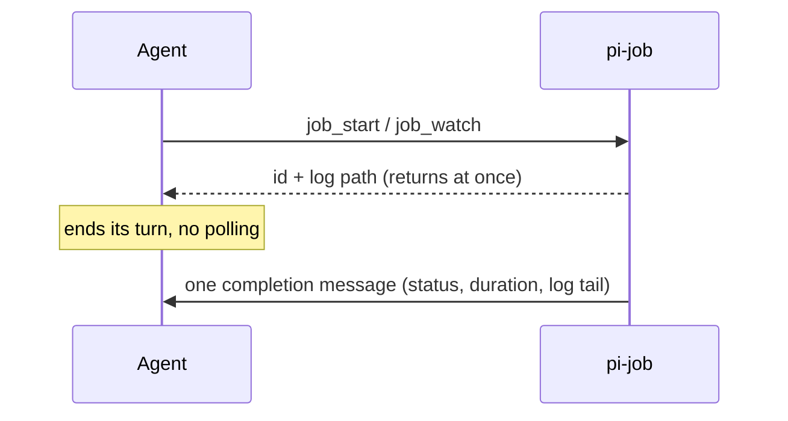

# pi-job

Background shell jobs and watches for pi that wake the agent when they finish.

[](LICENSE) [](https://www.npmjs.com/package/@woksin/pi-jobs) [](https://github.com/woksin/pi-jobs/actions/workflows/ci.yml)

Long waits (CI runs, long builds, "poll until X") run outside the model at zero token cost. The agent starts the job, ends its turn, and gets one concise message when it is done.



## Why

- Polling CI from the model burns tokens on every check and fills the context.
- A foreground wait blocks the session.
- Several jobs finishing together should start one run, not many.

## Features

- `job_start` runs a command under a supervisor in its own process group, with a log file.
- `job_watch` re-runs a check until it succeeds, fails or changes (`until`).
- Every job and watch is an item in the session's work host; its completion is one message with a bounded log tail. Completions that arrive together are answered by one run.
- `job_list`, `job_read` and `job_kill`, plus `/job` and `/job kill <id>` for you.
- Logs are capped at 50 MB and old logs are cleaned up after 7 days.
- Jobs survive `/reload`. After a restart the jobs that were still open are reported as lost.

## Install

Add the npm source to `packages` in your Pi settings:

```json
{
  "packages": ["npm:@woksin/pi-jobs"]
}
```

Or use `pi install npm:@woksin/pi-jobs`. Git and local checkouts work too:

```sh
pi install git:github.com/woksin/pi-jobs
pi install /path/to/pi-jobs
```

Restart Pi or run `/reload` after changing settings. Requires a POSIX system with Bash;
Windows is not supported. Tested with Pi 1.3.0. The host dependency uses `"*"` as recommended
for Pi packages: Pi supplies its own runtime and suppresses automatic peer installation
for managed packages. Other runtime versions are not guaranteed.

## Usage

Ask the agent to run a long command with `job_start` or wait for a condition with `job_watch`.
It should end its turn instead of polling, then continue when the completion message arrives.
Use `/job` to see session jobs or `/job kill j1` to stop one. Commands run with your user
permissions and inherited environment; only run commands you trust. Logs can contain
sensitive output, so do not publish them.

## Tools

| Tool                                                                                               | Purpose                                                                                                                              |
| -------------------------------------------------------------------------------------------------- | ------------------------------------------------------------------------------------------------------------------------------------ |
| `job_start { command, timeoutSeconds, cwd?, label? }`                                              | Run `bash -c <command>` under a supervisor in its own process group; stdout+stderr → log file. Returns at once with id and log path. |
| `job_watch { check, intervalSeconds, timeoutSeconds, until?, checkTimeoutSeconds?, cwd?, label? }` | Re-run `check` every `intervalSeconds` until the condition holds or `timeoutSeconds` passes.                                         |
| `job_list {}`                                                                                      | Running and recent jobs of this session.                                                                                             |
| `job_read { id, tailLines? }`                                                                      | Bounded log tail (default 40, max 200 lines, max 16 KB).                                                                             |
| `job_kill { id }`                                                                                  | SIGTERM the job's process group, SIGKILL after 5 s; returns the final state.                                                         |
| `/job`, `/job kill <id>`                                                                           | User command: list / stop.                                                                                                           |

The model is told: start the job, **end the turn**, do not poll.

### `until` (job_watch)

- `success` (default): a check exits 0.
- `failure`: a check exits non-zero or dies by a signal.
- `change`: exit code or complete output differs from the first conclusive check. Compared
  by SHA-256 of the full stdout and stderr streams (exact bytes, independent of the 64 KB
  display tail; output with timestamps always "changes", so keep checks deterministic).

A check that exceeds `checkTimeoutSeconds` (default `min(120, timeoutSeconds)`) has its process
group killed and counts as **inconclusive**: it never matches, never sets the `change`
baseline, and the watch continues. The interval is measured from the end of one check to the
start of the next. Prefer `job_start` with a native blocking watcher where one exists.

### CI

Watch an **immutable target**: `gh run watch <run-id> --exit-status`, or the checks of a
specific commit SHA. A PR number is a moving target: a push while you wait moves it to a newer
commit, and the result you are woken with may not describe the code you meant. The tool
descriptions tell the model the same.

## Completion message and delivery

**Contents.** Status, title (label or command), exit status, duration and log path, plus any
log truncation or log write error. Then the last 40 lines / 4 KB of output, with ANSI codes
stripped and `\r` redraws collapsed. Watches also report `until`, the check count, and the
status and output of the last completed check.

**One message per completion.** Each completion is its own message, so the output of one job
never shares a budget with another's. Completions that arrive together reach the model in one
request: the first wakes an idle session, the rest are appended to the run it starts.

**Terminal states.** `succeeded`, `failed` (non-zero exit or spawn failure), `timed_out`,
`matched` (watch) and `killed`. There is **no message** for jobs stopped by
`job_kill`/`/job kill` (the caller gets the final state synchronously; the item is cancelled) or by
non-reload session shutdown (nobody to wake; the item stays open, see [Restart](#restart-and-lost-work)).

### Guarantee

> A completion is a custom message in the session transcript, so **once sent it is never lost**:
> Escape and abort leave it in the transcript and force no turn, and the next run sees it. A
> completion that arrives while a run is active reaches the model **in that run**. Each model
> context contains **at most one full copy** of each completion id, for messages in the current
> indexed format; messages from older pi-job versions are only stubbed as a whole once all their ids
> were shown. This is **not exactly-once** on the idle path: pi has no atomic wake API (see
> [UPSTREAM-ISSUES.md](https://github.com/woksin/pi-jobs/blob/main/UPSTREAM-ISSUES.md)).
> A job that is still open when Pi restarts is not silently forgotten: the next start tells the
> model it was lost.

A completion that arrives mid-run is appended by pi at the end of the current turn. The host closes
the item only once the message is in the transcript, so if pi dies in between, the item is still open
and the next start reports it lost. A job that ends while the session reloads, between pi-work's
shutdown handler and pi-job's, is completed through the re-adopted item once startup is over.

### How it works

pi-job does not deliver anything itself. `job_start` and `job_watch` open an item in the
session's work host ([`packages/pi-work`](../../packages/pi-work/README.md), `work:v1`); when the
job ends, pi-job completes the item with the completion message, and the host does the rest. It is
event-driven only: no timers, no polling, no queue of its own. Every completion is one
`pi.sendMessage(…)` call made by the host, and pi's run boundaries do the scheduling. `src/items.ts`
maps jobs to items; `src/delivery.ts` keeps the completion message type and `dedupeCompletions`.

| Situation when the job finishes                                      | What happens                                                                                                                                                                                                                                                                                                       |
| -------------------------------------------------------------------- | ------------------------------------------------------------------------------------------------------------------------------------------------------------------------------------------------------------------------------------------------------------------------------------------------------------------ |
| Session idle                                                         | `triggerTurn: true`: pi starts a run with the completion as its prompt.                                                                                                                                                                                                                                            |
| A run is active (`agent_start` … `agent_settled`)                    | `triggerTurn: false`, at once, one message per completion. Pi appends it at the end of the current turn, never between a tool call and its result. If another turn follows, the model sees it there. Otherwise the `agent_before_settle` handler returns `continue: true`: one more model request in the same run. |
| Escape or abort during the run                                       | Nothing to do. The message is in the transcript, no turn is forced, and the next run sees it.                                                                                                                                                                                                                      |
| pi busy without a run (manual compaction, branch summary on `/tree`) | `triggerTurn: false`: pi appends it at once. Nothing wakes the agent afterwards; the next run sees it.                                                                                                                                                                                                             |

After an error the handler does not continue the run either: another request would repeat the failure.

**Duplicates.** Each completion carries a random UUID (`details.completions[].completionId`)
and occupies its own content part (`details.completions[].part`). A model-context filter keeps
the first copy of each id. In later messages it removes already-shown completion blocks,
leaving a one-line note, and keeps the unseen ones. A message with nothing unseen becomes a
one-line stub. The stub keeps the message in place, so the context never ends on an assistant
message. Messages from older pi-job versions without part indices can only be stubbed as a
whole; those versions also batched several completions into one message and could resend one.
Job handles such as `j1` restart in every session and are never used for deduplication.

**Reload.** On `session_shutdown` with reason `reload`, the session's manager is retained in a
process-wide registry (version 4), together with the object that maps its jobs to items. Node
timers do not belong to the extension runtime: the single watch loop, check/interval/until
definition, change baseline and original deadline stay alive with it, as do command supervisors
and logs. The work host does not survive: the new extension instance provides another one, and
the items are persisted in the transcript. At `session_start` (`reload`) pi-job takes the manager
back and calls `adopt` on the host for each item it left open. An item is adopted only when it
belongs to this session (the session id and log path recorded in the item match a live job of the
retained manager), so a fork that inherited the records, or a job id reused in a later process,
never adopts a job. A job that ended while no host was reachable is completed through its adopted
item once every extension has started (`resources_discover`, with the first agent start as the
fallback), so nothing wakes the session while later extensions are initializing. Job ids are
unchanged; numbering advances past session history. No subprocess is relaunched and no second
watch loop is created.

A stale attached runtime proves an owner is gone: its jobs/watches are stopped and reported
with log paths. Another live session is never stopped; a pending reload handoff is unknown,
reported and kept for at most five minutes. An unref'd handoff timer then stops its jobs/watches
and logs the expiry if no replacement adopts it. A versioned registry and method checks reject
incompatible handoffs (including one from the previous pi-job version, which delivered its own
messages) and stop their work instead of adopting it; the UI names what was stopped, and any
open item of it comes back as lost. This is **same-process reload**, not restart/crash recovery.
Old versions that shut down jobs cannot hand them off: the replacement preserves id numbering.
In particular, upgrading an already-loaded pre-0.2 runtime cannot preserve its jobs: its old
shutdown handler runs before the updated extension loads, and those jobs have no item to report.

### Restart and lost work

A job that is still running when Pi quits or dies stays an open item in the transcript. The next
time that session starts (resume, restart, or a reload with no handoff), nobody adopts the item,
so the host closes it as **lost** and writes one `work:lost` message listing everything lost,
without starting a turn. The model sees it on its next run and the TUI shows a warning. Nothing is
restarted, and the loss is recorded, so the next start reports nothing again. The same message
reaches the model in every session, a subagent's included, where the old "not delivered" warning
went to a UI that does not exist. Jobs and watches of earlier versions have no item, so a restart
reports nothing for them.

**Unexpected stale context.** Outside the reload handoff, a throw from `sendMessage` is permanent
for the host: it stops delivering, reports the loss once, and retries nothing. Its items stay open
on disk and the next start reports them lost.

### Known pi-side limitations

These are documented in [UPSTREAM-ISSUES.md](https://github.com/woksin/pi-jobs/blob/main/UPSTREAM-ISSUES.md), with skipped reproductions
in `test/agent-session.test.ts`:

- A completion that arrives while a user prompt is still preparing can make that prompt fail
  with "Agent is already processing" (#1).
- A wake that fires while pi emits `agent_settled` is deferred, and can start its run inside a
  compaction that another extension started from its own `agent_settled` handler (#2).
- A completion that finishes while `/tree` summarizes a branch is appended to the branch that
  was current when it arrived. If the navigation then moves to another node, that branch is the
  one the user left, so the completion is in the session file but not in the new branch's context.
- A completion that arrives after the last `agent_before_settle` but before `agent_settled` is
  appended with no turn to follow; the next run sees it.

Upstream issues #3, #4 and #5 no longer affect pi-job: nothing is queued in pi's follow-up
queue, and nothing waits for a compaction or branch summary to end.

## Processes

- `bash -c`, not `bash -lc`: same non-login semantics and inherited environment (PATH, nvm,
  tokens) as pi's own `bash` tool; a login shell re-sources profiles (slow, can print noise,
  can change PATH). Use `bash -lc '…'` inside the command if you really need it. stdin is closed.
- **Supervisor and PGID safety.** Each job and each watch check runs under a tiny bash
  supervisor that leads its own process group. Node only ever signals a group whose leader it
  has not reaped, so the PGID cannot have been reused by an unrelated process (a PGID is the
  leader's pid, which stays allocated until it is reaped). The supervisor runs the command as
  a child, reports its exit status on a private pipe, then stops leftovers itself: SIGTERM to
  the group (it survives via a no-op trap), wait the grace period, SIGKILL to the group (which
  ends the supervisor too). So the group never outlives its leader, and the session stays
  registered for the exit hook until that cleanup is done.
- Timeout and kill send SIGTERM to the whole group, then SIGKILL after 5 s if the supervisor
  is still alive. Exit statuses come from bash, which reports death by signal `n` as `128+n`.
  A command can also exit with such a code on purpose, so the signal is shown as an inference:
  `exit 143 (likely SIGTERM)`. `signal SIGKILL` appears only when the supervisor itself was
  killed.
- When a job's main process exits, leftover background processes in its group are stopped
  too (a job cannot leave orphans; start daemons some other way).
- Output goes through pipes. Once the command's status is known, the job settles when the
  pipes close or after 1 s at most, then the pipes are destroyed: a descendant that escaped
  the group (`setsid`, double fork) and keeps stdout open cannot stall a job, a watch, a
  timeout or shutdown. Escaped processes themselves are out of reach by design.
- Non-reload session shutdown (quit, `/new`, resume, fork) stops all of the session's jobs
  (SIGTERM, ≤1.5 s, then SIGKILL). One process-wide `process.on("exit")` hook SIGKILLs
  anything left if pi exits without a shutdown event; a session is registered with it only
  while it owns running jobs or pending SIGKILLs (and until its shutdown has finished).
- A job whose log cannot be opened or whose spawn fails synchronously (e.g. a NUL byte) is
  rolled back and the tool call fails; it never occupies a slot.
- Non-reload shutdown also destroys every pipe and clears every timer.

## Limits

- `timeoutSeconds` 1–14400 (4 h), required. `intervalSeconds` 10–3600.
- Commands (`job_start`) and watches (`job_watch`) have separate caps per session: at most 8 running
  commands and 32 running watches; more of either → tool error. Watches only run a short check per
  interval, so they never take command slots. Override with `PI_JOBS_MAX_RUNNING` and
  `PI_JOBS_MAX_WATCHES` (positive integers; anything else falls back to the default).
  - A finished job's supervisor may stay alive for up to 5 s (the grace period) while it cleans
    up its group, and it is not counted.
  - During that window, leftover user processes that ignore SIGTERM can still run, until the
    SIGKILL at the end of the grace period.
  - This is bounded: one supervisor per finished job or check, at most 5 s each.
  - Counting it would make every completion block a new job for 5 s.
- Tool schemas encode the bounds, so pi rejects out-of-range arguments before the tool runs.
  `checkTimeoutSeconds` defaults to `min(120, timeoutSeconds)`; `tailLines` is an integer from
  1 to 200.
- Each job's log is capped at **50 MB**: after that, output is discarded with a truncation
  marker in the log and a note in the completion message; the job keeps running. Log write
  errors (e.g. disk full) are reported in the completion message.
- Output tails read at most the last N bytes of the log; logs are never loaded whole, and the
  byte cap holds after decoding (invalid UTF-8 cannot inflate it). A watch keeps at most
  64 KB of one check's output in memory, even when the check writes larger chunks.
- The 50 most recent finished jobs are kept for `job_list`/`job_read`; state is in memory
  only (retained across same-process reload, not restored after restart/resume; a restart
  reports the jobs that were still open as lost).

## Logs

`$PI_JOBS_DIR` or `~/.pi/agent/jobs/<YYYY-MM-DD>/<HHMMSS>-<session tag>-<id>.log`. Watch logs
contain every check with a `--- check N · time · status ---` header. On each session start,
`*.log` files older than 7 days in those day directories are deleted and emptied day
directories removed; nothing else is touched. Symlinked day directories and files are
skipped, and every path must resolve inside the log root.

## Subagents and print mode

Each extension instance (main session, each subagent session) has its own JobManager: ids,
jobs and notifications are per session. A job started by a subagent wakes that subagent; if
the subagent session has already ended, its jobs were stopped at its shutdown (or, if the host
disposes it without a shutdown event, a later session start stops and reports its jobs once
the runtime is provably stale; otherwise they run to timeout and the message is dropped —
the exit hook still kills them when pi exits). Do not hand a subagent's job id to the parent.
Completions and lost-work messages reach a subagent through its own work host, as in the main
session.

In print mode (`pi -p`) the run ends when the agent goes idle and the shutdown kills running
jobs, so a wake-up cannot happen there; use interactive or RPC mode.

## Development

Requires Node.js 22.19 or newer for native TypeScript stripping; no compilation is required.

```sh
npm test   # node --test, real processes and a real AgentSession, ~10 s
```

`src/extension.ts` is the only pi-aware module and uses type-only pi imports; `jobs.ts`,
`supervisor.ts`, `delivery.ts`, `items.ts`, `logwriter.ts`, `tail.ts`, `watch.ts`,
`format.ts`, `logs.ts` are plain Node (`items.ts` and `delivery.ts` import only types
from `packages/pi-work`). Tests drive the extension through a fake
`ExtensionAPI`, spawn real processes, and run delivery scenarios (Escape, abort, compaction,
continuing the run) against the installed pi `AgentSession` with the faux model provider
(`test/agent-session.test.ts`). `test/work-session.test.ts` does the same for the work contract:
a real `session.reload()` that re-adopts a watch, a job that ends during the reload, and a
restart that reports the job lost with no model request. Tests resolve a local runtime dependency or Pi's standard
user installation directories; set `PI_RUNTIME_DIR` to override the package root. Runtime
tests skip with a clear message if Pi is unavailable. `test/run-boundary.test.ts` pins the Pi
behaviour delivery relies on, with a probe extension instead of pi-job. Two known upstream race
reproductions remain skipped. Live RPC scenarios are in
[`e2e/`](https://github.com/woksin/pi-jobs/blob/main/e2e/README.md); they require credentials
and make paid model calls, unlike `npm test`.
Requires `perl` only for the escaped-descendant tests.

## Releasing

CI (`.github/workflows/ci.yml`) runs the tests on Node 22 and 24 for every push and pull request. To release, bump `version` in `package.json`, commit, and publish a GitHub release tagged `v<version>`. `.github/workflows/publish.yml` then runs CI again and publishes to npm with provenance. That works through npm trusted publishing when it is set up for this repository, or otherwise through an `NPM_TOKEN` repository secret.

### Registry snapshots

`manager.list()` returns additive job snapshots including `label`, `until`, `intervalSeconds` and `timeoutSeconds`. `until` and `intervalSeconds` are absent for plain commands; `label` is optional. The interval is the configured delay between checks, not a countdown.

## Related projects

- [pi-setup](https://github.com/woksin/pi-setup): my full pi agent setup (rules, agents, extensions, installer) that ties these together
- [pi-recover](https://github.com/woksin/pi-recover): `/recover` picks up unfinished subagents, workflows and jobs after a crash or usage limit
- [pi-context-budget](https://github.com/woksin/pi-context-budget): structured context handoffs and bounded long sessions
- [pi-orch](https://github.com/woksin/pi-orch) (experimental): repo-owner orchestration with an order bus and batched candidate PRs

## License

MIT, see [LICENSE](LICENSE).
