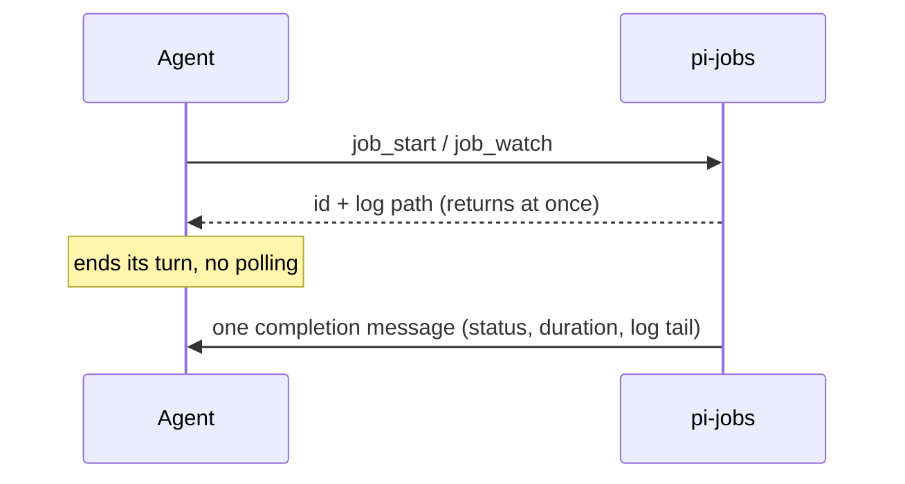

# pi-jobs

Background shell jobs and watches for pi that wake the agent when they finish.

[](LICENSE) [](https://www.npmjs.com/package/@woksin/pi-jobs) [](https://github.com/woksin/pi-jobs/actions/workflows/ci.yml)

Long waits (CI runs, long builds, "poll until X") run outside the model at zero token cost. The agent starts the job, ends its turn, and gets one concise message when it is done.



## Why

- Polling CI from the model burns tokens on every check and fills the context.
- A foreground wait blocks the session.
- Several jobs finishing together should wake the agent once, not many times.

## Features

- `job_start` runs a command under a supervisor in its own process group, with a log file.
- `job_watch` re-runs a check until it succeeds, fails or changes (`until`).
- Completions are batched into one message with a bounded log tail.
- `job_list`, `job_output` and `job_kill`, plus `/jobs` and `/jobs kill <id>` for you.
- Logs are capped at 50 MB and old logs are cleaned up after 7 days.
- Jobs survive `/reload`.

## Install

Add the npm source to `packages` in your Pi settings:

```json
{
  "packages": ["npm:@woksin/pi-jobs"]
}
```

Or use `pi install npm:@woksin/pi-jobs`. Git and local checkouts work too:

```sh
pi install git:github.com/woksin/pi-jobs
pi install /path/to/pi-jobs
```

Restart Pi or run `/reload` after changing settings. Requires a POSIX system with Bash;
Windows is not supported. Tested with Pi 1.3.0. The host dependency uses `"*"` as recommended
for Pi packages: Pi supplies its own runtime and suppresses automatic peer installation
for managed packages. Other runtime versions are not guaranteed.

## Usage

Ask the agent to run a long command with `job_start` or wait for a condition with `job_watch`.
It should end its turn instead of polling, then continue when the completion message arrives.
Use `/jobs` to see session jobs or `/jobs kill j1` to stop one. Commands run with your user
permissions and inherited environment; only run commands you trust. Logs can contain
sensitive output, so do not publish them.

## Tools

| Tool | Purpose |
|---|---|
| `job_start { command, timeoutSeconds, cwd?, label? }` | Run `bash -c <command>` under a supervisor in its own process group; stdout+stderr → log file. Returns at once with id and log path. |
| `job_watch { check, intervalSeconds, timeoutSeconds, until?, checkTimeoutSeconds?, cwd?, label? }` | Re-run `check` every `intervalSeconds` until the condition holds or `timeoutSeconds` passes. |
| `job_list {}` | Running and recent jobs of this session. |
| `job_output { id, tailLines? }` | Bounded log tail (default 40, max 200 lines, max 16 KB). |
| `job_kill { id }` | SIGTERM the job's process group, SIGKILL after 5 s; returns the final state. |
| `/jobs`, `/jobs kill <id>` | User command: list / stop. |

The model is told: start the job, **end the turn**, do not poll.

### `until` (job_watch)

- `success` (default): a check exits 0.
- `failure`: a check exits non-zero or dies by a signal.
- `change`: exit code or complete output differs from the first conclusive check. Compared
  by SHA-256 of the full stdout and stderr streams (exact bytes, independent of the 64 KB
  display tail; output with timestamps always "changes", so keep checks deterministic).

A check that exceeds `checkTimeoutSeconds` (default `min(120, timeoutSeconds)`) has its process
group killed and counts as **inconclusive**: it never matches, never sets the `change`
baseline, and the watch continues. The interval is measured from the end of one check to the
start of the next. Prefer `job_start` with a native blocking watcher where one exists.

### CI

Watch an **immutable target**: `gh run watch <run-id> --exit-status`, or the checks of a
specific commit SHA. A PR number is a moving target: a push while you wait moves it to a newer
commit, and the result you are woken with may not describe the code you meant. The tool
descriptions tell the model the same.

## Completion message and delivery

**Contents.** Status, title (label or command), exit status, duration and log path, plus any
log truncation or log write error. Then the last 40 lines / 4 KB of output, with ANSI codes
stripped and `\r` redraws collapsed. Watches also report `until`, the check count, and the
status and output of the last completed check.

**Batching.** Completions that are waiting together go out as **one** message (`N background
jobs finished:`). The output of all completions in a message shares a 16 KB budget.

**Terminal states.** `succeeded`, `failed` (non-zero exit or spawn failure), `timed_out`,
`matched` (watch) and `killed`. There is **no message** for jobs stopped by
`job_kill`/`/jobs kill` (the caller gets the final state synchronously) or by non-reload session shutdown
(nobody to wake).

### Guarantee

> In the normal case each completion is **delivered at least once**. Each model context contains
> **at most one full copy** of each completion id, for messages in the current indexed format;
> messages from older pi-jobs versions are only stubbed as a whole once all their ids were shown. Across Escape/abort, delivery is **best
> effort**, with at most one resend per dropped follow-up. This is **not exactly-once**: pi has no
> atomic wake API (see [UPSTREAM-ISSUES.md](https://github.com/woksin/pi-jobs/blob/main/UPSTREAM-ISSUES.md)).

### How it works

`src/delivery.ts` is event-driven only: no timers, no polling, no time-based resend. Every
message goes through `pi.sendMessage(…, { triggerTurn: true, deliverAs: "followUp" })`, and
pi does the scheduling.

| Situation when the job finishes | What pi-jobs does |
|---|---|
| Session idle | Send now; pi starts a run with the completion as its prompt. |
| A run is active (`agent_start` … `agent_settled`) | Hold it. At the next non-aborted `agent_end`, send everything held as one follow-up, which pi consumes in the same run. |
| Run aborted, or the completion arrived after the last `agent_end` | At `agent_settled`, send only if pi is idle; pi then starts a new run right after. If pi is already busy again (an earlier `agent_settled` handler started a compaction), keep holding. |
| pi busy without a run (manual compaction, branch summary on `/tree`) | Hold it. Send after `session_compact` or `session_tree` (one `setImmediate`, because these fire before pi clears its busy state), or after `session_compact_failed`, if pi is idle by then. Otherwise send at the next agent event. |

**Recovery.** A follow-up we queued has no `message_end` confirmation when its run settles if
Escape/`clearQueue` dropped it or an abort stranded it. It is then sent once more as its own
batch, never merged, through the same idle-checked path.

**Duplicates.** Each completion carries a random UUID (`details.completions[].completionId`)
and occupies its own content part (`details.completions[].part`). A model-context filter keeps
the first copy of each id. In later messages it removes already-shown completion blocks,
leaving a one-line note, and keeps the unseen ones. A message with nothing unseen becomes a
one-line stub. The stub keeps the message in place, so the context never ends on an assistant
message. Messages from older pi-jobs versions without part indices can only be stubbed as a
whole. Job handles such as `j1` restart in every session and are never used for
deduplication.

**Reload.** On `session_shutdown` with reason `reload`, the session's manager is retained in a
process-wide registry. Node timers do not belong to the extension runtime: the single watch loop,
check/interval/until definition, change baseline and original deadline stay alive with it, as do
command supervisors and logs. Completion delivery is suspended until the replacement extension
rebinds its API at `session_start` (`reload`); delivery resumes on the next `setImmediate`,
after other extensions can initialize. Job ids are unchanged; numbering advances past
session history. Unconfirmed follow-ups may be resent with the same completion ids (deduplicated
in context as above). No subprocess is relaunched and no second watch loop is created.

A stale attached runtime proves an owner is gone: its jobs/watches are stopped and reported
with log paths. Another live session is never stopped; a pending reload handoff is unknown,
reported and kept for at most five minutes. An unref'd handoff timer then stops its jobs/watches
and logs the expiry if no replacement adopts it. A versioned registry and method checks reject
incompatible handoffs and stop their work instead of adopting it. This is **same-process reload**,
not restart/crash recovery. Old versions
that shut down jobs cannot hand them off: the replacement warns and preserves id numbering.
In particular, upgrading an already-loaded pre-0.2 runtime cannot preserve its jobs: its old
shutdown handler runs before the updated extension loads. A missing or incompatible handoff
now reports each affected item's full command, cwd, log and recorded watch settings, both in the
UI and in session/model context, without starting a turn. Missing-handoff reports use the last
recorded running state, not proof that the item was still alive; inspect the logs before
re-arming. An old snapshot may lack an interval, which the notice explicitly marks as unknown.
Compatible handoffs do not require that optional snapshot field and are still adopted without
restarting commands or watches. Recovery notices do not automatically restart work or restore
an already-stopped process.

**Unexpected stale context.** Outside the reload handoff, a throw remains permanent: delivery
stops, the loss is reported once, and nothing is retried.

### Known pi-side limitations

These are documented in [UPSTREAM-ISSUES.md](https://github.com/woksin/pi-jobs/blob/main/UPSTREAM-ISSUES.md), with skipped reproductions
in `test/agent-session.test.ts`:
- A completion that arrives while a user prompt is still preparing can make that prompt fail
  with "Agent is already processing" (#1).
- A completion sent from `agent_settled` can start its run inside a compaction that another
  extension started from its own `agent_settled` handler (#2).
- If another `session_compact`/`session_tree` handler delays pi's teardown, or a `/tree`
  navigation is cancelled or fails (no `session_tree`), a held completion waits for the next
  agent activity (#4, #5).

## Processes

- `bash -c`, not `bash -lc`: same non-login semantics and inherited environment (PATH, nvm,
  tokens) as pi's own `bash` tool; a login shell re-sources profiles (slow, can print noise,
  can change PATH). Use `bash -lc '…'` inside the command if you really need it. stdin is closed.
- **Supervisor and PGID safety.** Each job and each watch check runs under a tiny bash
  supervisor that leads its own process group. Node only ever signals a group whose leader it
  has not reaped, so the PGID cannot have been reused by an unrelated process (a PGID is the
  leader's pid, which stays allocated until it is reaped). The supervisor runs the command as
  a child, reports its exit status on a private pipe, then stops leftovers itself: SIGTERM to
  the group (it survives via a no-op trap), wait the grace period, SIGKILL to the group (which
  ends the supervisor too). So the group never outlives its leader, and the session stays
  registered for the exit hook until that cleanup is done.
- Timeout and kill send SIGTERM to the whole group, then SIGKILL after 5 s if the supervisor
  is still alive. Exit statuses come from bash, which reports death by signal `n` as `128+n`.
  A command can also exit with such a code on purpose, so the signal is shown as an inference:
  `exit 143 (likely SIGTERM)`. `signal SIGKILL` appears only when the supervisor itself was
  killed.
- When a job's main process exits, leftover background processes in its group are stopped
  too (a job cannot leave orphans; start daemons some other way).
- Output goes through pipes. Once the command's status is known, the job settles when the
  pipes close or after 1 s at most, then the pipes are destroyed: a descendant that escaped
  the group (`setsid`, double fork) and keeps stdout open cannot stall a job, a watch, a
  timeout or shutdown. Escaped processes themselves are out of reach by design.
- Non-reload session shutdown (quit, `/new`, resume, fork) stops all of the session's jobs
  (SIGTERM, ≤1.5 s, then SIGKILL). One process-wide `process.on("exit")` hook SIGKILLs
  anything left if pi exits without a shutdown event; a session is registered with it only
  while it owns running jobs or pending SIGKILLs (and until its shutdown has finished).
- A job whose log cannot be opened or whose spawn fails synchronously (e.g. a NUL byte) is
  rolled back and the tool call fails; it never occupies a slot.
- Non-reload shutdown also destroys every pipe and clears every timer.

## Limits

- `timeoutSeconds` 1–14400 (4 h), required. `intervalSeconds` 10–3600.
- Commands (`job_start`) and watches (`job_watch`) have separate caps per session: at most 8 running
  commands and 32 running watches; more of either → tool error. Watches only run a short check per
  interval, so they never take command slots. Override with `PI_JOBS_MAX_RUNNING` and
  `PI_JOBS_MAX_WATCHES` (positive integers; anything else falls back to the default).
  - A finished job's supervisor may stay alive for up to 5 s (the grace period) while it cleans
    up its group, and it is not counted.
  - During that window, leftover user processes that ignore SIGTERM can still run, until the
    SIGKILL at the end of the grace period.
  - This is bounded: one supervisor per finished job or check, at most 5 s each.
  - Counting it would make every completion block a new job for 5 s.
- Tool schemas encode the bounds, so pi rejects out-of-range arguments before the tool runs.
  `checkTimeoutSeconds` defaults to `min(120, timeoutSeconds)`; `tailLines` is an integer from
  1 to 200.
- Each job's log is capped at **50 MB**: after that, output is discarded with a truncation
  marker in the log and a note in the completion message; the job keeps running. Log write
  errors (e.g. disk full) are reported in the completion message.
- Output tails read at most the last N bytes of the log; logs are never loaded whole, and the
  byte cap holds after decoding (invalid UTF-8 cannot inflate it). A watch keeps at most
  64 KB of one check's output in memory, even when the check writes larger chunks.
- The 50 most recent finished jobs are kept for `job_list`/`job_output`; state is in memory
  only (retained across same-process reload, not restored after restart/resume).

## Logs

`$PI_JOBS_DIR` or `~/.pi/agent/jobs/<YYYY-MM-DD>/<HHMMSS>-<session tag>-<id>.log`. Watch logs
contain every check with a `--- check N · time · status ---` header. On each session start,
`*.log` files older than 7 days in those day directories are deleted and emptied day
directories removed; nothing else is touched. Symlinked day directories and files are
skipped, and every path must resolve inside the log root.

## Subagents and print mode

Each extension instance (main session, each subagent session) has its own JobManager: ids,
jobs and notifications are per session. A job started by a subagent wakes that subagent; if
the subagent session has already ended, its jobs were stopped at its shutdown (or, if the host
disposes it without a shutdown event, a later session start stops and reports its jobs once
the runtime is provably stale; otherwise they run to timeout and the message is dropped —
the exit hook still kills them when pi exits). Do not hand a subagent's job id to the parent.

In print mode (`pi -p`) the run ends when the agent goes idle and the shutdown kills running
jobs, so a wake-up cannot happen there; use interactive or RPC mode.

## Development

Requires Node.js 22.19 or newer for native TypeScript stripping; no compilation is required.

```sh
npm test   # node --test, real processes and a real AgentSession, ~10 s
```

`src/extension.ts` is the only pi-aware module and uses type-only pi imports; `jobs.ts`,
`supervisor.ts`, `delivery.ts`, `logwriter.ts`, `tail.ts`, `watch.ts`,
`format.ts`, `logs.ts` are plain Node. Tests drive the extension through a fake
`ExtensionAPI`, spawn real processes, and run delivery scenarios (Escape, abort, compaction,
batching) against the installed pi `AgentSession` with the faux model provider
(`test/agent-session.test.ts`). Tests resolve a local runtime dependency or Pi's standard
user installation directories; set `PI_RUNTIME_DIR` to override the package root. Runtime
tests skip with a clear message if Pi is unavailable. Two known upstream race reproductions
remain skipped. Live RPC scenarios are in
[`e2e/`](https://github.com/woksin/pi-jobs/blob/main/e2e/README.md); they require credentials
and make paid model calls, unlike `npm test`.
Requires `perl` only for the escaped-descendant tests.

## Releasing

CI (`.github/workflows/ci.yml`) runs the tests on Node 22 and 24 for every push and pull request. To release, bump `version` in `package.json`, commit, and publish a GitHub release tagged `v<version>`. `.github/workflows/publish.yml` then runs CI again and publishes to npm with provenance. That works through npm trusted publishing when it is set up for this repository, or otherwise through an `NPM_TOKEN` repository secret.

### Registry snapshots

`manager.list()` returns additive job snapshots including `label`, `until`, `intervalSeconds` and `timeoutSeconds`. `until` and `intervalSeconds` are absent for plain commands; `label` is optional. The interval is the configured delay between checks, not a countdown.

## Related projects

- [pi-setup](https://github.com/woksin/pi-setup): my full pi agent setup (rules, agents, extensions, installer) that ties these together
- [pi-recover](https://github.com/woksin/pi-recover): `/recover` picks up unfinished subagents, workflows and jobs after a crash or usage limit
- [pi-context-budget](https://github.com/woksin/pi-context-budget): structured context handoffs and bounded long sessions
- [pi-orch](https://github.com/woksin/pi-orch) (experimental): repo-owner orchestration with an order bus and batched candidate PRs

## License

MIT, see [LICENSE](LICENSE).
