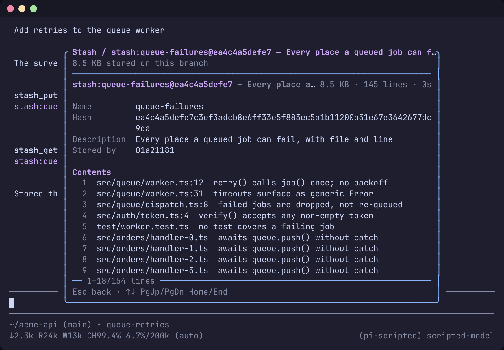
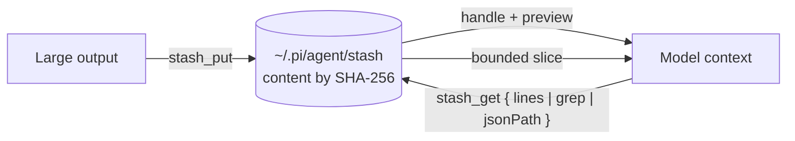

# pi-stash

Keeps large text out of the model's context. Search results, file snapshots,
tool output and worker findings are stored on disk, and the model gets a short
handle it reads back one slice at a time:

```text
stash:queue-failures@ea4c4a5defe7
```



## At a glance

- **The agent calls** `stash_put` to store text, a file, or the full result of
  an earlier tool call, and gets back a receipt with a short preview. It never
  echoes the content.
- **The agent calls** `stash_get` with a handle and `lines`, `grep` or
  `jsonPath` to read only what it needs, and `stash_list` to see what is stored.
- **You type** `/stash` to browse entries and open one, and `/stash:gc` to
  delete content nobody has used for 30 days.
- **Subagents** share handles with their parent: brief a worker with a handle
  instead of pasting 400 lines, or have it return its findings as one. A
  subagent's entries also appear in its parent's stash, marked `↑ agent a3f2b1c4`.
- **After compaction** the stash is still readable exactly, and one hidden card
  reminds the model what is in it.



## Tools

All three are ordinary (`direct`) tools with an `outputSchema`, so codemode
scripts receive structured values (`structuredContent`) instead of text.

### `stash_put`

```ts
{ name, description?, content? | path? | toolCallId? | handle? }   // exactly one source
```

- `content`: literal text.
- `path`: snapshot a file inside the working directory. Accepts the same spelling as
  `read` (relative, absolute, `~`, leading `@`), but the real path must stay inside
  the real working directory; symlinks out of it, directories and binary files are
  refused.
- `toolCallId`: snapshot the full text of an earlier tool result on the **current
  branch**, so the model never re-types a big output. When Pi's `bash` kept the
  untruncated output in a temp file, that full output is stored. Calls made inside
  a codemode script leave no tool result; stash those with `content`.
- `handle`: keep an existing entry (`stash:<name>@<hash>`), for example one from a
  session that is no longer running, on the current branch under `name`.

Names match `[A-Za-z0-9][A-Za-z0-9._-]{0,63}`. Re-using a name adds a new version;
older versions stay readable by their full handle.

Returns a receipt only: `{ handle, name, hash, bytes, lines, mime, preview }`, where
the preview is about 10 lines or 1 KB. The content is never echoed.

### `stash_get`

```ts
{ ref, lines?: [start, end], grep?: { pattern, context?, ignoreCase? }, jsonPath?, maxBytes? }
```

- `ref`: a full handle, or a bare name resolved through this branch's index.
- At most one of `lines` (1-based, inclusive), `grep` (JavaScript regex, up to 20
  context lines, `n:` marks matches and `n-` context) and `jsonPath` (`$.a[0]`,
  `$["key"]`, negative indexes). With none, returns the head.
- Output is line-numbered and bounded: `maxBytes` defaults to 16 KB and is capped
  at Pi's 50 KB / 2,000-line tool budget. Truncated reads say what to request next,
  e.g. `next range is [313, 624]`.

### `stash_list`

`{ filter? }` lists the current branch's entries (latest version per name, newest
first) with handle, size, line count, description, creator session and age.

## How it works

**Content** is immutable and stored by hash at `<root>/blobs/<aa>/<sha256>`, where
the root is `$PI_STASH_DIR` or `~/.pi/agent/stash/`. Writes are atomic (temp file +
rename), every path must resolve inside the root, and symlinks are refused. Reads
verify the hash.

**The index** is saved in the session as `stash:index` custom entries,
one per change plus a checkpoint after compaction. It is rebuilt from the current
branch on start, resume, reload and `/tree`, so abandoned branches drop out.

**Handles** resolve two ways:

- A bare name goes through the current branch's index.
- A full handle (`stash:<name>@<12+ hex>`) goes straight to the content store, from
  any session on this machine. Each subagent has its own session and index, but the
  content store is shared, so handles cross between parent and children. A prefix
  matching more than one blob fails and lists the candidates.

**Context:** the model sees a receipt for every entry it stores. After a compaction
summarizes those away, pi-stash writes an _index card_ into the transcript once (the
20 most recent entries: handle, size, origin of adopted entries, description), as a
hidden message: the model reads it, the TUI does not show it. It stays where it was
written, so later requests do not repeat it and the prompt cache keeps working. A
resume, reload or `/tree` keeps the receipts in context and writes nothing, unless
the branch's latest compaction has no card yet. When a subagent's entry is adopted,
a one-line hidden note naming it is written the same way, after the current turn.

## Views and actions

Other extensions and remote surfaces follow the index without parsing journal
entries: pi-stash defines actions and views on the session's bus (see
[`pi-surface`](../../packages/pi-surface/README.md)) from session start to
shutdown. Each subagent has its own bus. Content is read only through
`stash.inspect`, bounded, for a user who opens an entry.

| Id               | Kind     | What it does                                                                                                                       |
| ---------------- | -------- | ---------------------------------------------------------------------------------------------------------------------------------- |
| `stash.inspect`  | action   | `{ id: <handle> }` of an entry on this branch resolves to the detail blocks `/stash` shows when that entry is opened               |
| `stash.explorer` | explorer | The `/stash` list as a JSON `ExplorerModel`; its `loadDetail` is `stash.inspect`. Announced on every change to this branch's index |
| `stash.summary`  | summary  | This branch's entry count and sizes and the shared store's use, as a `SummaryModel`. Announced with the explorer                   |

The explorer lists every current entry on the branch, newest first, with its
handle as the item's `id`: the identity a stash picker inserts. `stash.summary`
carries the totals no item does. Its counts are present for an empty stash too,
so zeros mean nothing is stashed where a session without pi-stash has no view:

| Key               | Counts                                                                  |
| ----------------- | ----------------------------------------------------------------------- |
| `entries`         | Entries on this branch, the latest version of each name                 |
| `versions`        | Every version stored on this branch                                     |
| `bytes`           | Bytes of those entries' latest versions                                 |
| `store-bytes`     | Bytes in the shared content store; absent when it cannot be measured    |
| `store-max-bytes` | The store's configured cap (`maxStoreBytes`); absent with `store-bytes` |

The three size counts are `unit: "bytes"`, so displays show them as sizes
(`12.4 KiB on this branch`, `1.0 GiB store cap`); `entries` and `versions`
label themselves in agreement with their value (`1 entry`, `2 versions`).
Stash records live in the session file and their content in the store, so no
count is process-bound (`live`): a saved summary settles unchanged.

## Subagents

**A subagent's entries appear in its ancestors' stash.** When a subagent stores an
entry, it hands the entry to its parent's pi-stash, which journals it on its own
branch (`via: "adopt"`) and hands it to its own parent, and so on up to the root.
The entry's `id` makes adoption idempotent, so a repeat ends the chain. It then shows up in their `stash_list`,
`/stash`, adoption note, index card and `stash.explorer` view, marked with the agent that stored it
(`↑ agent a3f2b1c4`). Parent links come from pi-subagent's child lifecycle events
through [`pi-session-tree`](../../packages/pi-session-tree/README.md). Because the
entry is journaled where it lands, a parent `/tree` back to before the spawn drops it
like any other entry. A parent that is reloading or gone ends the chain there, and
every session below it keeps its copy either way. A top-level session's entries stay its own.

The bundled `pi-subagent` lets Explore and Plan call `stash_get` and `stash_list`;
Explore can also call `stash_put` to return large findings as a handle. The
orchestrator is told to brief workers with handles and ask for large results as
handles. See the [subagent documentation](../pi-subagent/README.md).

## Commands

- `/stash` opens the shared `packages/pi-ui` explorer as a modal (fullscreen TUI
  only): a filterable list → Enter loads that entry's name, full hash,
  description, origin, then a numbered content preview (up to 2,000 lines /
  50 KB). Nothing is read from the store until an entry is opened; a read error
  shows below the metadata. Warns when the store is over its size cap. The list
  is a plain JSON model; details load through `stash.inspect`. Outside the
  terminal UI (an app that runs Pi over RPC, say) it lists up to 100 entries as a
  displayed message instead; the agent reads one with `stash_get`.
- `/stash:gc` deletes content not read or written for `retentionDays` and reports
  what it freed, as a notification or, outside the terminal UI, a displayed
  message. Both are kept out of the model's context.

## Retention and limits

Content cannot be traced to every session that references it, so v1 uses an age
policy. On session start, blobs the current branch references are refreshed and
anything not read or written for `retentionDays` is deleted (tracked by file
mtime/atime). A handle older than that in another session may stop resolving.

Configure in `~/.pi/agent/stash.json` (global only, because the store is shared):

```json
{ "retentionDays": 30, "maxEntryBytes": 20971520, "maxStoreBytes": 1073741824 }
```

- `maxEntryBytes` (20 MB): larger entries are rejected.
- `maxStoreBytes` (1 GB): `/stash` warns above it.

## Security

Stashed text is **plaintext on local disk** (`0600` files in a `0700` directory).
It can include secrets from tool output, such as environment dumps or tokens in
logs. There is no redaction in v1. Treat the stash directory like your shell
history, and run `/stash:gc` or delete the directory to remove content.

## Not in v1

- Automatically spilling oversized tool results into the stash.
- Semantic search, embeddings, or memory across projects.
- Dispatching a todo item to a subagent with linked handles (issue #11).
