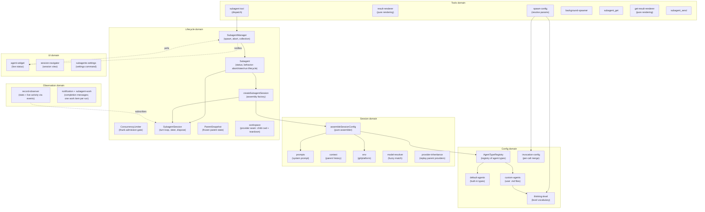
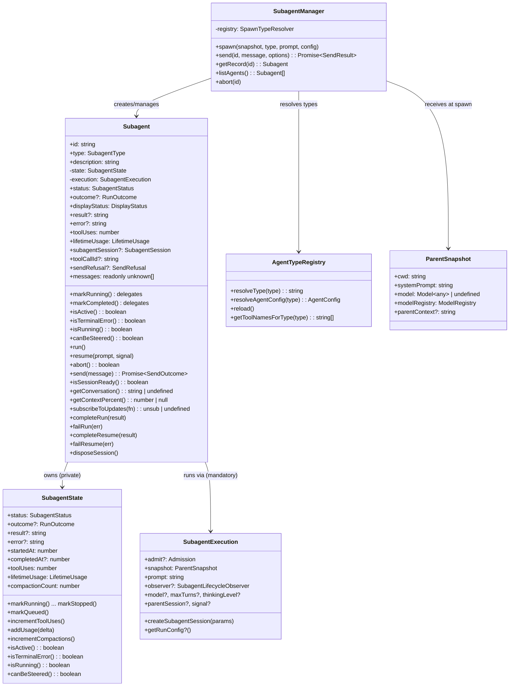
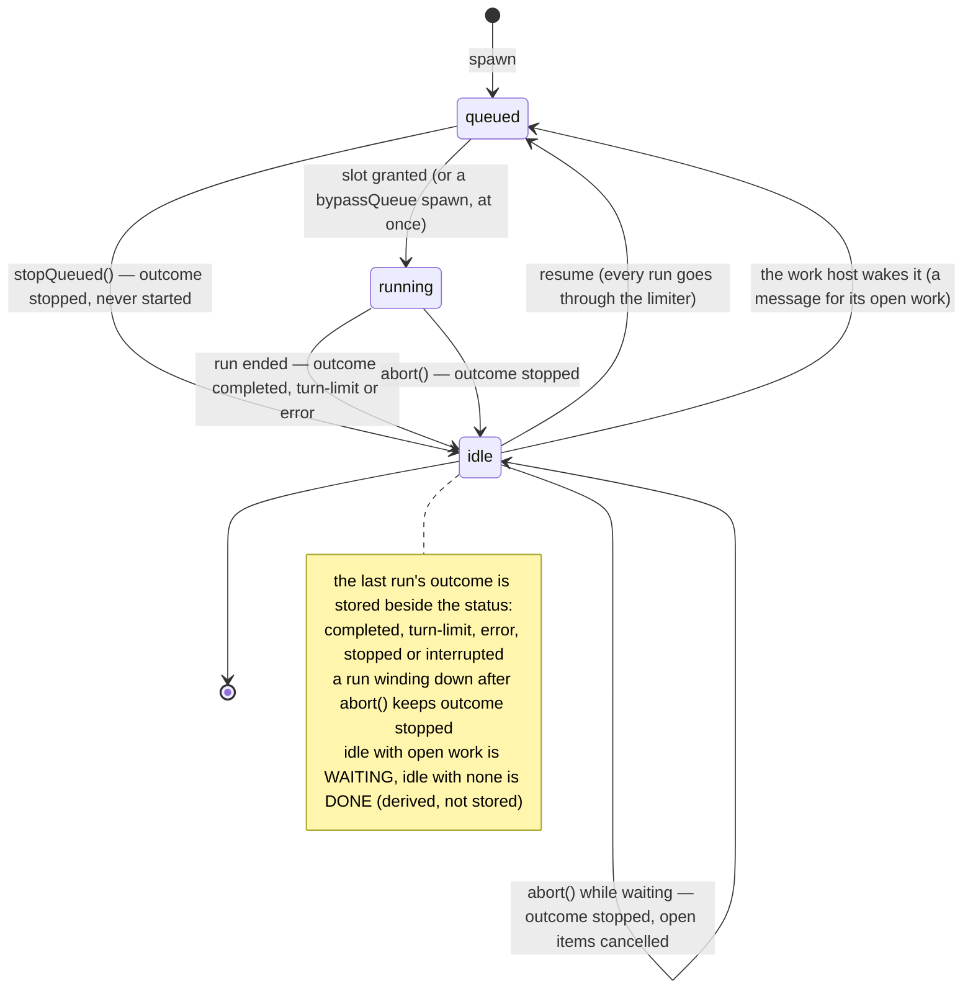
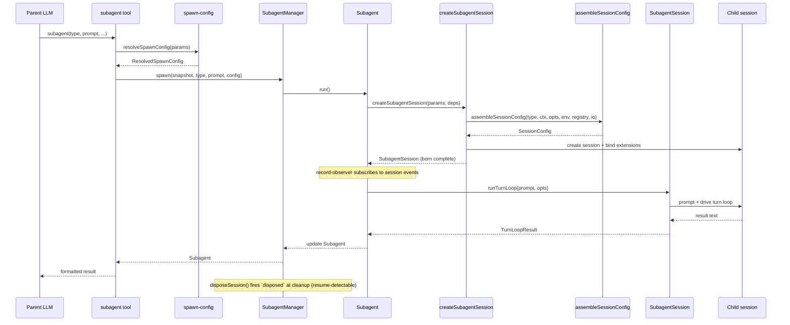

# Architecture

This document describes the architecture of the pi-subagent fork: a focused, composable core whose lifecycle events other extensions build on.

## Design principles

1. **Narrow core** — the extension owns agent spawning, execution, and result retrieval.
   Everything else is a consumer.
2. **Composable by default** — other extensions observe agents' lifecycle and display their state through `pi.events`, without importing this package.
3. **No programmatic API** — the model-facing tools are the only way to start and message agents.
   The typed `SubagentsService` upstream published on `globalThis` had no consumer here and was removed.
4. **No time-based scheduling** — cron-style timed dispatch (upstream's `schedule.ts` subsystem) is removed from the core (#52).
   The max-concurrent admission gate is not scheduling in this sense — concurrency management stays in core.
5. **UI is an in-core, substitutable consumer** — [ADR-0004](../decisions/0004-reconsider-ui-direction.md) records the per-component decision: the widget shrinks to background agents only, the bespoke conversation viewer is replaced by native session navigation, the `/agents` command is dissolved into focused surfaces, and the surviving UI stays in the core as a reactive consumer (not extracted to a separate package).
   Extraction remains an available future option because the composition invariant holds — the core is byte-for-byte identical with or without a given UI consumer.
6. **Snapshot, don't capture** — mutable parent state (ctx, session, model) is read once at spawn time and frozen into a `ParentSnapshot` data object.
   No live references survive past the spawn call.
7. **Subscribe, don't thread** — observation of agent progress uses direct session-event subscription, not callback parameters threaded through multiple layers.
8. **Construct complete** — objects are born with all their dependencies.
   If state isn't available yet, the object that needs it doesn't exist yet.
   No post-construction field writes from external code — if an object can't be instantiated ready-to-go, the prep work hasn't been done and the right dependencies haven't been identified.
9. **State owns its mutations** — mutable state lives in a class whose methods enforce valid transitions and invariants.
   Free functions that mutate module-scoped variables, closure-captured bags-of-functions, and external writes to shared interfaces are replaced by classes that encapsulate the state they manage.
10. **Open for extension, closed for modification** — pi-subagent is a minimal core that publishes events and a service API.
    Other packages (pi-permission-system, a future UI extension, hypothetical OTel integration) hook into these events to add permissions, rendering, or telemetry.
    Pi-subagents has zero knowledge of its consumers — dependency arrows point inward, never outward.

## Scope and non-goals

The README carries a short charter for the boundaries that come up most often.
This is the full inventory, with the decision record or design principle each rests on.

| Non-goal                                                                      | Rests on                                                                                              |
| ----------------------------------------------------------------------------- | ----------------------------------------------------------------------------------------------------- |
| Time-based scheduling (cron / interval / one-shot dispatch)                   | Design principle 4                                                                                    |
| Ad-hoc cross-extension event RPC (`subagent:rpc:*`)                           | Design principle 3; §"What the core dropped"                                                          |
| Group-join / consolidated completion notifications                            | §"What the core dropped"                                                                              |
| Model-scope enforcement (an `enabledModels` allowlist in the core)            | `docs/comparison-with-upstream.md` only — the weakest entry here                                      |
| Per-agent tool restriction policy (`disallowed_tools`, a built-in denylist)   | [ADR-0002](../decisions/0002-extensions-on-a-minimal-core.md); §"Child tool selection"                |
| Widening a child's tool allowlist with capability tools on the agent's behalf | §"Child tool selection"; operator position on the additive-key case                                   |
| A global run-mode default                                                     | Operator position; every agent runs in the background, so there is no mode to default                 |
| Worktree / environment isolation in the core                                  | [ADR-0002](../decisions/0002-extensions-on-a-minimal-core.md) §"What leaves the core"                 |
| Persistent agent memory (`memory:`) and skill preloading (`skills:`)          | [ADR-0002](../decisions/0002-extensions-on-a-minimal-core.md); comparison doc                         |
| Per-agent extension lifecycle control (`isolated`, `extensions:`, `noSkills`) | [ADR-0002](../decisions/0002-extensions-on-a-minimal-core.md) and its amendment                       |
| New generative provider seams without a concrete consumer                     | [ADR-0002](../decisions/0002-extensions-on-a-minimal-core.md) §"The governing rule: no vacant hooks"  |
| In-viewer steering or interactive child-session takeover                      | [ADR-0004](../decisions/0004-reconsider-ui-direction.md) Addendum criteria 1 and 2                    |
| Bespoke transcript rendering in the core                                      | [ADR-0004](../decisions/0004-reconsider-ui-direction.md) Decision B                                   |
| Agent-definition authoring UI (wizard, config editor, `/agents` menu)         | [ADR-0004](../decisions/0004-reconsider-ui-direction.md) Decision C                                   |
| A foreground mode, or any call that blocks the parent on an agent             | Roadmap `docs/roadmaps/subagent-work-lifecycle.md` step 6; the completion message is the only carrier |
| Propagating the parent's `pi -e <path>` ephemeral extensions to children      | [ADR-0001](../decisions/0001-deferred-patches.md), now superseded — restate before citing             |

Extracting the surviving UI to a separate package is a **not now with criteria**, not a decline: [ADR-0004](../decisions/0004-reconsider-ui-direction.md) Decision D names the revisit conditions.

The following are **not** boundaries.
Pi's client-server split is a deferral pending an upstream capability (`docs/architecture/client-server-opportunities.md`), not a declined direction.
The parity status of the SDK `spawn()` path against the tool path, the stability guarantee carried by the lifecycle event payloads, parent-data redaction for SDK-spawned children, and ownership of `subagent_get` presentation are all unstated rather than settled.
`SubagentRecord`'s own guarantee is no longer among them: [decision 0005](../decisions/0005-subagent-record-admission-policy.md) settles what the public snapshot admits and which direction the contract runs.

The reimplement-don't-merge contribution pattern, applied across eight closed pull requests, is a repo-wide process rather than a scope boundary, and is documented in the repository's [contributing guide](https://github.com/gotgenes/pi-packages/blob/main/CONTRIBUTING.md).

## Domain model

The extension is organized around six domains, each responsible for one aspect of managing agents.



### Key domain types



## Agent lifecycle



An agent is `queued` while a run waits for a concurrency slot (the first run and every later run alike), `running` while a run is active, and `idle` when it has no run.
How the last run ended is its `outcome`, recorded beside the status together with the run's `result` and `error`: `completed`, `turn-limit` (the harness stopped it at the turn ceiling), `error`, `stopped` (an `abort()`), or `interrupted` (a record read back from storage that still said queued or running).
An idle agent of any outcome accepts a new run; a stop ends the run (and, for an agent waiting on work, cancels that work, see below).

The status and outcome are the model; the words users and subscribers see are derived from them by `displayStatus` in `subagent-state.ts`: `completed`, `aborted` (outcome `turn-limit`), `stopped` (`stopped` and `interrupted`), `error`, or the status itself while queued or running.
Tool output, the widget, the watch overlay, the completion message and its details, and the `status` field of the lifecycle events still use these six words.
They are a bridge: the idle/done presentation replaces them in the steps after this one.

A message to a running agent (`subagent_send`) steers it and changes no status.
The turn budget is not a status either: it is the live `turnBudget` (`{ used, maxTurns, phase }`) the turn loop reports to the record before the first turn and after each turn boundary.
A `TurnBudgetTracker` (`turn-limits.ts`) counts successful turns and decides when `SubagentSession` warns the child (a context-only custom message once `wrapUpTurns` turns remain, which forces no turn) and when it stops the run (after a ceiling turn that ran tools, or as a turn starts past the ceiling).
`phase` is `warned` once the warning went out and `exhausted` when the harness stopped the run: the one case a run or resume that returned ends with outcome `turn-limit`.
A resume runs a fresh tracker under the initial run's limits.

Note: `markStopped` always succeeds regardless of current status.
`markCompleted`, `markTurnLimit` and `markError` still record their result or error after a stop but keep the outcome `stopped`.
A run that a later one has replaced (stopped, then the agent took new input while the old run wound down) reports nothing and changes nothing: the record belongs to the later run.
`stopQueued` composes `markStopped` with a never-started marker and notifies the lifecycle observer — so a queued stop, a queued resume's or relaunch's included, publishes the same events, session entry, and nudge a running stop does.

### Every run goes through the limiter

A run a message starts is admitted exactly like a first run.
`Subagent.send` on an idle agent calls `Subagent.resume` (or `relaunch`, below), which queues the record at once (`markQueued`: status `queued`, the earlier run's result, error and turn budget cleared) and hands the run to `SubagentExecution.admit`, which the manager binds to the `ConcurrencyLimiter`.
With a free slot the run begins synchronously, so no extra event is sent.
With every slot taken the run waits: `onResumeQueued` fires (the session record is saved as `queued`, `subagent:queued` is emitted, the widget counts it, and the `subagent_send` call says "Agent resume queued in background" with the queue position), and `onResumeStarted` (the `subagent:resuming` event) follows when the slot opens.
Stopping a queued run leaves the agent idle with outcome `stopped`; its place in the limiter's queue is spent harmlessly, because a run only begins if it is still the current one.

### Waiting: idle on open work

Every child session has a managed `work:v1` host (`lifecycle/child-work.ts`, built with `packages/pi-work`'s `createWorkHost`), offered under the child's session id before its extensions bind.
A job the child starts, an agent it starts itself and a question it asks its parent (pi-ask) are items in it; the host stores them as custom entries in the child's own session file and writes every message they report into the child's transcript at once (`triggerTurn: false`). It never starts a run itself.

Waiting is **derived**, never stored: an `idle` agent with open items (`Subagent.waitingOn`, the items' labels) is waiting, one without is done.
`Subagent.settle` applies it when a run ends:

- A run that **completed** with open work _parks_. No completion is reported and the spawner's item stays open; the observer's `onWaiting` fires (`subagent:waiting`, persisted). A question the child asked is an open item like a job: the agent waits on it (`waiting: answer`), and the parent's `subagent_send` closes it (`ChildWork.answerQuestions`) and is the run's prompt.
- A run that failed, hit its turn limit or was stopped does not wait: the assignment is over. `abandonWork` calls the agent's open work off (the items close as cancelled, like a stop's), writes ONE `work:called-off` message into the child's own transcript (`WorkHostRuntime.reportCalledOff`, mode `record`: no turn, no wake; the items' labels, sanitised and clipped like `work:lost`) and releases the session, stopping the jobs and agents inside it. The message is written after a stopped run has unwound (one sent mid-run would be held by Pi) and before the release, once (`Subagent.calledOff`); if new input reaches the stopped agent first, it is written as that run is requested. An agent that held no work gets none. Nothing is left open in a released session's transcript, so the reopen reports nothing lost, and a reopened agent knows its work was killed.
- **Mid-run delivery.** A message sent while the child runs is held by Pi until the end of the turn. The `agent_before_settle` handler that `ensureWorkHost` registers in every child (the inline extension `wireWorkHost`) returns `continue: true` when the newest context message, or one still pending, is a work message the host delivered, so the model answers it in the same run. Nothing about it is stored on the agent: it does not go idle, wake or queue.
- **Landing.** The host runs with `confirmLanding`: a completed item reads as closed for the agent at once (`openItems()` excludes it), but its close record is written only when the message is in the child's transcript. pi-work's `LandingTracker`, owned by `ChildWork` and fed by the child session's own events (`message_end`, `turn_start`, `agent_end`, `agent_settled`), reads the transcript for that. The inline extension forwards run boundaries only; it reads no landing, because a second reader would poll twice and drop marks that are not its own.
- **Final settle.** A message recorded after the run's last chance to continue (between its final `agent_before_settle` and `agent_settled`, when the session counts as busy so nothing wakes it) is in the transcript with no continuation to answer it. At `agent_settled` the host reads the transcript tail and, when it is a delivered work message with no answer after it (and the run was not stopped), calls `ChildWorkPolicy.wake`. `Subagent` is still running then, so `requestWorkRun` sets `wakeAfterRun`, `settle` parks, and the answering run goes through the limiter like any wake.
- **Compaction.** `SubagentSession.driveTurns` waits for a compaction in progress (`isCompacting`, then `waitForIdle`) before it prompts, because Pi refuses a prompt meanwhile. A stop during the wait never prompts.
- **No unmanaged runs.** Every path that sends a message into a child ends in the host (`triggerTurn: false`, then a wake through the manager) or in `Subagent.send`/`resume` (the limiter). Only pi-work's root host sends a triggering message, and it is never provided in a managed child. `test/helpers/managed-runs.ts` fails a test in which a run begins in a child outside `SubagentSession.driveTurns`.
- A message for an idle child makes the host call `ChildWorkPolicy.wake`, i.e. `Subagent.requestWorkRun`. That is a `resume` with a fixed prompt, admitted through the limiter like every run (queued, a second wake changes nothing; running, the message is answered in that run, or by one right after if it arrived as the run ended). A record being torn down starts no run.
- The last item going away without a message (`ChildWorkPolicy.changed`, from the host's `onChange`) while the agent waits finishes it: its end time is re-stamped and it reports then.
- **Stop cancels the work.** `abort()` of a waiting agent, of one queued or running for its work, and ESC at the spawner, close the agent's open items as cancelled (`ChildWork.cancelOpen`, no `work:lost` on reopen) and release its session, so the extensions' shutdown stops the jobs. The agent is idle with outcome `stopped`.
- **Retention (the one rule).** `Subagent.isDone()` (idle with no open work) is the single predicate for freeing a finished agent's session. A waiting agent keeps its session however long it waits: a job, a watch, a subagent of its own and a question all hold it alike, and it is released only after the last of them closes and the window then passes. Every release asks it: the sweep (`SubagentManager.sweep`, which adds the window), `clearCompleted` (which also drops the record, so it leaves a waiting agent to report back, be stopped or end with the spawning session), `Subagent.releaseSession` (which refuses unless done, so no caller can bypass it), and `abandonWork` (which makes the agent done by calling its work off first). Not retention, so not asking: `disposeSession` (the spawning session shut down: it ends everything), and disposing a session a stopped run never attached (it calls off the work that session adopted before). The window starts when the agent became done: `completedAt`, which `markFinishedWithoutRun` re-stamps when the last item closes without a run, and which a read of the result made while it still waited does not shorten. Both windows are kept (`consumed` is now "the parent read the finished result with `subagent_get`", no longer a delivery fact); `resolveRetentionWindow` picks between them.

The widget, status bar, roster, watch overlay, `subagent_get` and the dashboard show a waiting agent as `waiting: <labels>`, with no clock.

### One state rule for a message

`Subagent.send` is the only place that decides what a message does, by the state it finds:

| State                          | What happens                                                                                                                                                                         |
| ------------------------------ | ------------------------------------------------------------------------------------------------------------------------------------------------------------------------------------ |
| `running`                      | Steer: delivered to the session, or held in the steer buffer until the session exists (`steered`).                                                                                   |
| `queued`                       | The message is added to the waiting `Run`'s prompt (`Run.addMessage`) and reaches the agent when the run begins (`joined`). It needs no session and dies with a run that is stopped. |
| `idle`, session live or kept   | `resume`: the live session continues, or a released one is rebuilt from its transcript (`started`).                                                                                  |
| `idle`, never had a session    | `relaunch`: a first run from the spawn configuration the record still holds, with the original task followed by the message (`started`, `relaunched`).                               |
| `idle`, transcript or cwd gone | Refused (`SendRefusal`).                                                                                                                                                             |

A queued run takes the message into its prompt rather than the steer buffer because the buffer is flushed only when a session attaches, and a queued resume of a live session has no session to attach.
A `relaunch` run has its own `RunKind`: it creates its session like an initial run, from the original task and `AgentSpawnConfig`, but is announced through the resume observer hooks (`subagent:resuming`, `subagent:resumed`), because the agent already has a record and a consumer counting `subagent:started` once per agent must not see it twice.
Only the live record holds the original task; a record rebuilt from the branch's saved entries has none, so a saved agent with no transcript is refused (`no-session`).

`bypassQueue` is a spawn option for the first run only: it starts that run at once without taking a slot.
A resume of such an agent still goes through the limiter.
Nothing in production sets it today (the cross-extension RPC it served was removed); only tests do.
Admitting resumes cannot deadlock nested delegation: a run holds its slot only while its own turn loop runs and never waits on another agent's slot, since no call blocks on a subagent, and a child session's extensions have a limiter of their own.

## Execution flow



## Module organization

The extension's source files are organized into domain directories — `config/`, `session/`, `lifecycle/`, `observation/`, `tools/`, `ui/`, and `handlers/` — plus a handful of root-level entry-point and shared modules.

Two cross-directory edges are not sanctioned by anything above: `lifecycle/` imports `subscribeSubagentObserver` from `observation/` (`subagent.ts`), and `observation/` imports `display` and `glyphs` from `ui/` (`renderer.ts`).
The ratchet admits them because they predate it; this document states no ordering between those directories, so whether they should exist is a question for a later discovery round rather than a violation today.

### Current layout

```text
src/
├── index.ts                        entry point, tool registration, event wiring
├── runtime.ts                      SubagentRuntime factory (session-scoped state)
├── types.ts                        shared type definitions
├── persisted-record.ts             subagent:record session-entry contract (writer's builder, reader's parser)
├── settings.ts                     SettingsManager (persistent operational settings)
├── debug.ts                        debug logging utility
│
├── config/                         agent type definitions and resolution
│   ├── agent-types.ts              AgentTypeRegistry class
│   ├── default-agents.ts           loads the built-in agents from agents/*.md
│   ├── custom-agents.ts            user-defined agent .md file loader
│   ├── invocation-config.ts        per-call config merge (caller wins unless `locked`); background-mode resolution
│   └── thinking-level.ts           thinking-level vocabulary and parser, wider than pi-ai's `ThinkingLevel`
│
├── session/                        session assembly and preparation
│   ├── session-config.ts           pure assembler (main entry)
│   ├── prompts.ts                  system prompt building; inherits the parent prompt's identity, cutting the session-resolved tail (ADR 0006) and dropping Pi's `<tools>`/`<rules>` sections on the section-shaped prompt (ADR 0011) — and the project-context block too for a child running in its own directory (ADR 0010) — or its portable parts alone for a re-homing provider (ADR 0009)
│   ├── project-context.ts          Pi's `<project_context>` block, rendered in pi ≥0.86's shape; the loader a child whose adopted identity describes another directory resolves its own with (ADR 0010)
│   ├── builtin-extensions.ts       selects the Pi built-ins (codemode, tool-search, MCP) a child's allowlist calls for
│   ├── mcp-tool-patterns.ts        expands `mcp__…*` allowlist entries against the parent's registered tool names
│   ├── notify-parent-tool.ts       child-facing parent_notify: one-way mid-run update, capped at 2000 characters
│   ├── content-items.ts            shared message content parsing (tool-call names, assistant content)
│   ├── context.ts                  parent conversation extraction
│   ├── conversation.ts             render a session's messages as formatted text
│   ├── env.ts                      git/platform detection
│   ├── model-resolver.ts           fuzzy model name resolution
│   ├── package-exclusions.ts       child settings view that disables excluded packages' extensions
│   ├── provider-inheritance.ts     replays the parent's runtime-registered providers onto the child's own runtime, so the child inherits them without sharing the parent's mutable pool
│   └── session-dir.ts              session directory derivation
│
├── lifecycle/                      agent execution and state tracking
│   ├── child-work.ts               the child's managed `work:v1` host: the child's session file as its store, messages written into the transcript at once, a wake request to the agent for an idle child (never a run of its own), `cancelOpen` for a stop
│   ├── subagent-manager.ts         collection manager + observer wiring + session-retention sweep (consumption-aware; releases only an agent that is done, i.e. `Subagent.isDone()`: an agent with open work, a question included, keeps its session); the send choke point (`send`), refusing from the record's own predicate and reporting a discriminated outcome, so every front door declines the same messages; a run it starts begins synchronously and returns before the run ends, because every door is a background door
│   ├── create-subagent-session.ts  assembly factory: MCP pattern expansion, Pi built-in selection, session creation, spawn-tool denylist, core child-tool install, binding
│   ├── subagent-session.ts         born-complete child session: turn loop, steer, shutdown-then-dispose teardown
│   ├── turn-limits.ts              turn-budget policy: TurnBudget, the TurnBudgetTracker that decides warnings and stops, normalizeMaxTurns (minimum 2)
│   ├── subagent.ts                 owns full execution lifecycle (run, resume, relaunch, abort, send); `send` is the one state rule for a message (steer a running agent, fold into a queued run, start a run for an idle one); answers why a message would be refused (sendRefusal), which the send choke point and every report read rather than re-deriving; reports a resume's start as well as its end
│   ├── subagent-state.ts           lifecycle status + metrics + result-delivery value object (transitions, accumulators, classification predicates); a one-way latch for the time the parent read the finished result (retention only), and a per-run update ledger that renders only what no announcement delivered
│   ├── run-listeners.ts            per-run observer-unsub and signal-detach handles
│   ├── concurrency-limiter.ts       background admission gate: schedules run thunks FIFO against the limit
│   ├── parent-snapshot.ts          immutable spawn-time parent state, including the parent's operator-authored prompt parts composed in Pi's own order
│   ├── child-lifecycle.ts          child-execution lifecycle event publisher
│   ├── child-shutdown.ts           bounded session_shutdown emit for a child being disposed
│   └── usage.ts                    token usage tracking
│
├── observation/                    progress tracking and notification
│   ├── record-observer.ts          session-event stats observer
│   ├── notification.ts             the completion, update and question messages (`completionMessage`, `updateMessage`, `questionMessage`) and the task-notification formatting; no delivery
│   ├── subagent-work.ts            the work producer for the spawning session: one `work:v1` item per run, opened when a run is requested, completed with the completion message when it ends (a stopped run delivers its message and cancels the item), `notify` for a mid-run update (only while the child is still running, since a terminated run's updates ride the completion message); holding while the parent runs and waking it are the host's (packages/pi-work)
│   ├── outcome-delivery.ts         shared outcome rendering the completion message and the subagent_get report compose: one status vocabulary in two presentations, body, and the addenda tail (mid-run updates) in one fixed order
│   ├── renderer.ts                 notification and mid-run-update TUI components
│   ├── composite-subagent-observer.ts fans manager notifications out to multiple observers; enumerates every member, so an optional one it omits is dropped silently
│   └── subagent-events-observer.ts manager lifecycle observer (event emission + persistence + notification)
│
├── tools/                          LLM-facing tool implementations
│   ├── agent-tool.ts               subagent tool definition, validation, dispatch
│   ├── result-renderer.ts          pure per-status result rendering
│   ├── spawn-config.ts             pure config resolution
│   ├── background-spawner.ts       background spawn setup + the launch message every background door (spawn, resume) returns
│   ├── get-result-tool.ts          subagent_get tool: a non-blocking status and result read (no wait)
│   ├── get-result-report.ts        pure subagent_get report formatter
│   ├── get-result-renderer.ts      pure subagent_get line assembly for the collapsed and expanded TUI views
│   ├── send-tool.ts                subagent_send tool: wording for each way a message reached an agent, or was refused
│   └── helpers.ts                  shared tool utilities
│
├── ui/                             user-facing presentation
│   ├── agent-widget.ts             above-editor live status widget
│   ├── widget-renderer.ts          pure rendering for widget
│   ├── display.ts                  pure formatters and shared types
│   ├── bounded-lines.ts            component spending exactly one clipped terminal row per line
│   ├── labeled-rule.ts             full-width rule with embedded labels, Pi editor-border style
│   ├── glyphs.ts                   semantic display-glyph vocabulary (monospace-coverage constraint, #669)
│   ├── subagents-settings.ts       /subagent:settings command handler
│   ├── session-navigation.ts       pure session-selection and transcript-source logic
│   ├── session-navigator.ts        /subagent:sessions command handler
│   └── transcript-content.ts       transcript rows: per-message component blocks, width-cached (settles incrementally against Pi's state-before-listeners ordering, #689)
│
└── handlers/                       event handlers
    ├── index.ts                    barrel re-export
    ├── interrupt.ts                turn_start handler — abort all subagents on parent interrupt (ESC), when policy allows
    ├── lifecycle.ts                session_start, session_before_switch, session_shutdown
    └── widget-events.ts            widget's host events — session_start (UI context), turn_start (linger aging), session_shutdown (teardown)
```

### Observation model

Record statistics (tool uses, token usage, compaction counts) and live activity (active tools, response text) are updated by `record-observer.ts`, which subscribes directly to session events.
The turn budget is the exception: the turn loop owns the count it enforces, and reports each change to the record through its `onTurnBudget` option.
All run state still lives on the `Subagent` record.

The widget reads agent state by polling the records exposed via `SubagentManager.listAgents()` every 80 ms in fullscreen mode and every 250 ms in regular mode, where a frame's cost scales with the transcript; that poll loop is driven by the manager's lifecycle notifications (the widget subscribes as a `SubagentManagerObserver` fanned out through `CompositeSubagentObserver`), not by inbound calls from the spawn tools.
It runs if and only if a subagent is running, since a finished agent's line carries a fixed duration and the queued line is a count, so animating either would ask Pi to re-render its whole component tree for a byte-identical result.
The widget's rendered height is also bounded by the terminal's row count rather than a fixed ceiling: Pi's regular-mode differential renderer clears the screen and the scrollback whenever the first changed line sits above the previous viewport top, and the widget's spinner is that line on every tick, so a widget taller than the rows beneath it turns every tick into a destructive repaint ([#864]).
The `/subagent:sessions` navigator reads messages via `Subagent.agentMessages` and subscribes to updates via `Subagent.subscribeToUpdates()` — no direct `AgentSession` reference (#277).
It also reads the parent session's `subagent:record` entries (`persisted-record.ts`), so runs the manager no longer holds, such as those from before a `/reload`, open from their transcript file.

## Cross-extension architecture

Other extensions reach subagents only through the lifecycle events on `pi.events` (see [Lifecycle events](#lifecycle-events)): pi-dashboard follows agents through them, pi-git notes each child's `cwd` from `subagent:session:created`, and pi-todo hands work to a child through `subagent_start`'s `handoff`.
Nothing is published on `globalThis` for them to call.

### What the core owns

- The three tools: `subagent` (née `Agent`), `subagent_get`, `subagent_send`.
- `SubagentManager` — spawn, abort, resume, collection management, observer wiring.
- `ConcurrencyLimiter` — background admission gate: schedules run thunks FIFO against a configurable concurrency limit.
- `createSubagentSession` — assembly factory: session creation and extension binding; returns a born-complete `SubagentSession`.
- `SubagentSession` — the born-complete child session: drives the turn loop (`runTurnLoop`/`resumeTurnLoop`), steers, and disposes (firing `disposed` at true session disposal, so resume executions are registry-detected).
- `child-lifecycle` — publishes the child-execution lifecycle (`spawning`, `session-created` before `bindExtensions()`, `bound` after it resolves, `completed`, `disposed`) on `pi.events`.
  Reactive consumers subscribe: `@gotgenes/pi-permission-system` registers each child session on `session-created`, audits it for a permission node of its own on `bound`, and unregisters it on `disposed`.
  This replaced the former outbound `permission-bridge` (#261, [ADR-0002]) — the core no longer looks up a named consumer.
- `spawn-cwd` — a child runs in the parent's cwd, or in an existing directory the caller passes as `cwd` (for example a git worktree pi-git created); the core never prepares or removes one.
- `session-config` — pure configuration assembler (called by `createSubagentSession`).
- `SubagentRuntime` — session-scoped state bag with methods.
- `ParentSnapshot` — immutable snapshot of parent session state, captured once at spawn time.
- `record-observer` — session-event observer that updates record statistics without callback threading.
- Agent type registry — default agents, custom `.md` file loading.
- Prompt assembly, context extraction, skills, environment.
- Worktree isolation — evicted from the core in Phase 16 (#263, [ADR-0002]); a child runs in a caller-chosen `cwd`, and `git` no longer appears in the core.
- Token usage tracking.
- Session directory derivation and persisted `SessionManager` for subagent transcripts.
- Settings persistence.
- Internal UI (widget, `/subagent:sessions` session navigator, `/subagent:settings` command) — the conversation viewer and `/agents` menu were removed in Phase 19 (Steps 5–6, [#442], [#441]) per [ADR-0004].

### Child tool selection

A child's **capability** tool set is exactly its agent type's `tools:` list, which `createSubagentSession` hands to the SDK as the session's tool allowlist.
Pi applies that allowlist _before_ it builds the session's tool registry, so an extension loaded in the child registers its tools successfully and they are then filtered out unless the agent named them.
Naming an extension tool in `tools:` is therefore the supported way to give a child access to it, and the documented one ([Configuration](../configuration.md#tool-selection)).

The core does not widen that on the agent's behalf, and no settings key may name a tool.
Inheriting every extension tool a child registers would hand a read-only agent whatever write-capable tools the parent's extensions happen to publish — a capability decision that belongs to whoever writes the agent file, expressed per agent, not a default.
Tool _restriction_ beyond that stays with `@gotgenes/pi-permission-system`, per [ADR-0002].

Pi supplies `codemode`, `tool_search`, and MCP tools through built-in extensions it hands only to its own CLI session, so `createSubagentSession` hands them to the child's loader itself, and only those the allowlist calls for (`builtin-extensions.ts`).
They go in as `builtin: true, replaceable: true` entries under Pi's own names, so the operator's `-builtin:<name>` setting and Pi's replacement rule apply to children as they do to the parent.
Selecting by allowlist rather than inheriting the parent's set keeps MCP, which connects every configured server when it loads, out of every child that cannot reach an MCP tool.

An allowlist entry starting with `mcp__` and containing `*` is a pattern (`mcp__github__*`), expanded at child creation against the tool names the parent has registered (`mcp-tool-patterns.ts`, fed by the composition root's `listParentToolNames`).
Pi's allowlist matches names exactly and an MCP server's names exist only once it connects, so the parent's registry is the one place a whole server can be named from; the agent still writes the pattern, so this does not widen the allowlist on its behalf.

The core does install its own **protocol** in every child, on its own authority and independent of the agent file: the `<active_agent>` tag, the parent-context prefix, the `work:parent` service that turns pi-ask's `ask` toward the parent, and the `parent_notify` tool.
The distinction the boundary draws is capability, not provenance.
None of these reaches the filesystem, the shell, or the network — each can only put text into the session that spawned the child — so a read-only agent that gains them is still read-only, and the two failure modes that closed PR #612 (a read-only `explore` silently gaining `edit`/`write`; `subagent` re-entering the allowlist and reopening the recursion guard) remain refused.
A child-facing tool is appended to the allowlist at the assembly factory rather than drawn from it, because Pi filters `customTools` through the same allowlist and would otherwise drop it with no error.

The recursion guard is the one name set the core removes unconditionally.
It reaches the SDK as the `excludeTools` denylist, which Pi reapplies on every tool-registry rebuild; filtering the active set once after `bindExtensions` was undone by the next rebuild.

### What the core dropped

- **Scheduling** (`schedule.ts`, `schedule-store.ts`, `ui/schedule-menu.ts`) — removed (#52).
- **Ad-hoc RPC** (`cross-extension-rpc.ts`) — removed (#49); upstream's typed `SubagentsService` that replaced it was removed here too, having no consumer.
- **Group join** (`group-join.ts`) — removed (#49).
- **Output file** (`output-file.ts`) — replaced by `session-dir.ts` + `SessionManager.create()` (#61).
- **Callback threading** — the three-layer `on*` callback chain was replaced by direct session-event subscriptions (#100).
- **Live `ctx` capture** — replaced by `ParentSnapshot`, an immutable data object captured once at spawn time (#99).

## Lifecycle events

The core emits events on `pi.events` that any extension can observe:

| Channel              | Payload                                                                                          | When                                                                                      |
| -------------------- | ------------------------------------------------------------------------------------------------ | ----------------------------------------------------------------------------------------- |
| `subagent:started`   | `{ id, type, description }`                                                                      | Agent begins running                                                                      |
| `subagent:completed` | `{ id, type, description, status, turnBudget?, result?, error?, toolUses, durationMs, tokens? }` | Agent finishes successfully                                                               |
| `subagent:failed`    | same as `completed` (`buildEventData` shape)                                                     | Agent ends in `error`/`stopped`/`aborted`                                                 |
| `subagent:waiting`   | `{ id, type, description, reason }`                                                              | A run ended with open work: idle and waiting, not done; again when the work changes       |
| `subagent:resuming`  | `{ id, type, description }`                                                                      | A resume starts, from either front door                                                   |
| `subagent:resumed`   | same as `completed` (`buildEventData` shape)                                                     | Resumed run reaches a terminal state (`completed`/`error`); `status`/`error` discriminate |
| `subagent:compacted` | `{ id, type, description, reason, tokensBefore, compactionCount }`                               | Child session compacts                                                                    |
| `subagent:created`   | `{ id, type, description }`                                                                      | Agent created (pre-admission)                                                             |
| `subagent:steered`   | `{ id, message }`                                                                                | Steering message delivered to a running agent                                             |

These are fire-and-forget broadcast events — no request IDs, no reply channels.

The child-execution lifecycle (`src/lifecycle/child-lifecycle.ts`) is published on the same bus, keyed by the child's session id:

| Channel                      | Payload                                                                               | When                                                         |
| ---------------------------- | ------------------------------------------------------------------------------------- | ------------------------------------------------------------ |
| `subagent:session:spawning`  | `{ agentName, parentSessionId? }`                                                     | A child run starts, before its session exists                |
| `subagent:session:prepare`   | `{ agentName, cwd, parentSessionId?, agentId?, toolCallId?, handoff?, requireTools }` | Synchronously, before SDK creation fixes the tool allowlist  |
| `subagent:session:created`   | `{ sessionId, parentSessionId?, agentId?, toolCallId?, handoff? }`                    | Synchronously, before the child binds its extensions         |
| `subagent:session:bound`     | `{ sessionId, parentSessionId?, agentId?, toolCallId? }`                              | Every child `session_start` handler has run                  |
| `subagent:session:completed` | `{ sessionDir, agentName, turnBudget? }`                                              | The child's prompt resolved                                  |
| `subagent:session:disposed`  | `{ sessionId, agentId?, toolCallId? }`                                                | After the child's `session_shutdown` and `session.dispose()` |

`agentId` is the record id (`getRecord(id)`), `toolCallId` the parent's `subagent_start` call (absent for a service spawn), and `handoff` the spawn's extension-defined data.
The core forwards `handoff` without interpreting it, so a companion extension can define a new key (pi-todo reads `todo`) without a core change. The key's owner documents its shape in its own tool guidance and validates it.

`prepare` is the one generative hook on this bus: a parent extension must call
`requireTools(["exact_tool_name"])` synchronously, before its handler returns or
awaits. Contributions are deduplicated and added to the child's SDK allowlist;
selectors (`all`, `none`, exclusions, wildcards) are rejected. Explicit profile
exclusions and the delegation guard cannot be bypassed. After binding, every
required tool must be active or initialization fails and disposes the child.

```ts
pi.events.on("subagent:session:prepare", (event) => {
  if (event.handoff?.my_extension) event.requireTools(["my_extension_tool"]);
});
```

pi-todo uses this to request only `todo_list` and `todo_upsert` for a todo handoff.
This changes neither the profile nor sessions without a matching handoff.

## Architecture direction

pi-subagent **is** a minimal orchestrator with inverted dependencies.
The core spawns a child session derived from the parent, runs the turn loop, tracks and streams and collects the result, gates concurrency, supports resume, and **publishes its lifecycle**.
Everything else — permissions, worktree/workspace isolation, UI, telemetry — is an extension that attaches through one of two surfaces and never reaches into the core.
This inversion landed across Phases 14, 16, 18, and 19; the sections below describe the resulting boundary and the deeper direction still being sharpened.

The rationale and the full reasoning chain that led here are recorded in [`docs/decisions/0002-extensions-on-a-minimal-core.md`](../decisions/0002-extensions-on-a-minimal-core.md).

A separate, longer-horizon note — [`client-server-opportunities.md`](./client-server-opportunities.md) — records what Pi's eventual client-server split (Mario Zechner's session-sync unification) would unlock for pi-subagent: viewing live subagent sessions, viewing suspended ones, and operators interacting with a subagent through an editor.
That architecture is not on the near-term roadmap; the note captures the opportunity so it is on record.

### Two extension surfaces

Extensions attach through exactly two surfaces, distinguished by the direction of information flow.

1. **Lifecycle events (observational) — unlimited.**
   The core emits awaited, ordered events for the child-execution lifecycle (`spawning`, `session-created` pre-`bindExtensions`, `bound` post-`bindExtensions`, `completed`, `disposed`).
   Any number of extensions subscribe; handlers return nothing.
   Reactive concerns live here: permission detection, telemetry, UI, notifications.
   Adding a reactive concern never modifies the core.
2. **Provider seams (generative) — rationed.**
   The rare concern that must _inject_ a value the core consumes synchronously uses a narrow contribution seam.
   Today there is one: `subagent:session:prepare` collects required tool names before the SDK fixes its allowlist; pi-todo is its concrete consumer.
   Unlike observational lifecycle events, its callback contributes data the core consumes. The workspace provider remains removed; a caller-chosen `cwd` replaced its only consumer.
   Generative seams are the only places the core is "open," so the list is kept as small as possible.

The discriminator when deciding how a concern attaches:

- It only needs to **know** what happened → subscribe to a lifecycle event (observational, unlimited).
- It must **return a value the core consumes** → register a provider (generative, rationed).

The governing rule — **no vacant hooks**: the architecture must _admit_ a seam without _shipping_ it until a concrete consumer exists.
A provider seam with no consumer is a speculative abstraction that taxes every reader and that dead-code analysis flags as dead.
Latent extensibility is the deliverable; a vacant hook is not.

The [first-principles refinement](#first-principles-refinement-and-the-deeper-target) below sharpens this two-surface split.
The awaited, behavior-affecting lifecycle events (notably `session-created` before `bindExtensions`) are _hooks_ — the child's own extension surface applied recursively, generative because the core waits on the handler before deciding what to do next.
The observational surface then carries only fire-and-forget broadcasts of immutable snapshots, which no consumer can use to change the core.

### Core responsibilities (keep)

- **Agent definitions** — name, model, thinking, system prompt, tools list.
- **Prompt composition** — system prompt assembly.
- **Session lifecycle** — create child sessions, bind extensions, run conversation loop, track results.
- **Concurrency management** — queue, abort, resume, max concurrency.
- **Recursion guard** — remove pi-subagent's own three tools from child sessions (prevent infinite nesting).
  With `isolated` removed (#264), the guard is unconditional for every child that reaches binding, rather than gated on `cfg.extensions`.
  This is the core defending its own invariant, keyed off its own tool names — not policy.
- **Package-extension exclusion** — filter the child's package view by the `excludedExtensionPackages` setting before resource loading, so an excluded package's extensions are never imported in children (#696).
  Resolved at the composition root; the assembly factory receives a ready-made settings view and holds no policy.
- **Lifecycle events** — emit awaited, ordered events when child sessions spawn, are created, complete, and are disposed.

### Responsibilities removed from the core

These policy and environment concerns were removed so the core stays narrow; each now lives in a consumer:

- **Tool policy** (`disallowed_tools`) and **extension filtering** (`extensions: string[]`) — access control and tool visibility belong in pi-permission-system's `permission:` frontmatter (Phase 14, #237/#238).
- **Worktree isolation** (`GitWorktreeManager`, the `isolation: "worktree"` mode) — one _strategy_ for choosing the child's cwd, evicted from the core (#263); a caller passes a prepared directory as `cwd`.
- **Per-agent extension lifecycle control** (`extensions: false`, `isolated`, `noSkills`) — removed in #264; deny-at-use covers what `isolated` pretended to do for tools.
  Prevent-load ships instead as the global/project `excludedExtensionPackages` setting (#696): a provider seam was declined because no _extension_ wants to supply the policy, which would make the seam a vacant hook.

### Composition model

pi-subagent publishes events; other packages hook in:

- **pi-permission-system** (observational) subscribes to child-session lifecycle events, detects subagent execution context in the child, and gates tool calls at runtime.
- **pi-subagent-ui** (future, under reconsideration — see the [first-principles refinement](#first-principles-refinement-and-the-deeper-target)) subscribes to the broadcast and the query/behavior interfaces; the conversation viewer and `/agents` menu were removed in Phase 19 per [ADR-0004]; the surviving UI (widget, session navigator, settings command) stays in-core.
- **Any future extension** (OTel, auditing, cost tracking) subscribes to the same events without pi-subagent knowing.

Composition test: install any set of consumers — the core is byte-for-byte identical whichever are present, and they never reference each other.

This is achieved across phases: Phase 14 (strip policy), Phase 16 (invert dependencies — extensions on a minimal core), and Phase 18 (reconsider UI).

### First-principles refinement and the deeper target

The two-surface model above is correct but coarse.
Pushing it against our own principles — construct complete, state owns its mutations, tell-don't-ask, dependency inversion — surfaces sharper boundaries that the current code draws through the middle of classes.
This subsection records the deeper target; the steps that realize it are sequenced in later phases.

#### `Subagent` is four conflated domains

The construction duality that motivates Phase 17 — a class that is simultaneously a passive record and an executor — is only the two most visible of four domains fused into one class.
Pulling each apart by asking "who changes this, how often, and who needs to know" surfaces:

1. **Lifecycle state** — status, result, error, timestamps.
   Owned by the subagent; transitions are rare and meaningful; the right outward shape is an immutable snapshot announced on change.
2. **Metrics** — tool uses, token usage, compaction count.
   These are not lifecycle state; they are a projection aggregated over the child session's event stream.
   `record-observer` already computes them — its only error is writing the aggregate back onto the subagent.
3. **The hook surface** — the points where an extension alters or augments the child before and around its run.
   This is the child session's own extension binding (see below), not data on the subagent.
4. **Result delivery** — when to announce, how the result reaches the parent.
   The completion message is the only carrier of an outcome. `consumedAt` is a first-class field on `SubagentState`, marked when the parent reads a finished result with `subagent_get`; it only times session release (#617) and never suppresses a message.

The ~20 optional constructor fields and the runtime `run()` throws are the pressure these four domains exert on one class.
Separating them is what makes the Phase 17 steps fall out rather than fight back.

#### The subagent is a recursive Pi

A subagent is a child Pi session: created with `createAgentSession`, then `bindExtensions`.
Its extension surface is therefore Pi's extension surface applied recursively — not a bespoke event bus.
What the current doc calls "awaited, ordered lifecycle events" are not observations; they are **hooks**, structurally identical to Pi's own (`session_start`, `tool_execution_start`).
The tell is the awaiting: the core waits for the handler because the handler's completion changes what the core does next — an extension registers before the child binds.
A handler that can change subsequent behavior is generative, not observational, whatever we name the channel.

This splits the current "lifecycle events" surface cleanly in two:

1. **Broadcast** (observational, fire-and-forget) — "this happened; react if you want; you cannot change anything."
   Carries immutable snapshots for telemetry, notification, and any renderer.
   No consumer holds a live `Subagent`.
2. **Hooks** (generative, awaited, ordered) — the recursive Pi extension surface where workspace, permissions, and future concerns attach to the child.
   A typed provider would be one such hook; the general form is "be an extension of the child session."

The "no vacant hooks" rule still governs the generative side: admit the surface, ship a hook only when a real consumer exists.

#### Reactive versus discrete (not internal versus external)

The axis that decides push versus pull is whether a need is reactive or discrete — never whether the consumer is in-package or out.

- **Reactive** (ambient state that changes underneath you) → subscribe to the broadcast; be told.
  The state-owner announces; the consumer maintains its own read-model; nobody pulls.
- **Discrete** (a one-shot question: current value, full transcript) → pull a query.
  `subagent_get` and opening a transcript are queries by nature and stay pull, in-package or not.

Behavior is a third interface: **tell by id, with outcomes**.
`steer` and `abort` own their own rules — a non-running agent rejects a steer from inside `steer`, not via a caller's status pre-check — so coordinators never ask-then-tell.

#### Consequences

Two consequences fell straight out, and both cut scope — both have since landed.

1. **The activity/metrics push tier was provisional and is gone.**
   Its only reactive consumer was the inherited widget; treated from first principles, metrics are accumulated by an observer, exposed as a discrete query, and folded into the completion snapshot.
   Phase 18 deleted `AgentActivityTracker` and `ui-observer` and made the widget a pure reactive consumer of lifecycle events — the high-frequency stream did not need to exist.
2. **Phase 18 was "reconsider the UI," not "extract the UI."**
   The widget and `/agents` menu predated the fork; they were consumers judged on our principles, not requirements to preserve.
   [ADR-0004] recorded the per-component verdict and Phase 19 implemented it: the widget shrank to background agents, the bespoke viewer and `/agents` menu were removed, and the surviving UI stays in-core as a reactive consumer.

#### Sibling packages follow the same discipline

`@gotgenes/pi-permission-system` is one of these hooks, and it is subject to the same scrutiny.
Its boundaries deserve the same first-principles treatment: surface its conflated domains, distinguish what it observes from what it injects, and prefer being told over asking.
The recursion principle means a consumer's internal design is not exempt because it lives in another package — the same axes (reactive versus discrete, hook versus broadcast, construct complete) apply across the seam.

#### How we find these boundaries

The boundaries above were not deduced top-down; they were surfaced by friction.
Each place the target got _harder_ to test marked a domain seam drawn through the middle of a class.
That method — testability friction as a boundary probe, with its limits — is recorded in the `improvement-discovery` skill so it outlives this phase.

## Relationship with upstream

This fork (`@gotgenes/pi-subagents` in the [gotgenes/pi-packages] monorepo) is a hard fork of [tintinweb/pi-subagent].
The decomposition diverges materially from upstream's direction.

The three upstream PRs (#71, #72, #73) remain open.
If they land, upstream gains the peer-dep fix and the two RepOne patches.
This fork continues independently regardless.

Upstream fixes and ideas are cherry-picked when they align with this fork's scope.
The upstream test suite is run periodically as a regression canary for the session assembly core.

[gotgenes/pi-packages]: https://github.com/gotgenes/pi-packages
[tintinweb/pi-subagent]: https://github.com/tintinweb/pi-subagent
[#441]: https://github.com/gotgenes/pi-packages/issues/441
[#442]: https://github.com/gotgenes/pi-packages/issues/442
[#864]: https://github.com/gotgenes/pi-packages/issues/864
[ADR-0002]: ../decisions/0002-extensions-on-a-minimal-core.md
[ADR-0004]: ../decisions/0004-reconsider-ui-direction.md
