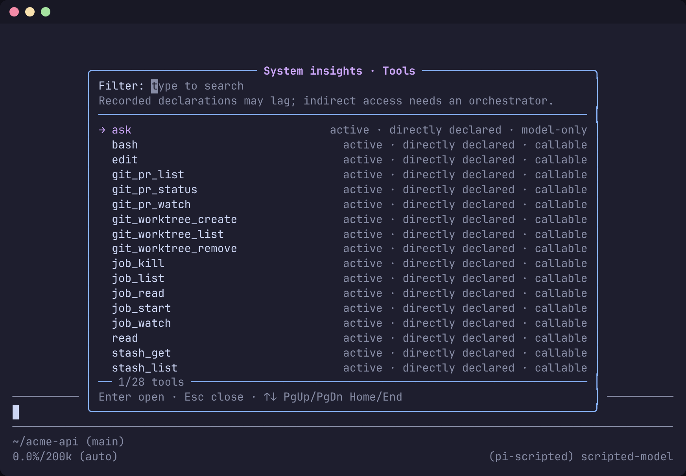

# pi-system-insights

See what the model actually has: the system prompt, every tool it can call and
every skill it can load, with evidence of which skills it has read. Read-only:
no model calls, no setting changes.

## At a glance

- **You type** `/system:prompt` to scroll through the current system prompt,
  with the tool and skill catalogs folded into markers.
- **You type** `/system:tools` to list the tools the model can call; Enter
  shows a tool's description, input schema and prompt guidelines.
- **You type** `/system:skills` to list discovered skills; a green `[loaded]`
  badge means the model read it on this branch since the last compaction.
- **Every other UI reads it:** the extension also publishes the session's
  status, model, context use, recent tool calls and usage as the
  `system.session` view, which the [dashboard](../pi-dashboard/README.md) and
  [bb](../pi-bb/README.md) draw. It does so in every mode, for every session,
  a subagent's included.

## Commands

- `/system:prompt` — scroll through the current Pi system prompt, with tool/skill
  catalog sections replaced by labeled redaction markers.
- `/system:tools` — list accessible tools. Enter opens description, input schema,
  prompt snippets/guidelines, exposure, namespace, and source metadata.
- `/system:skills` — list discovered skills, including command-only skills.
  Enter shows description, path, source, and loading evidence—not instruction
  contents. Opening this viewer never marks a skill loaded.

Views use the bundle's shared `packages/pi-ui` explorer and detail view: a
focused, centered overlay at 80% terminal width and height with a centered title,
rounded border, padded rows and prioritized footer hints. Tool and skill indexes
show names with a right-aligned status (tools) or `[loaded]` badge (skills);
descriptions remain searchable and appear in details. The note and the `[loaded]`
color legend are shown above the list and the detail. Details open with the name
and badge, then aligned fields and sections (description, input schema, snippets,
guidelines).

The viewers open in the fullscreen TUI only. Elsewhere (an app that runs Pi over RPC,
print or JSON mode) each command shows the same snapshot as plain text in a displayed
message, up to 120 lines: the prompt itself, or one row per tool or skill without its
details. The message is for you and is kept out of the model's context.

Use ↑/↓ to navigate, Enter to inspect, Esc to return to the list, then Esc to
close. Type to filter lists; Esc clears an active filter before closing. Ctrl+C
closes from any view. PgUp/PgDn and Home/End scroll text or navigate lists; Pi
alternate-screen paging remaps are honored. The mouse wheel scrolls too.
Views are snapshots taken when each command opens; reopen to refresh.

## What the labels mean

**Prompt** means Pi's current effective prompt from `ctx.getSystemPrompt()`.
Request-time transforms and provider-specific instructions may differ; this is
not a claim about exact wire bytes or the last request. Text displays literally,
not as Markdown; terminal control sequences are stripped for safe rendering.
Recognized top-level `<tools>`, `<skills>`, and legacy `<available_skills>` catalog
sections are replaced in place with `--- TOOLS [redacted] ---` or
`--- SKILLS [redacted] ---`. Other instructions, rules, nested project context,
and code examples stay unchanged. Unrecognized opaque prompt overrides are not
heuristically scrubbed. This is display folding, not security-grade redaction:
the real prompt sent to the model is never changed.

**Tools** include active non-hidden tools and registered `codemode`/`deferred`
tools callable through other tools. Inactive direct/model-only tools and hidden
tools are omitted. Direct declarations and indirect/discoverable tools are labeled
separately. Loadout-hidden declarations may remain executable indirectly.

Descriptions and input schemas are tool declarations, not necessarily literal
system-prompt text. Details show one primary description and one full input
schema: latest recorded branch declaration when present, otherwise registered
metadata. Origin is labeled; recorded descriptions capture loadout rewrites but
may lag pending changes. Prompt snippets/rules appear as readable construction
metadata, not duplicate JSON dumps. Source and access fields stay compact.
No final provider payload inspection is attempted.

**Skill loading** is observed evidence on the current branch:
successful `read` calls to a known skill file, successful nested reads (including
codemode), or expanded `/skill:name` instructions. Failed/pending reads and raw
command attempts do not count. Explicit offset/limit reads are labeled partial.
A successful nested read does not prove its caller forwarded the instructions.

A compaction or branch summary after the latest observed load marks that skill
**dirty**: instructions may have been summarized away. A later read/invocation
clears that state. Green `[loaded]` means fresh observed loading after the latest
boundary; grey `[loaded]` means not observed or dirty. A legend explains both colors.
Neither color guarantees the instructions remain in model context.
“Not observed” is not proof a skill was never loaded: shell reads, custom tools,
and old incomplete history may leave no recognizable evidence. Flags describe
history, not whether the model followed instructions.

Direct reads and skill invocations are reconstructed from current branch history.
For observed nested skill reads, a small custom session entry preserves only the
normalized path and partial flag across reload/resume. It stores no instruction
contents and never enters model context. Abandoned branches are not scanned.

## The session view

The extension observes Pi's own session state and publishes it as a
[pi-surface](../../packages/pi-surface/README.md) view: id `system.session`
(`SESSION_VIEW_ID`), kind `session`, a `SessionModel`. Any consumer on the
session's bus reads it with `readView` or `collectViews`; nothing else needs to
be installed. It is defined in every mode (terminal, RPC, print, JSON), whether
or not the dashboard or bb is loaded. pi-dashboard and bb draw each session's
header, status, activity and usage from it; neither observes Pi's core state
itself, and both show a session without it when this extension is not loaded.

| Field                    | Source                                                                         |
| ------------------------ | ------------------------------------------------------------------------------ |
| `sessionId`, `cwd`       | The current session context                                                    |
| `name`, `thinking`       | `pi.getSessionName()`, `pi.getThinkingLevel()`                                 |
| `model`, `context`       | The context's selected model and `getContextUsage()`; left out while unknown   |
| `status`                 | Lifecycle events and open forms, below                                         |
| `activity`               | The 12 most recent top-level tool calls, newest first; a running one is `live` |
| `usage`                  | Billed totals for the whole session file                                       |
| `startedAt`, `piVersion` | When the Pi process started, and Pi's version when known                       |

**Status** has one value and its `since`, which moves only when the value
changes. Precedence, highest first: `waiting` (a native Pi dialog, then the
oldest open surface questionnaire), `compacting`, `tool` (the most recent
top-level tool still running), `working`, `idle`. Tools another tool calls
(codemode scripts) stay under their parent: they change neither status nor
activity. A compaction that fails or is cancelled ends `compacting`. When Pi
settles, tools still marked running were interrupted: they leave the status
and lose their `live` mark, with no duration.

**Waiting on forms** reads surface's public form contract: every view of kind
`form` on the bus, such as pi-ask's `ask.questions`. A form with an open
questionnaire makes the session wait, named by the questionnaire's title or
its first question's header, even when no native dialog is open. The observer
re-reads forms when another view announces a change, never on its own
`system.session` announcements, and announces only when the status changes,
so publishing the waiting status cannot loop.

**Usage** adds every assistant and tool-result message, `usage` entry (such as
cache warming) and compaction or branch summary in the session file, abandoned
branches and compacted history included, as Pi's `/session` does. Current
context usage is the separate `context` field. The totals are scanned once and
cached until the history changes: a status-only refresh scans nothing.

**Lifecycle.** The view is defined at `session_start` and removed, without an
announcement, at `session_shutdown`. Each `session_start` (startup, reload,
`/new`, `/resume`, `/fork`) starts status and activity over: they describe this
process, so nothing is inferred from restored history and no tool from an
earlier process shows as running. Usage is rebuilt from the session file. Every
change that may alter the view (model, thinking, name, turn, message, tool,
prompt, compaction and tree events) announces it; consumers batch the
announcements, and reading the view never announces or changes anything.

Each subagent child loads its own copy of the extension on its own bus, so it
has its own observer and view; nothing is kept process-wide.
