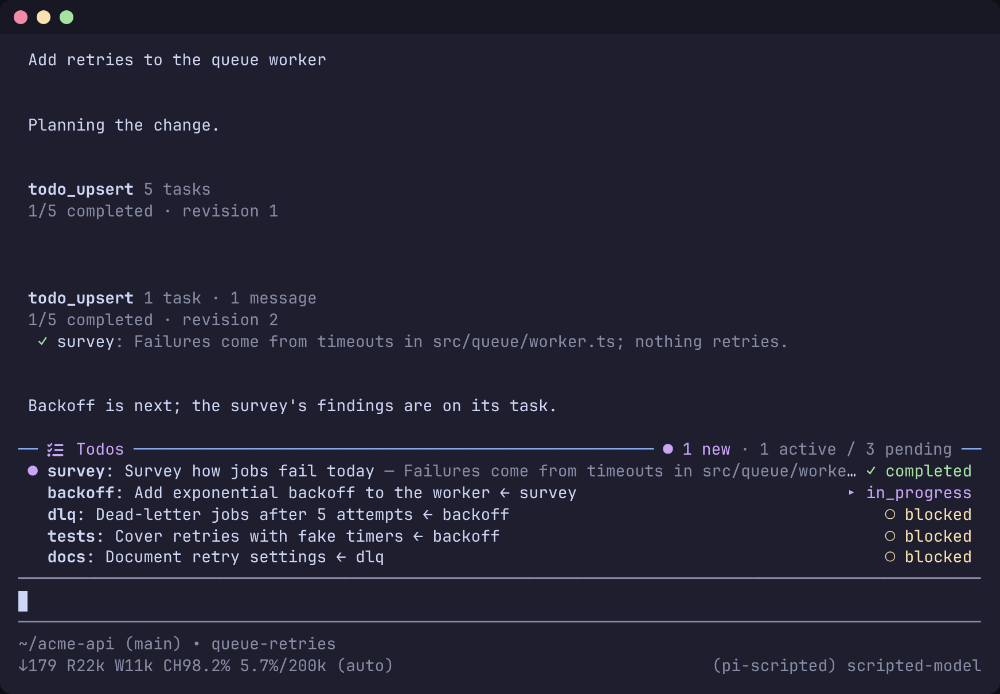
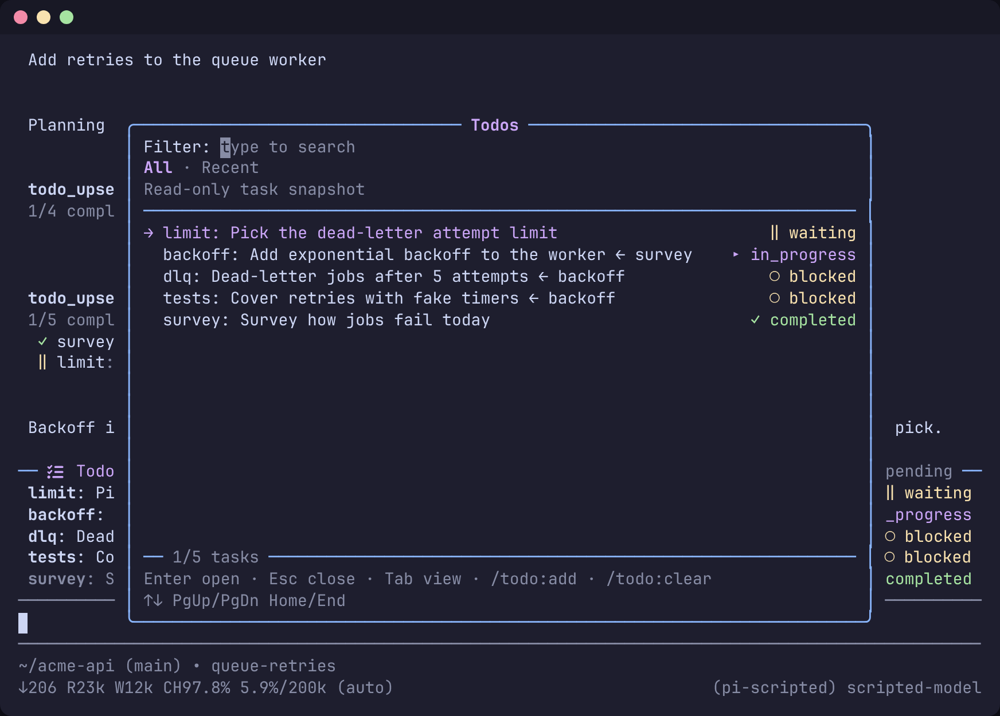

# pi-todo

A task list the agent keeps and you can watch: dependencies, statuses and the
findings recorded on each task, right above the editor.



## At a glance

- **You see** the Todos widget above the editor. A task waiting on you comes
  first, with what you need to do; then active work. A blocked task shows what
  it waits on (`← backoff`), and a task's latest finding follows its subject.
- **You type** `/todo` to browse every task and its history, and `/todo:add`,
  `/todo:update`, `/todo:remove` or `/todo:clear` to change the list yourself.
  None of them starts a turn.
- **The agent calls** `todo_upsert` to add or update tasks (with `dependsOn` and
  a `message` for what it found), `todo_list` to read, and `todo_replace`,
  `todo_remove` or `todo_clear` to delete on purpose.
- **Subagents** receive tasks with `handoff: { todo: { keys } }` on
  `subagent_start` and update them directly in your list.



The task engine comes from
[`@99percentpeople/pi-todo`](CHANGELOG.md#initial-import); the tools, UI and
subagent handoff are this bundle's.

## Agent tool

One tool per action: `todo_list`, `todo_upsert`, `todo_replace`, `todo_remove` and
`todo_clear`. All mutations are atomic and sequential. Every successful result
includes the revision and current plan. New keys require a subject; status defaults
to `pending`. Keys are stable lowercase ASCII identifiers, not display numbers.

`todo_upsert`:

```json
{
  "tasks": [
    { "key": "inspect", "subject": "Inspect implementation", "status": "in_progress" },
    { "key": "build", "subject": "Build change", "dependsOn": ["inspect"] },
    { "key": "verify", "subject": "Verify change", "dependsOn": ["build"] }
  ]
}
```

Sparse completion and handoff in one call:

```json
{
  "baseRevision": 1,
  "tasks": [
    { "key": "inspect", "status": "completed" },
    { "key": "build", "status": "in_progress" }
  ]
}
```

`verify` remains unchanged: omitting a task from `todo_upsert` never deletes it.

Record an outcome with the status change that produced it:

```json
{
  "tasks": [
    {
      "key": "build",
      "status": "completed",
      "message": "Built; 2 deprecation warnings in auth/session.ts"
    },
    { "key": "verify", "status": "in_progress" }
  ]
}
```

`message` goes into the task's history, not its description, and the user sees
it there; see [Messages](#messages).

| Tool           | Arguments        | Annotations | Behavior                                                                               |
| -------------- | ---------------- | ----------- | -------------------------------------------------------------------------------------- |
| `todo_list`    | optional `key`   | read-only   | Read revision/plan; one key returns its full description, or an archived task's record |
| `todo_upsert`  | `tasks`          | additive    | Add/patch only named keys; inherit omitted fields                                      |
| `todo_replace` | `tasks`          | destructive | Authoritative plan; omitted keys deleted; `[]` clears                                  |
| `todo_remove`  | `keys`           | destructive | Delete named tasks; dangling live dependencies rejected                                |
| `todo_clear`   | optional `scope` | destructive | `all` (default) clears the list and archive; `completed` archives every completed task |

Each tool's schema requires only its own arguments, and the read-only annotation lets
`job_watch` tool checks and read-only agents use `todo_list` without write access.

`todo_upsert` and `todo_replace` tasks accept an optional `message`. A message-only patch
still advances the revision. Full-plan output shows each task's latest message as a
120-character `lastMessage`. `todo_list` with `key` adds `createdAt` and the task's full
`updates` history.

Optional `baseRevision` rejects stale operations. Use it when user commands or
concurrent agents may have changed the plan. `description: ""` clears description;
`dependsOn: []` clears prerequisites. `todo_replace` may reorder tasks; `todo_upsert` preserves
existing order and appends new tasks.

### Waiting on the user

`waiting` is for a task only the user can move on: a decision, an approval, a
credential, something only they can reach. Setting it needs a `message` in the
same write saying what the user must do and where; without one the write is
refused. The agent can keep working on other tasks meanwhile. A waiting task is
unfinished: it counts toward the 50, takes no `in_progress` slot under
`singleActive`, and holds back the tasks that depend on it, which show as
`blocked`. When the user answers in chat, the agent moves it back to `pending`
or `in_progress` itself.

The user can also answer where they see what needs them. Each waiting task is an
item in `todo.attention`, with the message as its reason and a **Reply**
(`todo.unblock`): bb's Attention page and the dashboard's Needs you panel offer
it while the session runs, and `/attention` lists it in the terminal. A reply
is recorded on the task as the user's, sets it `pending`, and wakes the session
with one message:

```text
Task staging-host (Pick the staging host) was waiting on you: Pick the staging webhook host in .env.staging: …
The user replied: hooks.staging
```

`/todo:update` that moves a waiting task does the same with its message ("The
user set it in_progress: …"). The wake goes through a `pi-work` item, one per
waiting task (owner `pi-todo`, kind `waiting`), so it arrives exactly once, after
a run in progress, a compaction or a reload, and the dashboard lists the task
among what the session waits on. When the agent moves the task on itself, the
item closes without a message. A reply names the revision that set the task
waiting; one to a task that moved on or was set waiting again is refused.

```json
{
  "tasks": [
    {
      "key": "staging-host",
      "status": "waiting",
      "message": "Pick the staging webhook host in .env.staging: hooks.staging or a new one."
    }
  ]
}
```

Only the main session sets `waiting`. A subagent, with delegated tasks or a
list of its own, is refused and reports what it needs to its parent instead.

Dependencies must exist and be acyclic. A task cannot start or finish until every
prerequisite is completed. Reopening a prerequisite while its dependent is active
or completed is rejected unless the entire resulting plan is valid. Multiple
independent active tasks are permitted by default for parallel subagent work.

### Archived tasks

The list keeps every pending and in-progress task and the 10 most recently
completed ones. When another task completes, the one that completed longest ago
moves to the archive, so a session that runs for days does not carry every
finished task in the model's context. The effects of old work usually live
elsewhere (a merged pull request, a ticket, a document); its task record is no
longer worth the tokens.

- Full-list output adds `archivedCompleted`, the number of archived tasks.
  `todo_list` with an archived key returns its record: subject, completion time
  and the first 240 characters of its last message.
- The archive keeps the 200 most recently archived records; older ones are
  dropped. A task's history and its messages go with it.
- A prerequisite on an archived task is already satisfied: archiving drops the
  link, and a write naming an archived key in `dependsOn` leaves it out. A key
  named as a task in the same write is a new task with that key.
- `todo_clear` with `scope: "completed"` archives every completed task now;
  clearing everything also empties the archive. `todo_replace` and `todo_remove`
  delete, and never touch the archive.
- Archived records are journaled apart from the list (`todo:archive`, only the
  records each change archived), so a long archive is not rewritten on every edit.

Safety limits: 50 unfinished (pending, in-progress or waiting) tasks (a list holds at most 60 with the
recently completed ones), 20 dependencies/task, 160-character subjects,
2,000-character descriptions and messages, 40-character keys, and the latest 10
history updates per task. Plan output abbreviates
descriptions and is bounded at 30,000 characters / 48 KB; `list` with `key` gives full task
details. Validation failures never mutate state.

## Commands

| Command                                                                              | Purpose                                                                 |
| ------------------------------------------------------------------------------------ | ----------------------------------------------------------------------- |
| `/todo`                                                                              | Searchable task list, dependency details and history                    |
| `/todo:add Fix auth bug`                                                             | Add pending task with unique generated key; omit title for input dialog |
| `/todo:update fix-auth-bug in_progress`                                              | Change status explicitly                                                |
| `/todo:update fix-auth-bug completed Verified by hand`                               | Change status and record a note                                         |
| `/todo:update fix-auth-bug {"dependsOn":["inspect"],"description":"Recheck expiry"}` | Sparse field patch; `message` also accepted                             |
| `/todo:remove fix-auth-bug`                                                          | Remove one or more space-separated keys                                 |
| `/todo:clear completed`                                                              | Archive every completed task                                            |
| `/todo:clear`                                                                        | Clear all tasks and the archive, with confirmation by default           |
| `/todo:clear all --yes`                                                              | Explicitly bypass confirmation                                          |
| `/todo:settings`                                                                     | Built-in select/input settings menu, like subagents                     |

Commands never submit a user prompt, schedule a continuation, start subagents,
or mark unrelated work completed. When the next run starts, the agent gets a
hidden note listing what changed (see `contextSync` below). Clear confirmation rejects
stale revisions if tasks changed while the dialog was open, and cancels if the
session or branch changed. Non-UI clear-all
requires `--yes` unless confirmation is disabled. Model tool `clear` is already
explicit and does not open a dialog.

Outside the terminal UI, for example in an app that runs Pi over RPC, `/todo`
shows the task list as plain text and every command reports its result as a
displayed message instead of a notification. These messages are for you: they
are kept out of the model's context and never start a turn.

## Messages

In a long session with several tasks and subagents, an outcome reported in chat is
easy to lose: the next subagent result or tool burst scrolls it away. Messages attach
the outcome to its task, where it stays.

- **History:** each task keeps its latest 10 updates. An update records a status
  change, a message, or both, with its plan revision, time, and source.
  User-command updates are marked `you`.
- **Where you see them:** the widget and the `/todo` listing show each task's
  latest message after its subject; the browser's details show the whole
  history, newest first, and its filter matches message text.

## Handing tasks to subagents

A parent can hand specific tasks to a subagent through pi-subagent's generic spawn
`handoff`, under the `todo` key that pi-todo owns:

```ts
subagent_start({
  subagent_type: "general-purpose",
  description: "Audit auth",
  prompt: "…",
  handoff: { todo: { keys: ["audit", "tests"], scope: "assigned" } },
});
```

- **Checked before the spawn.** pi-todo's `tool_call` handler blocks the `subagent_start`
  call, with a reason, when a key is unknown, already completed, or held by another
  subagent. A call that passes reserves its keys, so two spawns in one turn cannot
  take the same task. A malformed `handoff.todo` is blocked too.
- **Tools supplied with the handoff.** On `subagent:session:prepare`, pi-todo requests
  `todo_list` and `todo_upsert` before the SDK fixes the child's tool allowlist.
  Restricted profiles (`explore`, `plan`, `review`, even `tools: none`) get these
  two tools for assigned work without gaining file-editing or destructive todo
  tools. Existing tools are preserved; no handoff leaves the profile unchanged.
  An explicit exclusion such as `-todo_upsert`, or pi-todo not loading in the
  child, fails initialization with a required-tools error instead of stranding work.
- **Claimed before the child starts.** When pi-subagent reports the child session
  (`subagent:session:created`, with its agent id and the same tool call id), the
  parent journals a claim in `todo:claim` entries. Claims follow the branch like
  the task list; the plan state engine is unchanged.
- **The subagent works in your list.** Its todo tools, context snapshot and widget
  ("Assigned tasks") show only its tasks with `scope: "assigned"`, or your whole list
  with `scope: "ledger"`. Its writes go to your list through
  [`pi-session-tree`](../../packages/pi-session-tree/README.md) and are checked there:
  - It may change and message its own tasks, but only the parent may mark them
    `completed`. Leave finished work `in_progress` and report the outcome in a
    `message`; the parent verifies and accepts it. This applies to new tasks too.
  - It cannot remove unfinished tasks. Once the parent completes a task, the child
    may remove or clear it, subject to the existing dependency checks.
  - New tasks it adds join its claim.
  - With `ledger`, it may also add prerequisites (`dependsOn`, keeping the existing
    ones) to tasks it does not hold, for a blocker it found. Each addition leaves a
    message on that task. Set `childPrerequisites: false` to turn this off.
  - Anything else on other tasks fails, as do `todo_replace` and clearing everything.
  - `baseRevision` is checked against the tasks the write touches, so other
    subagents' writes elsewhere do not make it stale.
- **Attributed.** Updates record the subagent's agent id (`agent a3f2b1c4` in
  history). Your widget and browser show `→ agent a3f2b1c4` on handed-over tasks.
- **Released when the agent ends.** On `subagent:completed`, `failed`, `resumed` or
  `subagent:session:disposed`, the claim is released and tasks it left `in_progress` get a
  message ("agent a3f2b1c4 ended (failed) with this task in progress"). A
  later run started by `subagent_send` (`subagent:resuming`) reclaims the agent's tasks that nobody else holds.
- **Kept across a reload or restart.** A claim belongs to the agent, not to the
  session it runs in. pi-subagent keeps agents when your session reloads or
  restarts and reopens those still waiting on work (a CI watch, a question), so
  their tasks stay theirs and their later updates still reach your list. Once
  every extension has started, the claim of an agent that did not come back (its
  run was cut short, or its work was lost) is released with the message "agent
  a3f2b1c4 ended (interrupted by a restart) with this task in progress"; sending
  it a message with `subagent_send` gives it back the tasks nobody else holds.
  A fork and `/tree` release the claims they replay: those agents belong to
  another session or branch.
- You can still edit any task yourself, handed over or not.
- A subagent working on handed-over tasks cannot hand them on to its own subagents
  yet; that `subagent_start` call is blocked. Without a handoff, a subagent keeps its own
  separate list as before.

## UI

The widget and browser render through the bundle's shared `packages/pi-ui`
library (`renderWidget` and `showExplorer`) from JSON models (see
[Persistence and integration boundaries](#persistence-and-integration-boundaries));
this extension supplies task selection, ordering, status colors and the
`todo.inspect` action.

Above-editor widget uses a static top rule with the Nerd Font tasks icon
(`nf-fa-tasks`, U+F0AE); use a patched Nerd Font, preferably its Mono variant.
Each task occupies one physical row, with identity left (the key bold, as the
subagent widget bolds an agent's name) and lifecycle status right. The header
counts active and pending tasks, `1 active / 2 pending`, as the subagent widget
counts agents; blocked tasks count as pending, completed tasks are not counted,
and a zero count is left out. Tasks waiting on you add `1 waiting on you` in
warning tone before them. Body rows reserve one space on each side. Theme tokens match subagents. Tasks
waiting on you (`‖ waiting`) appear first, then active work, ready tasks,
blocked tasks, and completed tasks. Dependency keys stay
visible; overflow becomes `+N more`. Completed tasks remain in state until
explicitly cleared; hiding them affects display only.

```text
──   Todos ─────────────────────── 1 active / 1 pending ──
▸ build Build change ← inspect                  in progress
○ verify Verify change ← build                     blocked
✓ inspect Inspect implementation                  completed
```

A task with messages shows a dim one-line excerpt of its latest one after its
identity; messages never change the order or the header. Narrow terminals drop
the counts, then the icon; on narrow rows the assignee badge drops first, then
the task identity clips before the status label, and the status glyph always
stays.

```text
──   Todos ──────────────────────────────────── 1 active / 1 pending ──
 build: Build change ← inspect                            ▸ in_progress
 verify: Verify change ← build                                ○ blocked
 inspect: Inspect implementation — Auth in src/auth/token ✓ completed
```

Browser uses the shared explorer controls: type to filter, arrows/PgUp/PgDn/Home/End
and the mouse wheel select, Enter details, Esc backs out/clears filter/closes,
Ctrl+C closes. Tab and Shift+Tab
cycle two views: All (status order) and Recent (all tasks by last activity). The
filter also matches message text. Details add created and updated times, plus an
activity timeline, newest first. The browser is a centered overlay in
Pi's fullscreen TUI (the regular renderer is not supported). Task text is
sanitized before terminal rendering.
Tool output is compact by default; expand it to list the tasks the call added,
updated or removed (the full list stays in the widget). Calls show how many
messages they carry, and results list each recorded message on its own row. RPC
gets plain-text widget output; task tools remain usable without terminal UI.

## Settings

Same layering as subagents: defaults → `<agentDir>/todo.json` →
`<cwd>/.pi/todo.json`. Agent directory honors `PI_CODING_AGENT_DIR` (normally
`~/.pi/agent`). `/todo:settings` writes only the changed project setting; global
settings are edited manually. Settings apply immediately. If persistence fails,
the change remains session-only with a warning. Invalid fields fall back to the
lower-priority layer; malformed files warn instead of preventing startup.

```json
{
  "widget": true,
  "maxVisible": 5,
  "showCompleted": true,
  "singleActive": false,
  "confirmClear": true,
  "contextSync": "changes",
  "childPrerequisites": true
}
```

- `maxVisible`: 1–12 task rows; short terminals further limit widget height.
- `showCompleted`: hides completed tasks in the widget.
- `singleActive`: reject mutations resulting in multiple active tasks. No implicit demotion.
- `contextSync`: `changes` writes a hidden note (`todo:sync`) into the transcript
  when the list differs from what the model last saw: its latest untruncated
  whole-list todo result, or the latest note, still in context after the last
  compaction. The note lists each changed task (status, subject, description,
  prerequisites, the latest message, and who changed it when the task's history
  records it) and counts the rest; it holds the whole list instead when the model
  has none (a new session's first run, a subagent's first look at its tasks, after
  a compaction) or when the changes would be longer than the list. Notes are
  written when a run starts (after its prompt), at the end of a turn in which the
  list changed (a subagent's updates), and after a compaction. Each is written
  once and keeps its place, so later requests do not repeat it and the prompt
  cache keeps working. `off` writes no notes; then call `todo_list` after user
  changes or compaction. No periodic work reminders or forced turns.
- `childPrerequisites`: let a subagent holding a `ledger` claim add prerequisites to
  tasks it does not hold (see [Handing tasks to subagents](#handing-tasks-to-subagents)).

## Persistence and integration boundaries

Tasks live in the active session branch, never a shared project task file. Each
mutation journals an immutable snapshot, task history included, with `pi.appendEntry`, covering commands
and nested codemode tool calls whose result details Pi does not persist. Direct
tool results also carry snapshots for the model, but replay reads only the
journal, so a delayed direct result cannot overwrite a newer command edit.
Reload, resume, tree navigation, and compaction restore the latest valid
journaled snapshot on the branch. Archived tasks are a separate `todo:archive`
journal of the records each change archived; like tasks, they follow the
branch. Entries of types pi-todo no longer writes are ignored. Compaction checkpoints state without
sending steering messages or running the agent.

Subagent sessions keep their own lists unless tasks were handed to them, and then
they write only through the parent's checks. No task status is inferred from child
notifications: successful child exit is not proof that parent verification passed;
the only automatic effect of an agent ending is releasing its claim. No subagent
spawning or process-global task store. Matching
UX and explicit model control keep extensions composable and independently loadable.

Other extensions and remote surfaces read tasks without coupling to the journal
format: from session start to shutdown pi-todo defines views and actions on the
session's bus (see [`pi-surface`](../../packages/pi-surface/README.md)), so
pi-dashboard and bb draw the widget, the browser and the counts and act on them.
Each subagent has its own bus, so a consumer sees only its own session's tasks.

| Id               | Kind      | What it does                                                                                                                                    |
| ---------------- | --------- | ----------------------------------------------------------------------------------------------------------------------------------------------- |
| `todo.widget`    | widget    | The above-editor widget as a JSON `WidgetModel`; nothing while the terminal would hide it (no tasks, `widget` off, only hidden completed tasks) |
| `todo.explorer`  | explorer  | The `/todo` browser on its All tab as a JSON `ExplorerModel`; `loadDetail` is `todo.inspect`                                                    |
| `todo.summary`   | summary   | This branch's task counts and the task in progress as a `SummaryModel`, whether or not the widget shows (see below)                             |
| `todo.inspect`   | action    | `{ id }` resolves to the task's detail blocks                                                                                                   |
| `todo.attention` | attention | One item per task waiting on the user: id `task:<key>`, category `task`, the message as reason, `reply` to `todo.unblock`                       |
| `todo.unblock`   | action    | `{ key, rev, text }` answers a waiting task: the text as the user's update, the task `pending`, the session woken with the answer               |

The terminal draws the same models: the widget is `todo.widget`'s model with the
terminal's row budgets, and `/todo` opens the `todo.explorer` model, loading
details through `todo.inspect`. The views announce a change after every plan
change and settings change.

`todo.summary` counts the branch's whole list, from the same state as the
widget and `/todo` but never filtered or capped by them: it answers while the
widget is off, hides completed tasks or shows fewer rows than there are tasks.
Every count is present, zero included, so an empty list reads as zeros where a
session without pi-todo has no `todo.summary` at all. `active` is the first task
in progress, in list order (`{ id: <key>, label: <subject> }`).

| Key           | Counts                                                    |
| ------------- | --------------------------------------------------------- |
| `total`       | Tasks on the list                                         |
| `completed`   | Completed tasks on the list                               |
| `in-progress` | Tasks in progress                                         |
| `waiting`     | Tasks waiting on the user                                 |
| `pending`     | Pending tasks free to start                               |
| `blocked`     | Pending tasks waiting on an unfinished prerequisite       |
| `archived`    | Completed tasks archived off the list (`list` reads them) |

`completed`, `in-progress`, `waiting`, `pending` and `blocked` add up to `total`. Task
statuses live in the session file, so no count and no active
task is process-bound (`live`): a saved summary settles unchanged.

## Migrating from rpiv-todo

Remove or disable `@juicesharp/rpiv-todo` before loading this extension: both own
the todo tools and `/todo`. Nothing here changes your personal Pi settings automatically.
For an installed bundle, remove the old package and reload:

```bash
pi remove npm:@juicesharp/rpiv-todo
```

Old rpiv session snapshots are not imported. Finish existing work with rpiv or
recreate its plan explicitly. Valid snapshots from the selected upstream engine
remain readable; action schema differs, so update instructions referring to its
full-list writes or rpiv's numeric IDs/create/update actions.

## License

The upstream MIT license is kept in [LICENSE](LICENSE); the
[initial import entry](CHANGELOG.md#initial-import) records the pinned source.
