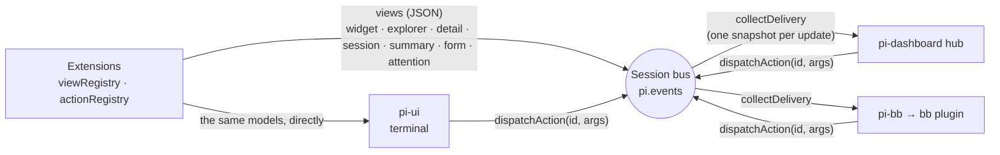

# pi-surface

A small library (not an extension) that describes views without drawing them.
An extension builds a view model once; [pi-ui](../pi-ui/README.md) draws it in
the terminal, and another renderer, such as a web app over Pi's RPC mode, can
draw the same model. It has no runtime dependencies: it imports neither
`@earendil-works/pi-tui` nor `@earendil-works/pi-coding-agent`, and a test fails
if it does.

```ts
import { actionRegistry, type ExplorerModel } from "#surface";
```

## At a glance

An extension **describes** what it wants shown and **names** what it can do; every
renderer of the session draws the same description and calls actions by name.

```ts
// In an extension: offer a view and an action on the session's bus.
const views = viewRegistry(pi.events);
const actions = actionRegistry(pi.events);
pi.on("session_start", () => {
  views.define({ id: "todo.widget", kind: "widget", title: "Tasks", model: () => widgetModel() });
  actions.define({ id: "todo.inspect", title: "Task details", parse, handler });
});
views.changed("todo.widget"); // after every change the model would show

// In a remote renderer: read everything, redraw on change, run what the views reference.
const snapshot = collectViews(pi.events);
onViewChanged(pi.events, () => redraw());
await dispatchAction(pi.events, "todo.inspect", { id: "backoff" });
```



Every model is plain JSON with no functions; behaviour is an `ActionRef`
(`{ action, args? }`) the renderer dispatches. That is what lets the
dashboard's hub and the bb plugin, which run outside Pi, draw the same views.

## The rule

A view model is JSON; behaviour is an action reference. A model must survive
`JSON.parse(JSON.stringify(model))` unchanged, so it holds no functions, class
instances, `undefined` array items, `NaN` or `Infinity`. Where a view needs
behaviour (load a detail, clear a marker) it carries an `ActionRef`:

```ts
type ActionRef = { action: string; args?: JsonValue };
```

The renderer resolves the reference through the session's action registry at
the moment it would have called a callback.

## Model types

| Type                                                               | What it is                                                                                          |
| ------------------------------------------------------------------ | --------------------------------------------------------------------------------------------------- |
| `Tone`, `Span`, `Line`, `Badge`, `Title`                           | Plain, untrusted text with a semantic tone; the renderer picks colours                              |
| `StateIcon`                                                        | A state a span's glyph stands for; a renderer may draw its own icon                                 |
| `Block`, `DetailContent`, `DetailModel`                            | Structured detail: headings, fields, text, bullets, numbered lines                                  |
| `Hint`                                                             | A footer hint: keys, action, priority                                                               |
| `WidgetRow`, `WidgetModel`                                         | A compact heading with rows, right-column fallbacks and overflow groups                             |
| `ExplorerItem`, `ExplorerTab`, `ExplorerMarker`, `ExplorerModel`   | A filterable list that opens into detail content                                                    |
| `SessionModel`, `SessionStatus`, `SessionActivity`, `SessionUsage` | Core session information (see [Session, summary and form models](#session-summary-and-form-models)) |
| `SummaryModel`, `SummaryCount`, `SummaryItem`, `SummaryProfile`    | An extension's structured counts, active item and profile                                           |
| `SummaryUnit`                                                      | What a count measures when it is not a number of things: `"bytes"`                                  |
| `FormModel`, `FormQuestionnaire`, `FormQuestion`, `FormAnswer`     | Open questionnaires and the answer a consumer submits                                               |
| `AttentionModel`, `AttentionItem`, `AttentionLink`                 | What a session owes the user (see [Attention](#attention))                                          |
| `ActionRef`, `JsonValue`, `JsonObject`                             | Behaviour by reference, and the JSON the model is made of                                           |

An explorer's tabs are its filters. A tab marked `secondary` matters less
(finished or merely referenced items): bb tucks secondary tabs into a **More**
menu after the others, and a renderer that ignores the flag shows them as
ordinary tabs.

A span can say which state its glyph stands for: `icon` (`done`, `active`,
`blocked`…) lets a renderer with icons (bb) draw its own in the glyph's place.
The terminal draws the text as it always has, so an icon span with empty text
shows only where icons are drawn. `since` marks a span's text as an elapsed
clock that started at that time (epoch milliseconds), so a renderer that does
not redraw on a timer, such as bb drawing a snapshot, can keep it running.

A widget row's `lead` is a short column before its text, such as a clock. The
terminal draws it two spaces before `left`; bb draws it after the row's state
icon (the icon span in its right column), which starts every row.

Every model type is a type alias, so a model is assignable to `JsonValue`.
`isJsonValue`, `isJsonObject`, `isDetailContent`, `isBlock`, `isLine`, `isSpan`
and `isActionRef` check data that arrives from elsewhere, such as an action's
result. Each kind's model has its own guard (`isWidgetModel`, `isExplorerModel`,
`isDetailModel`, `isSessionModel`, `isSummaryModel`, `isFormModel`,
`isAttentionModel`), and
`isViewModel(kind, value)` picks the one for a kind. They check nested data
too, refuse `NaN` and `Infinity`, and return false for a kind they do not know.
`isActionReference` checks a reference a model carries: an action id of the
`<extension>.<verb>` shape and JSON arguments.

### Process-bound state

Some state exists only while the Pi process that produced it runs: a running
tool or agent, a ticking clock, a count of running things. A view shown after
the process has gone, such as a saved snapshot in bb, settles that state, and
it does so from explicit `live` marks alone, never by guessing from an icon,
tone or text:

| Marked                   | Settled                                                                                  |
| ------------------------ | ---------------------------------------------------------------------------------------- |
| `Span.live`              | Loses `since` (the clock stops at its text); an `icon` becomes `stopped`                 |
| `Badge.live`             | Replaced by the badge given there, or removed when it is `true`                          |
| `WidgetRow.live`         | Fields given there replace the row's own; its spans settle by their own marks            |
| `WidgetModel.live`       | `active` and `meta` given there replace the heading's own; `true` changes neither        |
| `SummaryCount.live`      | Its `value` reads 0                                                                      |
| `SummaryItem.live`       | The summary has no active item                                                           |
| `SessionActivity.live`   | The flag is dropped; the call keeps no duration                                          |
| `SessionStatus` (always) | A status other than idle becomes `{ kind: "idle" }` from the time it settled; idle stays |
| `FormModel` (always)     | Removed: nobody can answer it                                                            |
| `AttentionItem.live`     | The item is removed, and the model's `total` no longer counts it                         |

Settling drops each mark it applies, so a settled view has no `live` field
left and settling again changes nothing. `settleSnapshot` applies these rules;
see [Saved snapshots](#saved-snapshots).

State kept in the session file is never `live`: a task's `in_progress`
status, review marks, finished-agent history, Git and stash records survive
unchanged, even where they share the `active` icon with runtime state.

In an `ExplorerModel`, `loadDetail` and `onOpen` are dispatched with the
reference's `args` (an object) plus `{ id }` of the opened item;
`marker.onClear` gets `{ ids }`. `loadDetail` must resolve to `DetailContent`.
Row budgets and docking are terminal layout and stay in pi-ui's `WidgetView`.

## Action registry

Actions live on the session's event bus (`pi.events`), not on `globalThis`:
every subagent is a session in the same process with its own bus, and each
extension loads its own copy of this library. A definition is a listener on the
`surface:actions` channel; listing and dispatching are requests on that channel,
answered synchronously.

```ts
const actions = actionRegistry(pi.events);
pi.on("session_start", () => {
  actions.dispose(); // in case session_start runs again on this factory
  actions.define({
    id: "stash.inspect", // <extension>.<verb>, lowercase, dot separated
    title: "Show a stash entry's details and content preview",
    parse: (args) => {
      if (!isJsonObject(args) || typeof args.id !== "string") throw new Error("expected { id }");
      return { id: args.id };
    },
    handler: async ({ id }) => detailBlocks(id), // JSON, or nothing
  });
});
pi.on("session_shutdown", () => actions.dispose());
```

| Function                         | Result                                                                |
| -------------------------------- | --------------------------------------------------------------------- |
| `defineAction(bus, definition)`  | Defines one action; returns the function that removes it              |
| `listActions(bus)`               | `{ id, title }[]` sorted by id                                        |
| `dispatchAction(bus, id, args?)` | Promise of the handler's JSON result, or `undefined`                  |
| `actionRegistry(bus)`            | `define`, `list`, `dispatch`, and `dispose` for everything it defined |

`defineAction` throws for an id that is not `<extension>.<verb>` (one or more
lowercase dot-separated segments after the extension, such as
`git.worktree.remove`), for an empty title, and for an id already defined on
that bus. `dispatchAction` rejects with `Unknown action "<id>".`, with
`Arguments for action "<id>" are not JSON.`, with
`Invalid arguments for "<id>": <parse error>`, with
`Action "<id>" returned a value that is not JSON.`, and with the handler's own
error.

Define actions on `session_start` and dispose them on `session_shutdown`. Pi
keeps the same bus across `/reload` and runs the extension factory again, so a
definition made in the factory and never removed would answer twice.

## Views

A view is a named model an extension offers to every consumer of its session,
such as the dashboard's page or the bb plugin, both reached through an adapter
extension (pi-dashboard, pi-bb) that collects the session's views. Views live on the
same bus as actions, answered on the `surface:views` channel, and are
defined and disposed the same way. Each copy of this library answers for all
the views it defines on a bus with one listener, so a session's many views stay
under Node's default limit of listeners on one event.

```ts
const views = viewRegistry(pi.events);
pi.on("session_start", () => {
  views.dispose();
  views.define({
    id: "todo.widget", // <extension>.<view>
    kind: "widget", // "widget" | "explorer" | "detail"
    title: "Tasks",
    model: () => (visible() ? widgetModel() : undefined), // built on every read
  });
});
// After every change the model would show:
views.changed("todo.widget");
pi.on("session_shutdown", () => views.dispose());
```

| Kind        | Model            | Meant for                                                  |
| ----------- | ---------------- | ---------------------------------------------------------- |
| `widget`    | `WidgetModel`    | Small, always visible: a remote surface shows it           |
| `explorer`  | `ExplorerModel`  | A list opened on demand; details load by action            |
| `detail`    | `DetailModel`    | One standalone detail, opened on demand                    |
| `session`   | `SessionModel`   | Core session information, from `system.session`            |
| `summary`   | `SummaryModel`   | Counts, active item and profile for badges and headers     |
| `form`      | `FormModel`      | Open questionnaires a consumer can answer, `ask.questions` |
| `attention` | `AttentionModel` | What the session owes the user, `<extension>.attention`    |

A consumer draws the kinds it knows and skips every other: `isViewKind` says
whether this copy knows a kind, and a newer producer may offer one it does not.

| Function                       | Result                                                                    |
| ------------------------------ | ------------------------------------------------------------------------- |
| `defineView(bus, definition)`  | Defines and announces one view; returns the remover, which announces too  |
| `listViews(bus)`               | `{ id, kind, title }[]` sorted by id                                      |
| `readView(bus, id)`            | The current model, or `undefined` while the view has nothing to show      |
| `announceView(bus, id)`        | Emits `surface:view-changed` with `{ version: 1, id }`                    |
| `onViewChanged(bus, listener)` | Calls `listener(id)` for each announcement; returns the unsubscribe       |
| `viewRegistry(bus)`            | `define`, `list`, `read`, `changed`, and `dispose` for everything defined |

`defineView` throws for an id that is not `<extension>.<view>` (the same shape as
an action id), an unknown kind, an empty title, and an id already defined on that
bus. `readView` throws `Unknown view "<id>".`, the provider's own error, and
`View "<id>" returned a model that is not JSON.` for anything but a JSON object.
The model function runs in the reader, outside the bus emit, so a provider that
throws does not disturb other listeners.

An announcement carries only the id: consumers read the model again when they
need it. Defining a view announces it, once it can be read. Removing one with
the function `defineView` or a registry's `define` returned announces its id
again, after it has left the bus, so the next collection no longer has it and
a receiver drops it without waiting for an unrelated change; the removal's
announcement is dropped when Pi has already retired the bus. A consumer
therefore treats an announced id it cannot find as a removal, not as noise.

A registry's `dispose` removes everything it defined without announcing. It
runs at `session_shutdown` and before `session_start` defines again: at
shutdown an announcement would make an adapter send a snapshot with every view
gone, which a receiver that saves its last snapshot (bb) would keep, and on
`session_start` the new definitions announce themselves. A registry's
`changed` does nothing for an id it does not currently define, so a late call
after `dispose` never reaches a bus Pi has retired.

## How pi-ui uses it

pi-ui imports these types and re-exports them under the same names, so
extensions keep importing from `#ui`. Its `ExplorerView` is an `ExplorerModel`
whose `loadDetail`, `onOpen` and `marker.onClear` may also be callbacks. Pass
the session's bus to resolve references:

```ts
await showExplorer(ctx, model, { command: "/stash", actions: pi.events });
```

A failed or unknown action, or one that returns something other than
`DetailContent`, shows `Couldn't load: <message>` in place, as a failed loader
does. `onOpen` and `onClear` actions run in the background and their failures
are dropped.

## Session, summary and form models

These describe a session for consumers outside the terminal, such as the
dashboard and bb. Display text and machine-readable values are separate fields:
a consumer never parses a number out of a label or a widget's `meta`.

**`session`** (`SessionModel`) holds what Pi itself knows about the session:
`sessionId`, `cwd`, `name`, `model`, `thinking`, `context` usage, `status` with
its `since`, recent top-level tool `activity` (newest first), `usage` totals for
the whole session file (abandoned branches and compacted history included),
the process's `startedAt` and `piVersion`. pi-system-insights provides it as
`SESSION_VIEW_ID` (`system.session`). It carries no main-agent profile, which
pi-subagent's summary owns, and no connection identity, which belongs to the
delivery snapshot. Status precedence is waiting, compacting, tool, working, idle.

**`summary`** (`SummaryModel`) is what an extension reports about its own state:
`counts` (each with a stable `key`, a display `label`, a finite `value` of zero
or more, an optional `unit` and an optional `live` mark), an `active` item by
the producer's own id, and an optional `profile` (such as the main agent's).
Counts are the producer's totals, never the rows some display shows, so they
stay right when a widget is hidden or a list is capped. An empty summary means a
loaded extension with nothing yet; an absent view means it is not loaded.
`summaryCount(model, key)` reads one count; consumers select counts by `key`.

A count's `label` is the text that follows its formatted value. The producer
chooses it for the value when it builds the summary, so a noun agrees in number
("1 worktree", "2 worktrees", "1 entry"); a state reads the same for any value
("3 running", "1 open"). A `live` count settles to 0 with the same label, so its
label must read right at 0 too. `unit: "bytes"` (the only unit) marks a size:
consumers format its value as one, and its label follows a size ("887 B in the
store", "1.0 GiB store cap"). `isSummaryModel` refuses any other unit.

`src/format.ts` holds the display text every renderer uses, so a count reads the
same in the dashboard, bb and anywhere else:

| Function                    | Returns                                                       |
| --------------------------- | ------------------------------------------------------------- |
| `formatSummaryCount(count)` | The value, then the label: `1 worktree`, `887 B in the store` |
| `formatBytes(bytes)`        | A short size in binary units: `887 B`, `12.4 KiB`, `1.0 GiB`  |
| `formatCount(value)`        | A short number: `7`, `2.5`, `12k`, `1.2M`                     |

Each is self-contained (no module state, and it calls only the others by name),
so a page that cannot import modules, such as the dashboard's inline script,
embeds their source with `Function.prototype.toString`.

**`form`** (`FormModel`) holds the session's open questionnaires, oldest first.
Each `FormQuestionnaire` has its own opaque `id` (pi-ask uses the asking tool
call's id; it need not have a view id's shape), its questions with options and
`multiSelect`, a `submit` reference and a `cancel` reference. Every question
also takes typed text and a note. A consumer dispatches `submit` with the
reference's arguments plus a `FormAnswer`'s fields (`answers` by question and
option index, optional `globalNote`), and `cancel` with its arguments alone;
the owner validates the answer again, all or nothing. pi-ask provides it as
`FORM_VIEW_ID` (`ask.questions`). `isFormModel` enforces the exported bounds:

| Constant                  | Bound |
| ------------------------- | ----- |
| `MAX_FORM_QUESTIONNAIRES` | 8     |
| `MAX_QUESTIONNAIRE_ID`    | 200   |
| `MAX_FORM_TITLE`          | 200   |
| `MAX_FORM_QUESTIONS`      | 8     |
| `MAX_FORM_OPTIONS`        | 20    |
| `MAX_FORM_TEXT`           | 4,000 |
| `MAX_FORM_HEADER`         | 60    |
| `MAX_FORM_LABEL`          | 200   |

Lengths count UTF-16 units, as `String.length` does. Two questionnaires in one
form never share an id.

## Attention

**`attention`** (`AttentionModel`) is what one producer says the session owes
the user: work handed off for review, findings to read. Each producer defines
one view, `<extension>.attention` (`git.attention`); `ATTENTION_VIEW_SUFFIX`
holds the suffix. The model is `items`, in the producer's order, and `total`,
the producer's true count (at least `items.length`), so a capped list can say
"and 12 more".

```ts
views.define({
  id: "git.attention",
  kind: "attention",
  title: "Git",
  model: () => ({
    items: [
      {
        id: "pr:github.com/acme/web#42", // stable within the view, opaque
        rev: "a13c90e", // what was handed off; a dismissal names it
        category: "review", // a renderer maps it to an icon; unknown → generic
        title: "Review acme/web#42",
        reason: "Checkout cleanup · draft at a13c90e",
        state: "ready", // "stale": still owed, but it changed since
        since: raisedAt,
        link: { url: "https://github.com/acme/web/pull/42", label: "acme/web#42" },
        dismiss: { action: "git.attention-dismiss", args: { id, rev } },
      },
    ],
    total: 1,
  }),
});
```

An item lives in the session file, so it outlasts the process: settling keeps
it as last known, link included, and drops its `open` and `dismiss` actions.
An item marked `live` exists only while the process runs and is removed. A
consumer dispatches `open` and `dismiss` with the reference's arguments as
given. `isAttentionModel` enforces the exported bounds, and refuses two items
with one id:

| Constant                 | Bound                                 |
| ------------------------ | ------------------------------------- |
| `MAX_ATTENTION_ITEMS`    | 50                                    |
| `MAX_ATTENTION_ID`       | 200, for `id` and `rev`               |
| `MAX_ATTENTION_CATEGORY` | 40, lowercase words joined by hyphens |
| `MAX_ATTENTION_TITLE`    | 200, every span's text together       |
| `MAX_ATTENTION_REASON`   | 500                                   |
| `MAX_ATTENTION_URL`      | 2,000                                 |
| `MAX_ATTENTION_LABEL`    | 100, for the link's label             |

A link is `https:` only. `isAttentionUrl` is the check, and every consumer runs
it again before drawing a link, since a saved snapshot may come from anywhere.

## Delivery snapshots and action requests

A `DeliverySnapshot` is what an adapter sends a receiver for one session: its
routing `id` (connection identity, such as one stable for the Pi process), an
optional `host` (`pid`, and the `terminal` dashboard Focus uses), and every
collected view as a `ViewEntry`: `id`, `kind`, `title`, and either its `model`
or a bounded `error` (at most `MAX_VIEW_ERROR` characters). A view with nothing
to show is left out. Each snapshot replaces the previous one; core session
information is the `session` view, not an envelope field, and a receiver
tolerates its absence.

`isDeliverySnapshot` is strict: every entry must be a valid entry of a known
kind, ids unique. `readDeliverySnapshot` is what a receiver uses on data from a
possibly newer producer: it returns `undefined` only for a malformed envelope,
leaves out entries of unknown kinds or without an id or title, turns a known
kind's malformed model into an error entry, and keeps the first entry for an id.

`ActionRequest` (`{ action, args? }`) and `ActionResult` (`{ ok: true, value? }`
or `{ ok: false, error }`) are the generic shapes for running an action from a
receiver, checked by `isActionRequest` and `isActionResult`.

Both transports send these: pi-dashboard's reporter to its hub (protocol 7) and
pi-bb to the bb plugin (protocol 3). Each builds its snapshots with the functions
below and runs every incoming `ActionRequest` through `dispatchAction` on the
session's bus; the dashboard's Focus is its own host request, not an action.

## Collecting views

`collectViews(bus)` reads every view registered on a session's bus at that
moment, sorted by id, and keeps no copy of any extension's state. Reading is
pure: it never announces. A view whose model is `undefined` is left out. One
failing view never affects the others; it becomes an error entry (at most
`MAX_VIEW_ERROR` characters) when its provider throws, returns something that
is not JSON, returns a model that fails `isViewModel` for its kind, or returns
a model over `MAX_VIEW_BYTES` (256 KiB) of UTF-8 JSON. A view of a kind this
copy does not know is left out, since its model cannot be checked. It works
with or without `system.session`, and throws only when the bus itself does.

`collectDelivery(bus, { id, host?, budget })` builds one complete
`DeliverySnapshot` that fits the adapter's message:

```ts
const result = collectDelivery(pi.events, {
  id: String(process.pid),
  budget: { maxBytes: BB_MESSAGE_BYTES, framingBytes: 256 },
});
if (result.ok) socket.send(`{"type":"update","snapshot":${result.json}}`);
else report(result.error); // never skip an update silently
```

`budget.maxBytes` is the transport's ceiling for one message and
`framingBytes` what the adapter adds around the snapshot (its envelope, other
fields, a line terminator); the snapshot gets the difference. Sizes are UTF-8
bytes of the JSON as sent, never `String.length`. The result's `json` is
exactly the measured text and `bytes` its size.

When the snapshot is over budget, models are replaced by error entries
("Left out to fit one message: …"), the largest first, ties by id, until it
fits; `evicted` names them. The same views always give the same result. A
model is either sent whole or replaced, a form included: nothing is cut short.
When even the snapshot with every model replaced does not fit, or the bus
cannot be read, the result is `{ ok: false, error, bytes }` and nothing is to
be sent; the adapter reports `error`. Options that leave no room, an invalid
id and a malformed host throw.

| Constant               | Bytes   | Ceiling                                                                       |
| ---------------------- | ------- | ----------------------------------------------------------------------------- |
| `MAX_VIEW_BYTES`       | 256 KiB | One view's model                                                              |
| `BB_MESSAGE_BYTES`     | 2 MiB   | One message to the bb plugin (`MAX_MESSAGE_BYTES` in `bb-plugin/protocol.ts`) |
| `DASHBOARD_LINE_BYTES` | 1 MiB   | One reporter line to the dashboard hub (`MAX_LINE_BYTES` in its protocol)     |

On the receiving side, `decodeJson(data, maxBytes)` checks one complete message
or line (a string, measured as UTF-8, or bytes) against the ceiling before
parsing it, and `decodeDeliverySnapshot(data, maxBytes)` also reads it with
`readDeliverySnapshot`. Both return `{ ok: true, value }` or
`{ ok: false, error }` and never throw. `utf8Bytes(text)` measures a string.

## Batching announcements

An adapter coalesces bursts of announcements with `batchViews`:

```ts
const batcher = batchViews(pi.events, { delayMs: 50, flush: () => send(collectDelivery(...)) });
// on disconnect or session_shutdown:
batcher.dispose();
```

Create it once the connection is ready. It subscribes, then flushes at once,
before it returns, so the first delivery is a complete read and nothing
announced after setup is missed. Each later announcement starts the delay
unless a flush is pending, so a burst gives one flush within `delayMs` of its
start. `schedule()` joins the adapter's own triggers to the batch and
`flushNow()` replaces a pending flush. A disposed batcher never flushes, even
when a timer fires late. `timers` replaces `setTimeout` and `clearTimeout` in
tests, and `onError` receives what `flush` throws, which is otherwise dropped
so a timer cannot crash Pi.

## Form consumers

Whether anyone can answer forms is discovered on the session's bus, like
actions and views; nothing is process-global and no form state is kept.

```ts
// Consumer, once its connection is up and its form handler is ready:
const revoke = advertiseFormConsumer(pi.events, { name: "bb" });
// on disconnect or disposal:
revoke();

// Producer:
if (hasFormConsumer(pi.events)) publishForm();
onFormCapabilityChanged(pi.events, (available) => (available ? publishForm() : handOver()));
```

`advertiseFormConsumer` announces the consumer and returns an idempotent
revoke that announces its withdrawal. `listFormConsumers` and
`hasFormConsumer` answer for the bus now. `onFormCapabilityChanged` reports
only real changes: `true` when the first consumer arrives, `false` when the
last withdraws; a second consumer, or one of two leaving, is not reported.
Saved snapshots and fixtures never advertise: nobody can answer them.

## Saved snapshots

`settleSnapshot(snapshot, settledAt)` returns a snapshot as it should be shown
once its Pi process has gone, such as a thread bb restores from its saved
record; `settleViews(views, settledAt)` does the same for the views alone.
`settledAt` is when the session stopped being live (epoch milliseconds), such
as when its last snapshot was saved. The result is a new copy: the input is
never changed and shares nothing with it, so restoring cannot reach a live
producer's objects.

- Form views are removed, error entries of the form kind too.
- Attention items marked `live` are removed, and `total` no longer counts
  them; the others keep their links.
- Every `live` mark settles as the [process-bound table](#process-bound-state)
  says, and is dropped. Unmarked state, such as a persisted task's `active`
  icon, finished-agent history, Git and stash records, is kept as it is.
- Actions are disabled by removing their references: an explorer's `onOpen`
  and `loadDetail`, and its marker's `onClear` with its `clearAction` hint.
  The marker's label and marks stay; an item with included `detail` still
  opens into it. An attention item loses its `open` and `dismiss`.
- The snapshot's `host` is removed: its pid and terminal belong to the process
  that has gone.
- An entry of a kind this copy does not know is removed.
