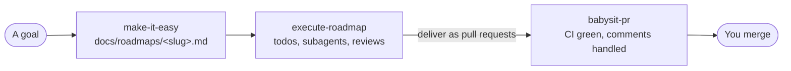

# Skills

The bundle loads every skill here, and the skills an extension ships in its own
`skills/` directory, so one install provides them all. The model loads a skill
when its description matches the task; force one with `/skill:<name>`.

## make-it-easy

**You say:** "plan how we'd add multi-region failover". **You get:** a roadmap
document with two or three strategies, a recommendation, and ordered steps that
each ship on their own.

It follows Kent Beck's "make the change easy (warning: this may be hard), then
make the easy change", one gated stage at a time:

1. **True goal:** the outcome behind the request, with success criteria,
   non-goals and what existing things may change.
2. **Inputs:** what the new work must know or receive (placement, identity,
   config, dependencies, policy) and how each is supplied so producer and
   consumer stay decoupled, such as discovery by tag instead of hardcoded IDs.
3. **What exists:** prior art, conventions and friction, deciding per item
   whether to fix first, work around, or leave.
4. **Options:** two or three strategies, always including a least-preparation
   baseline, with a recommendation.
5. **Roadmap:** ordered, independently shippable steps that keep tidying apart
   from behaviour change and end with a small, easy change.

It writes `docs/roadmaps/<slug>.md` and does not implement. Its questions go
through pi-ask's `ask`, four at a time, and each is logged in the roadmap with
the recommendation shown, your answer and whether it is resolved; a question
you dismiss stays open. It reuses an existing `GRILL-ME.md`
([`@firstpick/pi-extension-grill-me`](https://www.npmjs.com/package/@firstpick/pi-extension-grill-me))
for stage 1 instead of asking again, and does not depend on it.

## execute-roadmap

**You say:** "execute the failover roadmap" or "ship it as pull requests".
**You get:** each step done by a subagent, checked by a reviewer that did not do
the work, and committed or opened as a pull request; the roadmap's `Status:`
and per-step `Landed:` lines record progress, so a later run resumes from the
first unfinished step.

- Each step becomes a todo, its `Depends on` mapped to `dependsOn`. Ready steps
  go to subagents, each in its own pi-git worktree when several run at once.
- A `review` agent checks every step against its "Done when" and
  "Verification" lines before it lands. Two failed repair rounds block a step.
- A finding the roadmap did not anticipate stops the run and lands in the
  document's open questions instead of an improvised plan.

**Local** delivery commits each step on the roadmap branch and never pushes.
**Pull requests** (when you ask it to deliver or ship):

- Each step that ships alone is a pull request from the remote default branch;
  steps that cannot ship alone share the pull request of the step they need.
- Independent steps touching different files are open at the same time; a
  dependent step starts only after what it needs is merged and verified.
- The main session holds one `git_pr_watch` per pull request, hands failed
  checks and review comments to the worker that wrote the change, and re-arms a
  watch that timed out or was lost.
- A green pull request alerts you with `user_notify`. It never approves or
  merges: you do, or your auto-merge does.
- After a merge it verifies the deploy with `job_watch` when the repository has
  a way to (a deploy skill, agent instructions, or a check the step names), and
  records the merge as unverified when it has none. A failed deploy check stops
  new work and notifies you; nothing is reverted.

## babysit-pr

**You say:** "get #42 green". **You get:** a pull request with passing checks and
every in-scope review comment fixed and answered, or a clear report of what only
you can decide.

It waits with pi-git's `git_pr_watch`, ending its turn until checks finish on
the head it pushed. A failed check gets its log read and is classified:

- **Caused by the PR:** reproduce locally with the same command, smallest fix,
  rerun, push.
- **Infrastructure:** rerun the failed jobs once.
- **Pre-existing:** reported, not fixed.

Larger asks go back to you. It stops after three attempts per check, on a
decision only you can make, or on a conflict with the base branch. It never
skips tests, pushes empty commits, rewrites others' history, approves or merges.
It uses `gh` when authenticated, otherwise the GitHub MCP tools. A delegated
worker can own the loop; when the delegator holds the watch (as execute-roadmap
does), the worker only handles the report it was handed and returns the new
head SHA.

## creating-agents

Shipped by [pi-subagent](../extensions/pi-subagent/README.md) in
`extensions/pi-subagent/skills/`. **You say:** "make a read-only security
reviewer agent". **You get:** an agent file in the right place, checked in
`/subagent:agents`.

It covers where the file goes and which one wins, every frontmatter field, how
to write the `description` and `guidance` that make up the agent's line in
`subagent_start`, `prompt_mode`, tool selection, `visibility: hidden` for agents
only a skill calls, locked fields and fragments.

## Skills for working on this repository

Skills used to develop this repository itself live in
[`.agents/skills/`](../.agents/skills/) and are not part of the bundle.
